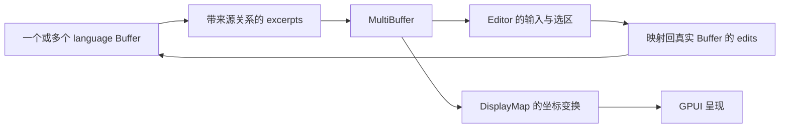

# Zed 与 Grok Build：可组合的核心，需要多明确的边界

Zed 的例子展示数据与交互能力怎样叠加；Grok Build 的例子展示 Agent 定义、工具、宿主与产品入口怎样分工。本章的比较单位是具体机制，不按语言、代码量或功能数量给产品排名。[调查入口](README.md) · [概念框架](01-framework.md) · [Raycast / Warp](02-raycast-warp.md) · [Yuuki](04-yuuki.md)

## 1. Zed：让一套编辑能力作用于不同文本组织方式

本轮承接[上一轮逐链调查](../2026-09-26-zed-pi-rust/02-zed-architecture.md)，基线仍是本地 Zed `7ea077c78b865d17854cee812bb775dbe64a925a`。这里改变的是观察问题：从“crate 分别做什么”，转向“这些边界怎样减少变化传播”。没有把上轮静态阅读升级成新一轮运行验证。

### 片段组合的关键，是保留与真实文本的关系

`MultiBuffer` 用 excerpts 组织一个或多个 `language::Buffer` 的片段；普通单文件也经过 `MultiBuffer::singleton`。Editor 因而可以围绕共同模型处理选区、输入和显示，不必为每种文本呈现各写一套编辑器。编辑时，片段坐标仍要映射到底层 Buffer，不能把显示文本拼成新字符串后丢掉来源。[MultiBuffer 定义](/Users/chp/explore/zed/crates/multi_buffer/src/multi_buffer.rs:71) · [单文件构造](/Users/chp/explore/zed/crates/editor/src/editor.rs:1857) · [编辑映射](/Users/chp/explore/zed/crates/multi_buffer/src/multi_buffer.rs:1403)

下面是据源码整理的职责图，不是全部调用栈：

**分析：**可组合的收益来自共享行为与身份，不是“多个文件能放在一起看”。代价也很具体：片段边界、撤销、定位、订阅、版本与屏幕坐标都要保持一致。对于 Yuuki 的任务结果，能先借鉴“显示片段保留来源与产物身份”；只有确实需要直接编辑跨文件片段时，才值得考虑同等复杂的编辑模型。

### 显示变换增加层次，却减少混合责任

Zed 的 `DisplayMap` 组织 Inlay、Fold、Tab、Wrap、Block 等变换：源文本位置与屏幕位置使用各自的坐标及映射。折叠不是删除源文本，软换行也不改变文件中的换行。这些分层使不同显示能力有接合点；同时，变换顺序和增量同步需要实现者明确维护。[DisplayMap 设计说明](/Users/chp/explore/zed/crates/editor/src/display_map.rs:1)

`SumTree` 的结构共享、Rope 分块与 Buffer snapshot 则降低后台读取对当前编辑状态的直接依赖。后台可以处理一个明确版本；回到前台后仍要处理版本差异。语法解析路径可能接纳本次结果并继续重解析，以追上新的编辑，不能概括为“所有旧结果一律丢弃”。[共享节点](/Users/chp/explore/zed/crates/sum_tree/src/sum_tree.rs:647) · [快照](/Users/chp/explore/zed/crates/language/src/buffer.rs:1319) · [解析结果处理](/Users/chp/explore/zed/crates/language/src/buffer.rs:1994)

**分析：**这些机制让开发者分别思考“这一版本是什么”和“当前界面该采用什么”，付出的成本是版本与生命周期规则。删掉快照和映射层，可能减少目录，却把并发读写和坐标换算散落到调用者。

### 注册表让窗口知道“可打开的对象”，不必知道所有编辑器

Editor 向 `ProjectItemRegistry` 注册 Buffer 的打开和视图构建方式。Workspace 通过 trait/注册表工作，`editor` 可以依赖 `workspace`，而 Workspace 不必形成到 Editor 的静态反向依赖。运行时回调方向与编译依赖方向因此不同。[注册表](/Users/chp/explore/zed/crates/workspace/src/workspace.rs:1050) · [Editor 注册](/Users/chp/explore/zed/crates/editor/src/editor.rs:364) · [项目项构建](/Users/chp/explore/zed/crates/editor/src/items.rs:1568)

**变化推演：**增加一种工作区 Item 时，可以先检查它是否满足已有身份、打开、焦点和生命周期契约，再提供具体实现。注册机制将一部分变化局部化；如果新对象不满足共同契约，不能以“多注册一个类型”掩盖差异。这也是为什么模块数量和可组合性不能画等号。

### Rust 支持边界，但产品责任仍需设计

GPUI 的 `Entity<T>`、`Context<T>`、弱引用、Subscription 与 Task，让状态和生命周期可以通过类型与持有关系表达；前台 async 与后台 executor 仍不同，`notify()` 仍须正确调用，嵌套更新同一实体也存在运行时借用检查。[GPUI 生命周期与调度证据](../2026-09-26-zed-pi-rust/02-zed-architecture.md)

特别要区分两件事：Zed 内部 Agent 能复用项目和 UI 体系；它的 `agent` crate 却仍依赖 GPUI、UI、Project，`Thread` 也持有实体状态。内部模块清楚，不等于直接获得可抽走的独立 headless SDK。[agent 清单](/Users/chp/explore/zed/crates/agent/Cargo.toml) · [Thread](/Users/chp/explore/zed/crates/agent/src/thread.rs:1272)

## 2. Grok Build：先分清终端 Agent 与 Web 造物入口

官方文档把 Grok Build 描述为可通过 TUI、headless 脚本和 ACP 接入的 coding agent。2026-07-15 公告公开了 harness、工具、TUI 和扩展系统。本文查看的官方仓库固定到 `f0e3be1100ef5252488e3be8bb0e91cf68d8c305`，提交时间为 2026-09-23T16:52:41Z。[官方入口](https://docs.x.ai/build/overview) · [开源公告](https://x.ai/news/grok-build-open-source) · [固定提交](https://github.com/xai-org/grok-build/commit/f0e3be1100ef5252488e3be8bb0e91cf68d8c305)

2026-08-19 的另一个产品公告描述 Web/iOS/Android 里的造物入口：自然语言生成可交互应用、发布到 `grok.me`、设置访问范围，并可导出到 GitHub。它还提供按应用授予、可撤销的模型 API 使用能力。这些是官方产品能力陈述，本轮未登录或运行验证，也没有证据证明整套云发布后端都包含在终端仓库中。[Web 与移动端公告](https://x.ai/news/grok-build-for-everyone)

**分析：**Web 入口把生成、预览、修改、发布连成一个闭环，用户可以围绕产物持续表达意图。部署、环境和授权的大量工作由平台承担；导出提供了离开托管工作流的入口，但不能据此断言所有托管能力都能原样迁移。源码层的可组合与产品层的低门槛，应该分别评价。

## 3. Grok 的核心：定义可复用，运行实例有归属

`xai-grok-agent` 的 README 描述 Agent 定义、Builder、prompt 组装以及多宿主使用方式；定义可来自 Markdown/YAML，也可由程序构造。源码里构建后的 `Agent` 则持有 `PromptContext`、缓存 prompt、`Arc<ToolBridge>` 与会话策略，并明确标注它包含会话上下文、不是可搬移的独立配置对象。[crate README](https://github.com/xai-org/grok-build/blob/f0e3be1100ef5252488e3be8bb0e91cf68d8c305/crates/codegen/xai-grok-agent/README.md) · [Agent 实体](https://github.com/xai-org/grok-build/blob/f0e3be1100ef5252488e3be8bb0e91cf68d8c305/crates/codegen/xai-grok-agent/src/agent.rs#L12)

这两处措辞存在张力。较稳妥的解读是：**多个宿主可以复用定义与构建机制；已经绑定资源的 Agent 实例有自己的会话归属。** 本轮没有把 README 中的 portable 当作运行实例可以任意跨进程共享的证明。

更具体的边界位于 `SessionContext`：宿主传入终端后端、文件系统、工作目录、会话目录、环境、通知句柄及拥有子进程的 session ID；工具层在内部装配 Resources。`ToolBridge::call` 委托给已完成装配的 toolset，按工具名、参数和 tool call ID 调用。[SessionContext](https://github.com/xai-org/grok-build/blob/f0e3be1100ef5252488e3be8bb0e91cf68d8c305/crates/codegen/xai-grok-tools/src/registry/types.rs#L186) · [ToolBridge 调用](https://github.com/xai-org/grok-build/blob/f0e3be1100ef5252488e3be8bb0e91cf68d8c305/crates/codegen/xai-grok-tools/src/bridge.rs#L213)

**分析：**工具作者不必让每个工具分别读取全局终端与目录配置；宿主仍负责给出一致的资源和归属。依赖注入产生的价值是明确谁提供能力，不能把所有参数塞入一个容器就视为完成架构设计。

源码还把工具流的 Progress 与 Terminal 区分开；等待最终值的调用会消费进度，直到收到 Terminal，流结束却没有终态会返回错误。比起“拿到一个字符串”，这样的结果契约更能支持不同呈现方式。[工具调用与终态](https://github.com/xai-org/grok-build/blob/f0e3be1100ef5252488e3be8bb0e91cf68d8c305/crates/codegen/xai-grok-tools/src/registry/types.rs#L1630)

## 4. TUI、headless、ACP：共享能力，输出契约各不相同

TUI 的内部说明将 AppView、每会话 AgentView、Action、Effect 和事件循环分开。界面操作经 dispatch 产生副作用，事件再更新显示状态；这使呈现和调用有可定位的接缝，但不是“UI 纯函数化以后就没有状态”。[TUI 架构说明](https://github.com/xai-org/grok-build/blob/f0e3be1100ef5252488e3be8bb0e91cf68d8c305/crates/codegen/xai-grok-pager/README.md)

headless 文档区分 plain、最终 JSON 对象和 streaming-json 事件流；ACP 的 `grok agent stdio` 则使用 JSON-RPC，`session/prompt` 的回复表达完成信息，正文经 `session/update` 通知流出。接入方若只等 RPC 返回并把它当最终回答，会丢失正文通道。[headless / ACP 契约](https://docs.x.ai/build/cli/headless-scripting)

因此，给同一能力再接一个界面，不能只问“是否支持 JSON”。还要问：谁建立会话、哪个事件引入消息身份、进度与终态如何分开、用户取消后等待哪种确认。对 Yuuki，这能直接连接现有 `state/delta` 协议的学习，而不要求引入 Grok 的整套工具或 TUI。[本地协议](../../../examples/shared/runtime/PROTOCOL.md)

## 5. 扩展的种类越多，越需要明确边界

| 扩展方式 | 官方契约中的作用 | 组合时应保留的区别 |
|---|---|---|
| Skill / plugin | 可复用指令与资源；plugin 打包多种扩展 | 说明文字不自动成为权限隔离 |
| MCP | 引入外部工具，以服务器与工具名区分身份 | 增加连接、启动、鉴权与超时边界 |
| Hook | 在工具或会话生命周期触发脚本/HTTP 调用 | 观察、审批、失败时继续或阻断必须分开 |
| Subagent | 独立子会话处理任务，并向父会话返回结果 | 分离上下文后仍需处理任务归属、取消与交付 |

依据：[skills/plugins](https://docs.x.ai/build/features/skills-plugins-marketplaces) · [MCP](https://docs.x.ai/build/features/mcp-servers) · [hooks](https://docs.x.ai/build/features/hooks) · [subagents](https://docs.x.ai/build/features/subagents)。这是用途比较，不是完整加载顺序或调用链审计。

有两处容易误判。第一，当前 skill 文档明确 `allowed-tools` 不授予也不限制工具；格式兼容不代表字段语义处处相同。第二，hook 文档说明 `PreToolUse` 可以明确拒绝，但超时、崩溃或格式错误会记录失败并继续。因此不能把一个普通 hook 默认当作失败即阻断的强制边界。[skill 字段语义](https://docs.x.ai/build/features/skills-plugins-marketplaces) · [hook 失败契约](https://docs.x.ai/build/features/hooks)

权限与 sandbox 也分别回答“工具是否获准执行”和“执行时能触及什么资源”。少一个确认框不会让文件系统、网络与副作用边界消失。[权限说明](https://docs.x.ai/build/features/permissions)

源码中还有值得借鉴的克制：`xai-agent-lifecycle` 声明生命周期 contributor 接收数据输入，通过安装时注入的能力行动，并不拥有 loop control。扩展可以参与循环的某些时刻，循环控制权仍有明确归属。[生命周期接口说明](https://github.com/xai-org/grok-build/blob/f0e3be1100ef5252488e3be8bb0e91cf68d8c305/crates/codegen/xai-agent-lifecycle/src/lib.rs#L1)

配置层叠本身也产生理解成本。官方提供 `grok inspect` 展示当前目录下发现的配置、指令、skills、plugins、hooks 和 MCP。**分析：**能解释“最终生效了什么、来自哪里”是可组合系统的重要维护能力，增加更多开关之后尤其如此。[配置观察入口](https://docs.x.ai/build/overview)

## 6. 取消显示了最小界面背后的真实复杂性

Grok 的 `cancel_running_task` 接收的不只是一个布尔值，还要区分是否取消子代理、是否终止后台任务、怎样保留历史，以及取消针对哪个 prompt。定点阅读的分支会核对 prompt 身份；针对排队输入和已经过期的输入作不同处理，避免一条旧取消消息错误影响新的工作。[取消实现](https://github.com/xai-org/grok-build/blob/f0e3be1100ef5252488e3be8bb0e91cf68d8c305/crates/codegen/xai-grok-shell/src/session/acp_session_impl/cancel.rs#L250)

这里只证明这些状态与处理存在，没有完整审计所有取消路径，也没有运行竞态测试。**设计推断：**用户看到一个停止按钮是合理的；实现必须知道它停止哪次工作、已经发生了什么、剩余资源由谁收尾。Yuuki 目前一次运行一个任务可以暂时减少并发组合，仍应保留任务身份与终态语义；无需提前复制多代理调度器。

## 7. 两个项目真正可带走的东西

| 问题 | Zed 的具体答案 | Grok Build 的具体答案 |
|---|---|---|
| 多种入口如何复用核心 | 单文件与片段编辑共享 MultiBuffer/Editor | 定义、Builder、toolset 与不同宿主/协议入口 |
| 如何控制变化传播 | 坐标变换、快照、注册表、类型化生命周期 | SessionContext、工具终态、Action/Effect、生命周期接口 |
| 复杂性留在哪里 | 编辑一致性、显示映射、平台与任务持有关系 | 会话资源、工具权限、取消、配置叠加和输出协议 |
| 什么不应直接推断 | 独立 crate 就是可抽走 SDK | 公开终端源码等于公开全部云产品 |

本轮没有发现足以把两者的成功统一归因为 Rust 的证据。Rust 是两套实现中表达资源、并发和类型契约的工具；稳定对象、适当限制、增量工作和错误语义仍是具体设计决定。对 Yuuki 最有价值的练习，是用这些问题追踪一条真实业务变化，并观察边界是否仍清楚。[继续到本地变化探针](04-yuuki.md)
