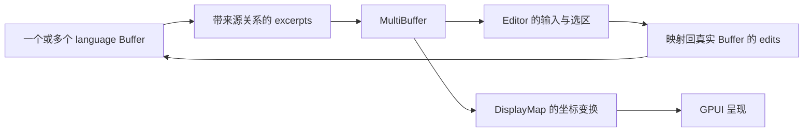

# Zed 与 Grok Build：核心组合与职责边界

Zed 展示数据与交互组合，Grok Build 展示定义、工具和宿主分工；比较具体机制，不按语言、代码量或功能数排名。[调查入口](README.md) · [框架](01-framework.md) · [Raycast / Warp](02-raycast-warp.md) · [Yuuki](04-yuuki.md)

## 1. Zed：让一套编辑能力作用于不同文本组织方式

承接[上轮调查](../2026-09-26-zed-pi-rust/02-zed-architecture.md)，基线仍为 `7ea077c78b865d17854cee812bb775dbe64a925a`；转看边界如何减少变化传播，没有新增运行验证。

### 片段组合的关键，是保留与真实文本的关系

`MultiBuffer` 以 excerpts 组织 `language::Buffer` 片段，单文件也经 `singleton`，复用 Editor 的选区、输入和显示。编辑坐标必须映射回 Buffer，不能拼接文本后丢失来源。[定义](https://github.com/zed-industries/zed/blob/7ea077c78b865d17854cee812bb775dbe64a925a/crates/multi_buffer/src/multi_buffer.rs#L71) · [单文件构造](https://github.com/zed-industries/zed/blob/7ea077c78b865d17854cee812bb775dbe64a925a/crates/editor/src/editor.rs#L1857) · [编辑映射](https://github.com/zed-industries/zed/blob/7ea077c78b865d17854cee812bb775dbe64a925a/crates/multi_buffer/src/multi_buffer.rs#L1403)

源码职责图，非完整调用栈：

**分析：**收益来自<mark class="key">共享行为且保留身份</mark>，代价是维护片段、撤销、订阅、版本和坐标一致。Yuuki 先保留结果来源与产物身份，需要跨文件编辑时再引入复杂模型。

### 显示变换的分层职责

`DisplayMap` 分层组织 Inlay、Fold、Tab、Wrap、Block，并映射文本/屏幕坐标。折叠不删文本，软换行不改文件；实现仍须维护变换顺序与增量同步。[设计说明](https://github.com/zed-industries/zed/blob/7ea077c78b865d17854cee812bb775dbe64a925a/crates/editor/src/display_map.rs#L1)

SumTree 共享、Rope 分块与 snapshot 让后台读取固定版本；回前台仍要处理版本差异。解析路径可先接纳结果再重解析追赶新编辑，并非旧结果一律丢弃。[共享节点](https://github.com/zed-industries/zed/blob/7ea077c78b865d17854cee812bb775dbe64a925a/crates/sum_tree/src/sum_tree.rs#L647) · [快照](https://github.com/zed-industries/zed/blob/7ea077c78b865d17854cee812bb775dbe64a925a/crates/language/src/buffer.rs#L1319) · [结果处理](https://github.com/zed-industries/zed/blob/7ea077c78b865d17854cee812bb775dbe64a925a/crates/language/src/buffer.rs#L1994)

**分析：**固定版本与当前界面分开考虑，靠版本和生命周期规则衔接。删除快照/映射层，可能只把并发与坐标换算散给调用者。

### 项目项注册与编辑器依赖

Editor 向 `ProjectItemRegistry` 注册 Buffer 打开与视图构建方式；Workspace 经 trait/注册表调用，无需静态反向依赖 Editor。回调方向不等于编译依赖方向。[注册表](https://github.com/zed-industries/zed/blob/7ea077c78b865d17854cee812bb775dbe64a925a/crates/workspace/src/workspace.rs#L1050) · [Editor 注册](https://github.com/zed-industries/zed/blob/7ea077c78b865d17854cee812bb775dbe64a925a/crates/editor/src/editor.rs#L364) · [项目项构建](https://github.com/zed-industries/zed/blob/7ea077c78b865d17854cee812bb775dbe64a925a/crates/editor/src/items.rs#L1568)

**推演：**新 Item 先核对身份、打开、焦点和生命周期契约，再注册实现。不符合共同契约的差异不能靠多注册类型掩盖；模块数不等于组合能力。

### Rust 支持边界，但产品责任仍需设计

GPUI 以 Entity、Context、弱引用、Subscription 和 Task 表达生命周期；仍需区分前台/后台、正确 `notify()`，遵守运行时嵌套借用检查。[证据](../2026-09-26-zed-pi-rust/02-zed-architecture.md)

内部 Agent 可复用项目/UI，但 crate 仍依赖 GPUI、UI、Project，Thread 持有实体状态；模块清楚不等于独立 headless SDK。[清单](https://github.com/zed-industries/zed/blob/7ea077c78b865d17854cee812bb775dbe64a925a/crates/agent/Cargo.toml) · [Thread](https://github.com/zed-industries/zed/blob/7ea077c78b865d17854cee812bb775dbe64a925a/crates/agent/src/thread.rs#L1272)

## 2. Grok Build：先分清终端 Agent 与 Web 造物入口

Grok Build 是支持 TUI、headless 与 ACP 的 coding agent；2026-07-15 公布 harness、工具、TUI 和扩展源码。本轮固定于 `f0e3be1100ef5252488e3be8bb0e91cf68d8c305`（2026-09-23T16:52:41Z）。[官方入口](https://docs.x.ai/build/overview) · [公告](https://x.ai/news/grok-build-open-source) · [提交](https://github.com/xai-org/grok-build/commit/f0e3be1100ef5252488e3be8bb0e91cf68d8c305)

2026-08-19 公告另述 Web/iOS/Android 应用生成、`grok.me` 发布、访问范围、GitHub 导出，以及按应用可撤销的 API 使用权。本轮未登录验证，也无证据证明云后端包含于终端仓库。[产品公告](https://x.ai/news/grok-build-for-everyone)

**分析：**Web 平台将生成、预览、修改、发布连成闭环，承担部署、环境和授权。可导出不代表托管能力能原样迁移；源码组合与产品门槛应分评。

## 3. Grok 的核心：定义可复用，运行实例有归属

README 介绍 Markdown/YAML 或程序定义、Builder、prompt 和多宿主复用；构建后的 Agent 却持有 `PromptContext`、缓存 prompt、`Arc<ToolBridge>` 与会话策略，并注明不是独立可搬配置。[README](https://github.com/xai-org/grok-build/blob/f0e3be1100ef5252488e3be8bb0e91cf68d8c305/crates/codegen/xai-grok-agent/README.md) · [Agent 实体](https://github.com/xai-org/grok-build/blob/f0e3be1100ef5252488e3be8bb0e91cf68d8c305/crates/codegen/xai-grok-agent/src/agent.rs#L12)

较稳妥的解读是：<mark class="key">复用定义，不等于共享运行实例</mark>；绑定资源的 Agent 有会话归属，portable 不证明可任意跨进程搬移。

宿主经 `SessionContext` 提供终端、文件系统、工作/会话目录、环境、通知与子进程 session ID，工具层装配 Resources。`ToolBridge::call` 按工具名、参数和 call ID 调用 toolset。[SessionContext](https://github.com/xai-org/grok-build/blob/f0e3be1100ef5252488e3be8bb0e91cf68d8c305/crates/codegen/xai-grok-tools/src/registry/types.rs#L186) · [ToolBridge](https://github.com/xai-org/grok-build/blob/f0e3be1100ef5252488e3be8bb0e91cf68d8c305/crates/codegen/xai-grok-tools/src/bridge.rs#L213)

**分析：**工具不必分别读取全局配置，宿主仍须提供一致资源与归属。依赖注入明确能力来源，容器本身不完成设计。

工具流区分 Progress/Terminal；调用消费进度直至终态，流结束仍无 Terminal 就报错。这比单字符串更利于不同呈现。[工具终态](https://github.com/xai-org/grok-build/blob/f0e3be1100ef5252488e3be8bb0e91cf68d8c305/crates/codegen/xai-grok-tools/src/registry/types.rs#L1630)

## 4. TUI、headless、ACP：共享能力，输出契约各不相同

TUI 区分 AppView、会话 AgentView、Action、Effect 和事件循环；dispatch 发起副作用，事件更新状态。呈现/调用有边界，不代表无状态。[TUI 架构](https://github.com/xai-org/grok-build/blob/f0e3be1100ef5252488e3be8bb0e91cf68d8c305/crates/codegen/xai-grok-pager/README.md)

headless 分 plain、最终 JSON 与 streaming-json。ACP `grok agent stdio` 用 JSON-RPC：`session/prompt` 回复完成，正文走 `session/update`；只等 RPC 返回会丢正文。[契约](https://docs.x.ai/build/cli/headless-scripting)

接新界面除 JSON 格式，还须查会话建立、消息身份、进度/终态和取消确认。Yuuki 可对照 `state/delta`，无需引入整套 Grok。[本地协议](../../../examples/shared/runtime/PROTOCOL.md)

## 5. 扩展的种类越多，越需要明确边界

| 扩展方式 | 官方契约中的作用 | 组合时应保留的区别 |
|---|---|---|
| Skill / plugin | 可复用指令与资源；plugin 打包多种扩展 | 说明文字不自动成为权限隔离 |
| MCP | 引入外部工具，以服务器与工具名区分身份 | 增加连接、启动、鉴权与超时边界 |
| Hook | 在工具或会话生命周期触发脚本/HTTP 调用 | 观察、审批、失败时继续或阻断必须分开 |
| Subagent | 独立子会话处理任务，并向父会话返回结果 | 分离上下文后仍需处理任务归属、取消与交付 |

用途依据：[skills/plugins](https://docs.x.ai/build/features/skills-plugins-marketplaces) · [MCP](https://docs.x.ai/build/features/mcp-servers) · [hooks](https://docs.x.ai/build/features/hooks) · [subagents](https://docs.x.ai/build/features/subagents)。非完整加载/调用链审计。

两处易错：`allowed-tools` 不授予或限制工具；`PreToolUse` 可明确拒绝，但超时、崩溃或格式错会记失败后继续。<mark class="caution">普通 hook 不保证失败即阻断</mark>。[skill 字段](https://docs.x.ai/build/features/skills-plugins-marketplaces) · [hook 失败](https://docs.x.ai/build/features/hooks)

权限决定能否执行，sandbox 限制执行时资源；少确认框不会消除文件、网络或副作用边界。[权限](https://docs.x.ai/build/features/permissions)

`xai-agent-lifecycle` contributor 接收数据，以安装时注入的能力行动，不拥有 loop control；参与生命周期不等于接管循环。[接口](https://github.com/xai-org/grok-build/blob/f0e3be1100ef5252488e3be8bb0e91cf68d8c305/crates/codegen/xai-agent-lifecycle/src/lib.rs#L1)

`grok inspect` 展示当前目录发现的配置、指令、skills、plugins、hooks 和 MCP。**分析：**层叠越多，越需解释最终配置及来源。[观察入口](https://docs.x.ai/build/overview)

## 6. 取消显示了最小界面背后的真实复杂性

`cancel_running_task` 区分子代理、后台任务、历史保留和 prompt 身份；排队与过期输入分别处理，防止旧取消误伤新任务。[取消实现](https://github.com/xai-org/grok-build/blob/f0e3be1100ef5252488e3be8bb0e91cf68d8c305/crates/codegen/xai-grok-shell/src/session/acp_session_impl/cancel.rs#L250)

本轮只确认这些处理存在，未审计全部路径或测试竞态。**推断：**单个停止按钮背后仍须明确任务、副作用与清理责任；Yuuki 单任务可减少并发，但不能省略身份与终态，也无需先做多代理调度。

## 7. 两项目机制对照

| 问题 | Zed 的具体答案 | Grok Build 的具体答案 |
|---|---|---|
| 多种入口如何复用核心 | 单文件与片段编辑共享 MultiBuffer/Editor | 定义、Builder、toolset 与不同宿主/协议入口 |
| 如何控制变化传播 | 坐标变换、快照、注册表、类型化生命周期 | SessionContext、工具终态、Action/Effect、生命周期接口 |
| 复杂性留在哪里 | 编辑一致性、显示映射、平台与任务持有关系 | 会话资源、工具权限、取消、配置叠加和输出协议 |
| 什么不应直接推断 | 独立 crate 就是可抽走 SDK | 公开终端源码等于公开全部云产品 |

没有证据将两者成功统一归因于 Rust；稳定对象、限制、增量与错误语义仍需设计。Yuuki 应用这些问题追一条真实变化，检验边界。[本地探针](04-yuuki.md)
