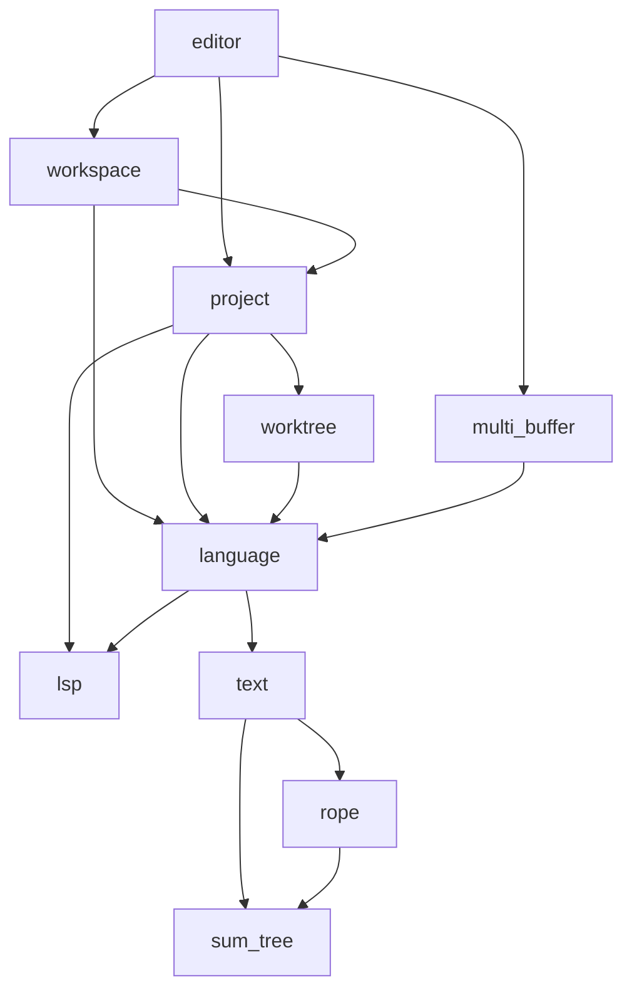
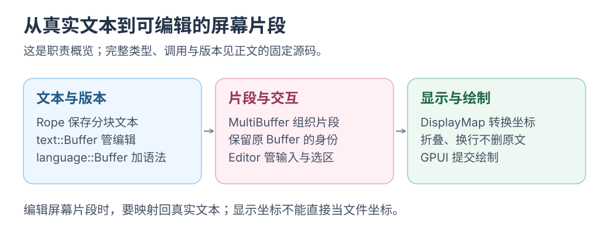

# Zed 深入源码：crate 如何组成一个编辑器

基线：`7ea077c78b865d17854cee812bb775dbe64a925a`，2026-09-26 工作树干净。源码固定此版，历史博客仅解释动机。

相关：[调查入口](README.md) · [为什么 Rust](01-why-rust.md) · [PI-Desktop 对照](03-pi-desktop.md) · [Yuuki Box 实验](04-yuuki-box.md)。

先追文件→Buffer→显示行→绘制，crate 表按需回查；分清<mark class="key">编译依赖、运行时调用、进程通信</mark>，再读 Agent 或扩展。

## 1. 规模和阅读地图

根清单有 **253** 个显式 member，其中 **246** 个在 `crates/`；该目录实际 **248** 份 manifest，默认成员 `crates/zed`。口径不可互换：本轮只解析 TOML，未运行 Cargo metadata 或统计平台编译数量。[根清单](https://github.com/zed-industries/zed/blob/7ea077c78b865d17854cee812bb775dbe64a925a/Cargo.toml#L3)

额外两份为 `copilot_ui`（有 path 依赖引用）与自带 `[workspace]` 的 `gpui_web/examples/hello_web`；不在 members 中不代表不参与应用。另 7 个成员是 `extensions/{glsl,html,proto,test-extension}`、`tooling/{compliance,perf,xtask}`。

清单、依赖边/分类、target 与 manifest 哈希见 [inventory.json](inventory.json)，采集脚本见[入口](README.md)。

| 子系统 | 代表 crate | 主要协作方式 |
|---|---|---|
| 应用装配 | `zed`、`cli`、`assets`、`settings`、`session` | 入口创建服务、注册 action、恢复窗口与配置 |
| UI 框架与平台 | `gpui`、`gpui_platform`、`gpui_macos`、`gpui_apple`、`gpui_linux`、`gpui_wgpu`、`gpui_windows`、`gpui_web` | 状态/事件/布局/Scene 与原生窗口、GPU 后端衔接 |
| Zed 组件与交互 | `ui`、`ui_input`、`theme`、`picker`、`command_palette`、`workspace` | 共享视觉组件、输入、焦点、pane/item、命令选择 |
| 文本与编辑模型 | `sum_tree`、`rope`、`text`、`language`、`multi_buffer`、`editor` | 分块文本、版本、语法、片段组合、输入和显示映射 |
| 项目与文件 | `fs`、`worktree`、`project`、`git`、`search`、`fuzzy_nucleo` | 目录快照、文件读取、Git、搜索、后台计算 |
| 语言和调试 | `lsp`、`languages`、`grammars`、`language_extension`、`dap`、`debugger_ui` | 本地语法分析与外部语言服务器/调试器协议 |
| AI 与 Agent | `language_model_core`、`language_model`、`language_models`、供应商 crate、`agent`、`agent_ui`、`acp_thread`、`context_server` | 模型事件规范化、provider 适配、工具循环与 UI |
| 扩展 | `extension_api`、`extension`、`extension_host`、`extensions_ui` | 声明式资源、WIT 接口、Wasm 宿主与安装界面 |
| 协作与远程 | `client`、`rpc`、`proto`、`collab`、`remote`、`remote_server` | 连接、消息、远端项目服务和文本操作同步 |
| 基础设施 | `scheduler`、`gpui_tokio`、`http_client`、`reqwest_client`、`db`、`sqlez`、`telemetry` | 任务调度、运行时桥接、HTTP、数据库与诊断 |

此为人工导航，crate 可跨职责；manifest 扫描不等于全量审计。本轮深入 UI、文本、项目、异步、Agent 和进程边界。

还需读 `rust-toolchain.toml`、`Cargo.lock`、`extensions/`、`assets/`、`docs/`、`script/` 和 `tooling/`，分别看工具链、依赖、扩展、资源及构建验证，不能只数 Rust 文件。

## 2. 三种关系必须分开看

1. **编译依赖：** `editor` 使用 `workspace` 的 trait，所以清单有 `editor → workspace`。
2. **运行时调用：** workspace 经注册表创建具体 Editor，因此打开文件时也会从 Workspace 回调到 Editor。
3. **进程通信：** LSP、远程服务等需要协议与序列化；普通 crate 之间大多是同进程 Rust 函数和句柄调用。

下图只列部分普通依赖，箭头由使用者指向依赖，省略交叉边：



来源：[editor](https://github.com/zed-industries/zed/blob/7ea077c78b865d17854cee812bb775dbe64a925a/crates/editor/Cargo.toml)、[workspace](https://github.com/zed-industries/zed/blob/7ea077c78b865d17854cee812bb775dbe64a925a/crates/workspace/Cargo.toml)、[project](https://github.com/zed-industries/zed/blob/7ea077c78b865d17854cee812bb775dbe64a925a/crates/project/Cargo.toml)、[全量记录](inventory.json)。不是进程图或调用时序。

Editor 经 `ProjectItemRegistry` 注册 Buffer 打开器与 view builder，workspace 通过 trait 使用，无需静态反向依赖。[注册表](https://github.com/zed-industries/zed/blob/7ea077c78b865d17854cee812bb775dbe64a925a/crates/workspace/src/workspace.rs#L1050)、[注册](https://github.com/zed-industries/zed/blob/7ea077c78b865d17854cee812bb775dbe64a925a/crates/editor/src/editor.rs#L364)、[构建](https://github.com/zed-industries/zed/blob/7ea077c78b865d17854cee812bb775dbe64a925a/crates/editor/src/items.rs#L1568)

[](../../../site/public/diagrams/architecture/zed-layers.svg)

## 3. 从文本到屏幕：每一层添加一种能力

| 层 | 实际数据/职责 | 为什么需要这一层 | 源码 |
|---|---|---|---|
| `sum_tree::SumTree<T>` | `Arc<Node<T>>` 的持久化 B+ 树，按摘要和 Dimension 定位 | 共享旧树，以不同累计量查找位置 | [定义](https://github.com/zed-industries/zed/blob/7ea077c78b865d17854cee812bb775dbe64a925a/crates/sum_tree/src/sum_tree.rs#L206) |
| `rope::Rope` | `chunks: SumTree<Chunk>` | 将大文本分块，支持字节、行列、UTF-16 坐标 | [Rope](https://github.com/zed-industries/zed/blob/7ea077c78b865d17854cee812bb775dbe64a925a/crates/rope/src/rope.rs#L25) |
| `text::Buffer` | 当前快照、History、operations、Lamport 时钟 | 编辑、撤销、版本、协作和稳定 Anchor | [Buffer](https://github.com/zed-industries/zed/blob/7ea077c78b865d17854cee812bb775dbe64a925a/crates/text/src/text.rs#L59) |
| `language::Buffer` | 包装 text buffer，添加文件、语言、语法、诊断与解析任务 | 将普通文本变成能提供语言服务的文件模型 | [Buffer](https://github.com/zed-industries/zed/blob/7ea077c78b865d17854cee812bb775dbe64a925a/crates/language/src/buffer.rs#L103) |
| `MultiBuffer` | 一个或多个 Buffer 的 excerpts、历史及快照 | 把多处真实文本片段组合为一个可编辑视图 | [MultiBuffer](https://github.com/zed-industries/zed/blob/7ea077c78b865d17854cee812bb775dbe64a925a/crates/multi_buffer/src/multi_buffer.rs#L71) |
| `Editor` | MultiBuffer、DisplayMap、选区、滚动等 | 把输入意图变成 edits，把模型呈现在窗口里 | [Editor](https://github.com/zed-industries/zed/blob/7ea077c78b865d17854cee812bb775dbe64a925a/crates/editor/src/editor.rs#L965) |

两个 Buffer 需带模块名。Rope 存文本，CRDT 版本/操作/删除历史主要在 `text`；单文件也经 `MultiBuffer::singleton`，与片段视图共用 Editor。[单文件构造](https://github.com/zed-industries/zed/blob/7ea077c78b865d17854cee812bb775dbe64a925a/crates/editor/src/editor.rs#L1857)

显示映射继续把文本逐层变换：

```text
MultiBuffer → InlayMap → FoldMap → TabMap → WrapMap → BlockMap
            行内提示     折叠       tab展开    软换行     块装饰
            └──────── DisplayMap 组织各层快照与坐标映射 ────────┘
                              ↓
                    EditorElement → GPUI 绘制
```

各层用独立坐标、摘要和增量同步，分开源文件/屏幕位置；收益来自只同步变化部分，类型体系维护映射关系。[设计说明](https://github.com/zed-industries/zed/blob/7ea077c78b865d17854cee812bb775dbe64a925a/crates/editor/src/display_map.rs#L1)

### 结构共享的实际含义

`Arc::make_mut` 修改时才复制共享部分；Buffer snapshot 可便宜克隆并供后台读取。[写时复制](https://github.com/zed-industries/zed/blob/7ea077c78b865d17854cee812bb775dbe64a925a/crates/sum_tree/src/sum_tree.rs#L647)、[snapshot](https://github.com/zed-industries/zed/blob/7ea077c78b865d17854cee812bb775dbe64a925a/crates/language/src/buffer.rs#L1319)

并非全应用零拷贝/无锁：共享节点修改仍复制，旧快照延长寿命，syntax map 也有 Mutex；优化的是工作量与共享范围。

## 4. 真实调用链 A：打开一个本地文件

已核对的正常文本路径，省略错误和类型适配：

```text
Workspace::open_path / open_path_preview / load_path
  → ProjectItemRegistry::open_path
  → Buffer 的 ProjectItem::try_open
  → Project::open_buffer → BufferStore::open_buffer
  → LocalBufferStore::open_buffer
  → Worktree::load_file → LocalWorktree::load_file
  → 文件读取和解码为 Rope
  → 后台创建 text::Buffer
  → 前台插入 Entity<language::Buffer>
  → registry 返回 WorkspaceItemBuilder
  → Pane::open_item（复用已有 item，或执行 builder）
  → Editor::for_project_item / for_buffer
  → MultiBuffer::singleton
```

| 步骤 | 值得注意的行为 | 精确阅读入口 |
|---|---|---|
| 窗口处理路径 | 选择项目对象处理者，再构建可打开的 view | [Workspace::open_path](https://github.com/zed-industries/zed/blob/7ea077c78b865d17854cee812bb775dbe64a925a/crates/workspace/src/workspace.rs#L5041)、[registry](https://github.com/zed-industries/zed/blob/7ea077c78b865d17854cee812bb775dbe64a925a/crates/workspace/src/workspace.rs#L1074) |
| 项目委托 buffer store | 缓存、正在加载的任务去重、本地/远端分派 | [Project::open_buffer](https://github.com/zed-industries/zed/blob/7ea077c78b865d17854cee812bb775dbe64a925a/crates/project/src/project.rs#L3277)、[BufferStore](https://github.com/zed-industries/zed/blob/7ea077c78b865d17854cee812bb775dbe64a925a/crates/project/src/buffer_store.rs#L908) |
| 本地加载 | await 文件，在后台建文本，再回前台注册 entity | [LocalBufferStore](https://github.com/zed-industries/zed/blob/7ea077c78b865d17854cee812bb775dbe64a925a/crates/project/src/buffer_store.rs#L681)、[load_file](https://github.com/zed-industries/zed/blob/7ea077c78b865d17854cee812bb775dbe64a925a/crates/worktree/src/worktree.rs#L1705) |
| 创建 Editor | 把语言 Buffer 接入 MultiBuffer 与 workspace item | [for_project_item](https://github.com/zed-industries/zed/blob/7ea077c78b865d17854cee812bb775dbe64a925a/crates/editor/src/items.rs#L1575)、[for_buffer](https://github.com/zed-industries/zed/blob/7ea077c78b865d17854cee812bb775dbe64a925a/crates/editor/src/editor.rs#L1857) |

Project 组合 Worktree/Buffer/Lsp/Git/Dap/Task Store 与远程客户端；Workspace 管 pane/item。Worktree 是文件树模型，不等于 Git linked worktree。[Project](https://github.com/zed-industries/zed/blob/7ea077c78b865d17854cee812bb775dbe64a925a/crates/project/src/project.rs#L217)、[Worktree](https://github.com/zed-industries/zed/blob/7ea077c78b865d17854cee812bb775dbe64a925a/crates/worktree/src/worktree.rs#L102)

远程打开经 `RemoteBufferStore` 发 `proto::OpenBufferByPath`、等远端 buffer，不是本地读远程路径；未审计全部 SSH 启动。[远端分支](https://github.com/zed-industries/zed/blob/7ea077c78b865d17854cee812bb775dbe64a925a/crates/project/src/buffer_store.rs#L304)

## 5. 真实调用链 B：输入、解析和诊断

### 5.1 用户输入先改变文本模型

输入/IME 经 `replace_text_in_range`→`handle_input`，Editor 按选区、括号等计算 edits；MultiBuffer 映射到底层，language Buffer 调 text Buffer 更新文本、历史与版本。

入口顺序：[replace_text_in_range](https://github.com/zed-industries/zed/blob/7ea077c78b865d17854cee812bb775dbe64a925a/crates/editor/src/input.rs#L2851) → [handle_input](https://github.com/zed-industries/zed/blob/7ea077c78b865d17854cee812bb775dbe64a925a/crates/editor/src/input.rs#L72) → [MultiBuffer::edit](https://github.com/zed-industries/zed/blob/7ea077c78b865d17854cee812bb775dbe64a925a/crates/multi_buffer/src/multi_buffer.rs#L1403) → [底层 edit 转换](https://github.com/zed-industries/zed/blob/7ea077c78b865d17854cee812bb775dbe64a925a/crates/multi_buffer/src/multi_buffer.rs#L1513) → [language::Buffer::edit](https://github.com/zed-industries/zed/blob/7ea077c78b865d17854cee812bb775dbe64a925a/crates/language/src/buffer.rs#L2835) → [text::Buffer::edit](https://github.com/zed-industries/zed/blob/7ea077c78b865d17854cee812bb775dbe64a925a/crates/text/src/text.rs#L870)。

### 5.2 Tree-sitter 通道：快照、解析预算、旧结果处理

`did_edit` 触发 reparse/Edited。解析取快照和版本、映射旧语法，可先作限时同步解析，再按需后台执行。回前台检查文本/grammar/registry，先接纳并通知，再重解析追赶变化；并非旧结果一律丢弃。[处理顺序](https://github.com/zed-industries/zed/blob/7ea077c78b865d17854cee812bb775dbe64a925a/crates/language/src/buffer.rs#L1994)

来源：[did_edit](https://github.com/zed-industries/zed/blob/7ea077c78b865d17854cee812bb775dbe64a925a/crates/language/src/buffer.rs#L3086)、[reparse 与同步预算](https://github.com/zed-industries/zed/blob/7ea077c78b865d17854cee812bb775dbe64a925a/crates/language/src/buffer.rs#L1930)、[后台解析与版本检查](https://github.com/zed-industries/zed/blob/7ea077c78b865d17854cee812bb775dbe64a925a/crates/language/src/buffer.rs#L1971)、[Editor 接收结果](https://github.com/zed-industries/zed/blob/7ea077c78b865d17854cee812bb775dbe64a925a/crates/editor/src/editor.rs#L10173)。

<mark class="caution">async 不等于后台执行</mark>；预算、snapshot、executor、前台更新和过期检查各有职责。

### 5.3 LSP 通道：协议版本与 UTF-16 坐标

`on_buffer_edited` 对照上次 snapshot，按服务器能力选 FULL/INCREMENTAL；`edits_since` 算 UTF-16 行列和字节范围，发送带版本的 DidChange。诊断转换、合并、写回 buffer，再通知 MultiBuffer/Editor。

来源：[on_buffer_edited](https://github.com/zed-industries/zed/blob/7ea077c78b865d17854cee812bb775dbe64a925a/crates/project/src/lsp_store.rs#L9507)、[坐标计算](https://github.com/zed-industries/zed/blob/7ea077c78b865d17854cee812bb775dbe64a925a/crates/project/src/lsp_store.rs#L9554)、[发送 DidChange](https://github.com/zed-industries/zed/blob/7ea077c78b865d17854cee812bb775dbe64a925a/crates/project/src/lsp_store.rs#L9617)、[注册 diagnostics](https://github.com/zed-industries/zed/blob/7ea077c78b865d17854cee812bb775dbe64a925a/crates/project/src/lsp_store.rs#L897)、[写回诊断](https://github.com/zed-industries/zed/blob/7ea077c78b865d17854cee812bb775dbe64a925a/crates/project/src/lsp_store.rs#L3035)。

Tree-sitter 与 LSP 并行，局部输入/语法无需等服务器。LSP 启动外部 binary，以 `Content-Length` framing 的 stdin/stdout 交换消息，不要求服务器用 Rust。[启动](https://github.com/zed-industries/zed/blob/7ea077c78b865d17854cee812bb775dbe64a925a/crates/lsp/src/lsp.rs#L514)、[framing](https://github.com/zed-industries/zed/blob/7ea077c78b865d17854cee812bb775dbe64a925a/crates/lsp/src/lsp.rs#L45)

### 5.4 CRDT 已经在普通文本编辑路径中

`edit` 产生 Lamport 时间戳/operation；snapshot 存版本向量、可见/删除文本和 fragments。`apply_ops` 等待因果条件并去重；Anchor 绑定插入 offset/bias，比瞬时下标稳定。[snapshot](https://github.com/zed-industries/zed/blob/7ea077c78b865d17854cee812bb775dbe64a925a/crates/text/src/text.rs#L112)、[apply_ops](https://github.com/zed-industries/zed/blob/7ea077c78b865d17854cee812bb775dbe64a925a/crates/text/src/text.rs#L909)、[Anchor](https://github.com/zed-industries/zed/blob/7ea077c78b865d17854cee812bb775dbe64a925a/crates/text/src/anchor.rs#L8)

Operation 序列化发往远端，接收后反序列化并 `apply_ops`。[发送](https://github.com/zed-industries/zed/blob/7ea077c78b865d17854cee812bb775dbe64a925a/crates/project/src/project.rs#L4054)、[接收](https://github.com/zed-industries/zed/blob/7ea077c78b865d17854cee812bb775dbe64a925a/crates/project/src/buffer_store.rs#L1231)。支持文本协作，不代表 Agent 状态、设置等也应采用 CRDT。

## 6. GPUI：状态、事件、布局、平台与调度

### 6.1 GPUI 和 Zed 是不同层

GPUI 是 path dependency，核心标 0.2.2，平台已拆 crate。`main` 经 `current_platform(false)` 创建 Application、加入资源/服务，再建 AppState、注册 workspace/editor/Agent。[入口](https://github.com/zed-industries/zed/blob/7ea077c78b865d17854cee812bb775dbe64a925a/crates/zed/src/main.rs#L201)、[Application](https://github.com/zed-industries/zed/blob/7ea077c78b865d17854cee812bb775dbe64a925a/crates/zed/src/main.rs#L87)、[AppState](https://github.com/zed-industries/zed/blob/7ea077c78b865d17854cee812bb775dbe64a925a/crates/zed/src/main.rs#L645)

此 checkout 记录：Rust **1.98.1**、edition **2024**，Taffy **0.13.0**、wgpu **29.0.4**、Tokio **1.52.1**；非最低版本建议或 Yuuki 依赖。[工具链](https://github.com/zed-industries/zed/blob/7ea077c78b865d17854cee812bb775dbe64a925a/rust-toolchain.toml#L1)、[Taffy](https://github.com/zed-industries/zed/blob/7ea077c78b865d17854cee812bb775dbe64a925a/crates/gpui/Cargo.toml#L94)、[wgpu](https://github.com/zed-industries/zed/blob/7ea077c78b865d17854cee812bb775dbe64a925a/Cargo.lock#L20921)、[Tokio](https://github.com/zed-industries/zed/blob/7ea077c78b865d17854cee812bb775dbe64a925a/Cargo.lock#L18731)

| 概念 | 做什么 | 需要开发者明确处理 |
|---|---|---|
| `Entity<T>` | 指向 App 管理状态的强类型句柄 | 状态归属；读/写必须经相应上下文 |
| `Context<T>` | 在实体操作中访问 App、发通知、订阅和启动任务 | UI 更新的作用范围 |
| `WeakEntity<T>` | 长任务和回调弱引用目标 | 目标已释放时 update 可能失败 |
| `EventEmitter<E>` / Subscription | 类型化业务事件和监听生命周期 | 保存订阅；Drop 会退订 |
| `Render` / `RenderOnce` | 从状态构造元素，或消耗组件配方生成元素 | 布局/绘制工作量和可复用粒度 |
| `cx.notify()` | 通知观察者并使相关视图失效 | 改字段并不等于自动刷新全部 UI |

来源：[Entity](https://github.com/zed-industries/zed/blob/7ea077c78b865d17854cee812bb775dbe64a925a/crates/gpui/src/app/entity_map.rs#L432)、[Context](https://github.com/zed-industries/zed/blob/7ea077c78b865d17854cee812bb775dbe64a925a/crates/gpui/src/app/context.rs#L21)、[Subscription](https://github.com/zed-industries/zed/blob/7ea077c78b865d17854cee812bb775dbe64a925a/crates/gpui/src/subscription.rs#L147)、[Render](https://github.com/zed-industries/zed/blob/7ea077c78b865d17854cee812bb775dbe64a925a/crates/gpui/src/element.rs#L163)、[notify](https://github.com/zed-industries/zed/blob/7ea077c78b865d17854cee812bb775dbe64a925a/crates/gpui/src/app.rs#L2791)。

嵌套更新同一实体仍可触发 double lease panic；编译通过不证明 UI 生命周期正确。[lease 检查](https://github.com/zed-industries/zed/blob/7ea077c78b865d17854cee812bb775dbe64a925a/crates/gpui/src/app/entity_map.rs#L219)

### 6.2 从元素到画面

```text
Entity 状态 → Render 元素树
  → request_layout → prepaint → paint → Scene
  → Window::present → PlatformWindow::draw
  → 平台 renderer → GPU command buffer / presentation
```

Taffy 管布局，prepaint 管位置/hitbox，paint 填绘制数据，present 将 scene 交平台；Metal 按 `scene.batches()` 批处理并提交。[Element](https://github.com/zed-industries/zed/blob/7ea077c78b865d17854cee812bb775dbe64a925a/crates/gpui/src/element.rs#L50)、[present](https://github.com/zed-industries/zed/blob/7ea077c78b865d17854cee812bb775dbe64a925a/crates/gpui/src/window.rs#L3435)、[Metal](https://github.com/zed-industries/zed/blob/7ea077c78b865d17854cee812bb775dbe64a925a/crates/gpui_apple/src/metal_renderer.rs#L661)

| 平台 | 当前仓库的实际路径 | 证据 |
|---|---|---|
| macOS | `gpui_macos → gpui_apple::metal_renderer` | [renderer alias](https://github.com/zed-industries/zed/blob/7ea077c78b865d17854cee812bb775dbe64a925a/crates/gpui_macos/src/gpui_macos.rs#L18) |
| Linux 的 Wayland/X11 | `gpui_linux → gpui_wgpu::WgpuRenderer` | [Wayland](https://github.com/zed-industries/zed/blob/7ea077c78b865d17854cee812bb775dbe64a925a/crates/gpui_linux/src/linux/wayland/window.rs#L113)、[X11](https://github.com/zed-industries/zed/blob/7ea077c78b865d17854cee812bb775dbe64a925a/crates/gpui_linux/src/linux/x11/window.rs#L273) |
| Windows | `gpui_windows → DirectXRenderer / Direct3D 11` | [window](https://github.com/zed-industries/zed/blob/7ea077c78b865d17854cee812bb775dbe64a925a/crates/gpui_windows/src/window.rs#L66)、[D3D11 resources](https://github.com/zed-industries/zed/blob/7ea077c78b865d17854cee812bb775dbe64a925a/crates/gpui_windows/src/directx_renderer.rs#L61) |
| wasm target | `gpui_platform` 选择 `gpui_web` | [平台选择](https://github.com/zed-industries/zed/blob/7ea077c78b865d17854cee812bb775dbe64a925a/crates/gpui_platform/src/gpui_platform.rs#L56) |

表格只确认代码与连接方式，不证明平台成熟度相同；`gpui_apple` 或 wasm target 不代表 Yuuki 可直接发布移动 UI。

### 6.3 两种 executor 与 Tokio 桥

`App::spawn` 在前台 poll，后台 spawn 要求 Future/输出为 `Send + 'static`；前台 async 的 CPU 循环仍阻塞 UI。scheduler Task Drop 即取消，detach 才继续；任务和订阅需明确持有者。[前台](https://github.com/zed-industries/zed/blob/7ea077c78b865d17854cee812bb775dbe64a925a/crates/gpui/src/app.rs#L2032)、[后台](https://github.com/zed-industries/zed/blob/7ea077c78b865d17854cee812bb775dbe64a925a/crates/gpui/src/executor.rs#L101)、[Task](https://github.com/zed-industries/zed/blob/7ea077c78b865d17854cee812bb775dbe64a925a/crates/scheduler/src/executor.rs#L385)

`gpui_tokio::init` 另建 Tokio runtime，两套 executor 并存；桥接 Task Drop 时 abort Tokio task，将其接入 GPUI 生命周期。[init](https://github.com/zed-industries/zed/blob/7ea077c78b865d17854cee812bb775dbe64a925a/crates/gpui_tokio/src/gpui_tokio.rs#L8)、[spawn](https://github.com/zed-industries/zed/blob/7ea077c78b865d17854cee812bb775dbe64a925a/crates/gpui_tokio/src/gpui_tokio.rs#L52)

### 6.4 真实调用链 C：命令面板搜索

1. `command_palette::init/register` 给 Workspace 注册 Toggle action，创建带 delegate 的 `Picker`。[注册](https://github.com/zed-industries/zed/blob/7ea077c78b865d17854cee812bb775dbe64a925a/crates/command_palette/src/command_palette.rs#L38)
2. Picker 输入控件的 `BufferEdited` 进入 `update_matches`，委托 `CommandPaletteDelegate`。[输入事件](https://github.com/zed-industries/zed/blob/7ea077c78b865d17854cee812bb775dbe64a925a/crates/picker/src/picker.rs#L1177)
3. Delegate 克隆 query/command 等必要数据，用后台任务调用 `fuzzy_nucleo::match_strings_async`。[后台匹配](https://github.com/zed-industries/zed/blob/7ea077c78b865d17854cee812bb775dbe64a925a/crates/command_palette/src/command_palette.rs#L580)
4. channel 送回匹配结果；前台任务经弱 Picker handle 更新列表状态，Picker 整理滚动/预览并 notify。[结果返回](https://github.com/zed-industries/zed/blob/7ea077c78b865d17854cee812bb775dbe64a925a/crates/command_palette/src/command_palette.rs#L659)、[notify](https://github.com/zed-industries/zed/blob/7ea077c78b865d17854cee812bb775dbe64a925a/crates/picker/src/picker.rs#L1306)
5. 确认选择时，后台写命令历史，恢复焦点、发 DismissEvent，最后 `window.dispatch_action` 回到原功能的 action handler。[confirm](https://github.com/zed-industries/zed/blob/7ea077c78b865d17854cee812bb775dbe64a925a/crates/command_palette/src/command_palette.rs#L714)

`PendingUpdateMatches` 明确两个任务的释放时机；新搜索与旧任务取消的关系需设计，不能只学 UI API 名称。[任务持有](https://github.com/zed-industries/zed/blob/7ea077c78b865d17854cee812bb775dbe64a925a/crates/picker/src/picker.rs#L1244)

## 7. Agent、模型与扩展如何接入已有框架

### Agent 同样使用 Entity 与任务体系

Thread 持有消息、模型、工具、Project、ContextServerRegistry、turn、usage 和子代理弱引用。send 加消息，run_turn 管旧任务清理/取消、事件通道与前台任务，通过 `stream_completion` 接类型流、协调工具。[Thread](https://github.com/zed-industries/zed/blob/7ea077c78b865d17854cee812bb775dbe64a925a/crates/agent/src/thread.rs#L1272)、[send](https://github.com/zed-industries/zed/blob/7ea077c78b865d17854cee812bb775dbe64a925a/crates/agent/src/thread.rs#L2551)、[run_turn](https://github.com/zed-industries/zed/blob/7ea077c78b865d17854cee812bb775dbe64a925a/crates/agent/src/thread.rs#L2716)、[模型调用](https://github.com/zed-industries/zed/blob/7ea077c78b865d17854cee812bb775dbe64a925a/crates/agent/src/thread.rs#L2897)

模型层分工可以概括为：

```text
供应商协议 crate / provider adapter
  → LanguageModel::stream_completion
  → LanguageModelCompletionEvent
  → agent::Thread 的 turn / tool loop
  → ThreadEvent / ACP 相关适配
  → Agent UI
```

未逐一追踪 provider/UI adapter。language_models 注册 provider，core 表达 Text/Thinking/ToolUse/UsageUpdate/Stop；ThreadEvent 表达授权、重试、压缩和停止等运行事件。[注册](https://github.com/zed-industries/zed/blob/7ea077c78b865d17854cee812bb775dbe64a925a/crates/language_models/src/language_models.rs#L217)、[trait](https://github.com/zed-industries/zed/blob/7ea077c78b865d17854cee812bb775dbe64a925a/crates/language_model/src/language_model.rs#L254)、[模型事件](https://github.com/zed-industries/zed/blob/7ea077c78b865d17854cee812bb775dbe64a925a/crates/language_model_core/src/language_model_core.rs#L36)、[ThreadEvent](https://github.com/zed-industries/zed/blob/7ea077c78b865d17854cee812bb775dbe64a925a/crates/agent/src/thread.rs#L901)

agent 仍依赖 gpui/ui/project/language_models，Thread 持有 Entity，不是无 UI 的小 SDK；较轻的 core 也依赖网络。复用前检查完整清单，不按名字判断。[agent](https://github.com/zed-industries/zed/blob/7ea077c78b865d17854cee812bb775dbe64a925a/crates/agent/Cargo.toml)、[core](https://github.com/zed-industries/zed/blob/7ea077c78b865d17854cee812bb775dbe64a925a/crates/language_model_core/Cargo.toml)

### Wasm、LSP、RPC 是不同边界

| 边界 | 通信/执行方式 | 不能混淆的地方 |
|---|---|---|
| 普通内部 crate | Rust 函数、trait、Entity、事件 | crate 通常不会各自启动进程 |
| 语言服务器 | 外部 binary + LSP pipes | Zed 使用 LSP，不要求服务器使用 Rust |
| 可执行扩展逻辑 | Wasmtime Component Model + WIT/WASI | 不等同 native dylib，也不等同所有扩展资源都要执行 Wasm |
| 远程项目 | `proto` 请求、buffer operations 与版本 | 不是把远端 UI 画面传回本地 |
| 模型服务 / 外部 Agent | provider 接口、网络或专用协议适配 | 不等同 Wasm 扩展宿主 |

WasmHost 在 GPUI 后台编译 component，再切 Tokio 实例化 WASI/处理消息；Store 注入 CapabilityGranter、预打开目录，epoch interruption 提供让出机会。[engine](https://github.com/zed-industries/zed/blob/7ea077c78b865d17854cee812bb775dbe64a925a/crates/extension_host/src/wasm_host.rs#L557)、[编译](https://github.com/zed-industries/zed/blob/7ea077c78b865d17854cee812bb775dbe64a925a/crates/extension_host/src/wasm_host.rs#L653)、[执行](https://github.com/zed-industries/zed/blob/7ea077c78b865d17854cee812bb775dbe64a925a/crates/extension_host/src/wasm_host.rs#L723)、[目录](https://github.com/zed-industries/zed/blob/7ea077c78b865d17854cee812bb775dbe64a925a/crates/extension_host/src/wasm_host.rs#L742)

这不是全部 host API 安全审计；扩展启动的外部程序仍需单独管理权限和生命周期。

## 8. 能带走的设计与需要核对的版本

可直接学习：快照、前后台边界、旧结果检查、typed event/action、item 注册、任务/订阅所有权及坐标分层。

完整显示映射、CRDT、多 GPU 后端、Wasm 插件、协作和语言服务，需先证明 Agent 工作台确有需求。

清单中 gpui/sum_tree/zed_extension_api 为 Apache-2.0，rope/text/editor/agent 等为 GPL-3.0-or-later；不能统一看待全仓许可证，也不据此作派生项目结论。[证据](inventory.json)

本项目 [GPUI MVP](../../../examples/rust-gpui/README.md) 固定 crates.io 0.2.2，Zed 同名版已拆平台 crate；<mark class="key">复制 API 前查 source 与锁文件</mark>。SharedString 当前包装 SmolStr，不应沿用 Arc&lt;str&gt; 旧描述。[实现](https://github.com/zed-industries/zed/blob/7ea077c78b865d17854cee812bb775dbe64a925a/crates/gpui_shared_string/gpui_shared_string.rs#L9)
