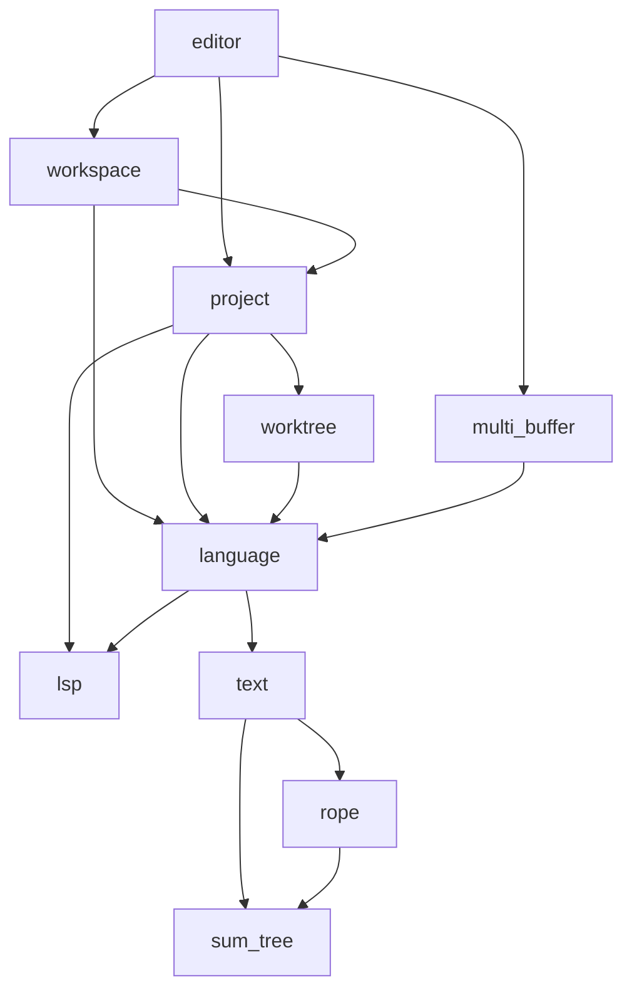

# Zed 深入源码：crate 如何组成一个编辑器

基线：Zed 提交 `7ea077c78b865d17854cee812bb775dbe64a925a`，2026-09-26 调查时工作树干净。源码链接固定在这个版本；历史博客只帮助解释动机。

相关：[调查入口](README.md) · [为什么 Rust](01-why-rust.md) · [PI-Desktop 对照](03-pi-desktop.md) · [Yuuki Box 实验](04-yuuki-box.md)。

第一次读只追一条链：文件内容怎样进入 Buffer，怎样变成显示行，最后怎样提交绘制。下方 crate 表是回查地图，不是需要背诵的依赖清单。读完能区分“编译依赖”“运行时调用”和“跨进程通信”，再选择 Agent 或扩展部分继续。

## 1. 规模和阅读地图

根 `Cargo.toml` 显式列出 **253** 个 workspace member，其中 **246** 个在 `crates/`；`crates/**/Cargo.toml` 实际有 **248** 份。这些数字表达不同口径，不能互换。`default-members` 是 `crates/zed`。本轮直接解析 TOML，没有运行 Cargo metadata，未声称这是 Cargo 解析后的最终 workspace 集合或某个平台实际编译数量。[根清单](https://github.com/zed-industries/zed/blob/7ea077c78b865d17854cee812bb775dbe64a925a/Cargo.toml#L3)

根列表以外的两份 crate manifest 是 `copilot_ui` 和 `gpui_web/examples/hello_web`，后者自带独立 `[workspace]`；前者也被 Zed 的 path dependency 引用，所以“没写在 members 数组里”不能理解为“不会参与应用”。非 `crates/` 的 7 个显式成员是 `extensions/{glsl,html,proto,test-extension}` 与 `tooling/{compliance,perf,xtask}`。

完整清单、每个包的本地依赖边、普通/开发/构建依赖分类、target 条件及 manifest 哈希在 [inventory.json](inventory.json)。采集方法和可重跑脚本见[入口](README.md)。

| 子系统 | 代表 crate | 主要协作方式 |
|---|---|---|
| 应用装配 | `zed`、`cli`、`assets`、`settings`、`session` | 入口创建服务、注册 action、恢复窗口与配置 |
| UI 框架与平台 | `gpui`、`gpui_platform`、`gpui_macos`、`gpui_apple`、`gpui_linux`、`gpui_wgpu`、`gpui_windows`、`gpui_web` | 状态/事件/布局/Scene 与原生窗口、GPU 后端衔接 |
| Zed 组件与交互 | `ui`、`ui_input`、`theme`、`picker`、`command_palette`、`workspace` | 共享视觉组件、输入、焦点、pane/item、命令选择 |
| 文本与编辑模型 | `sum_tree`、`rope`、`text`、`language`、`multi_buffer`、`editor` | 分块文本、版本、语法、片段组合、输入和显示映射 |
| 项目与文件 | `fs`、`worktree`、`project`、`git`、`search`、`fuzzy_nucleo` | 目录快照、文件读取、Git、搜索、后台计算 |
| 语言和调试 | `lsp`、`languages`、`grammars`、`language_extension`、`dap`、`debugger_ui` | 本地语法分析与外部语言服务器/调试器协议 |
| AI 与 Agent | `language_model_core`、`language_model`、`language_models`、供应商 crate、`agent`、`agent_ui`、`acp_thread`、`context_server` | 模型事件规范化、provider 适配、工具循环与 UI |
| 扩展 | `extension_api`、`extension`、`extension_host`、`extensions_ui` | 声明式资源、WIT 接口、Wasm 宿主与安装界面 |
| 协作与远程 | `client`、`rpc`、`proto`、`collab`、`remote`、`remote_server` | 连接、消息、远端项目服务和文本操作同步 |
| 基础设施 | `scheduler`、`gpui_tokio`、`http_client`、`reqwest_client`、`db`、`sqlez`、`telemetry` | 任务调度、运行时桥接、HTTP、数据库与诊断 |

这是人工归纳的导航表，部分 crate 跨多个职责；完整 manifest 扫描不等于逐行审计了全部实现。本轮深入的主线是 UI、文本、项目、异步、Agent 和进程边界。

`crates/` 之外同样影响程序：`rust-toolchain.toml` 决定工具链与 targets，`Cargo.lock` 固定依赖，`extensions/` 提供语言扩展，`assets/`、`docs/`、`script/`、`tooling/` 承担资源、开发说明和构建/验证工作。研究 Zed 不能只数 Rust 文件。

## 2. 三种关系必须分开看

1. **编译依赖：** `editor` 使用 `workspace` 的 trait，所以清单有 `editor → workspace`。
2. **运行时调用：** workspace 经注册表创建具体 Editor，因此打开文件时也会从 Workspace 回调到 Editor。
3. **进程通信：** LSP、远程服务等需要协议与序列化；普通 crate 之间大多是同进程 Rust 函数和句柄调用。

下面只表示经过 manifest 核对的**部分普通依赖**，箭头从使用者指向依赖。为可读性省略大量交叉依赖：



来源：[editor 清单](https://github.com/zed-industries/zed/blob/7ea077c78b865d17854cee812bb775dbe64a925a/crates/editor/Cargo.toml)、[workspace 清单](https://github.com/zed-industries/zed/blob/7ea077c78b865d17854cee812bb775dbe64a925a/crates/workspace/Cargo.toml)、[project 清单](https://github.com/zed-industries/zed/blob/7ea077c78b865d17854cee812bb775dbe64a925a/crates/project/Cargo.toml)、[全量依赖记录](inventory.json)。这不是进程图或严格调用时序。

一个值得学习的连接点是 `ProjectItemRegistry`。Editor 注册自己能呈现 `language::Buffer`；workspace 经 trait 找到打开器与 view builder，不必静态反向依赖 editor。这同时保留扩展性和单向依赖。[注册表](https://github.com/zed-industries/zed/blob/7ea077c78b865d17854cee812bb775dbe64a925a/crates/workspace/src/workspace.rs#L1050)、[Editor 注册](https://github.com/zed-industries/zed/blob/7ea077c78b865d17854cee812bb775dbe64a925a/crates/editor/src/editor.rs#L364)、[Editor 项构建](https://github.com/zed-industries/zed/blob/7ea077c78b865d17854cee812bb775dbe64a925a/crates/editor/src/items.rs#L1568)

[](../../../site/public/diagrams/architecture/zed-layers.svg)

## 3. 从文本到屏幕：每一层添加一种能力

| 层 | 实际数据/职责 | 为什么需要这一层 | 源码 |
|---|---|---|---|
| `sum_tree::SumTree<T>` | `Arc<Node<T>>` 的持久化 B+ 树，按摘要和 Dimension 定位 | 共享旧树，以不同累计量查找位置 | [定义](https://github.com/zed-industries/zed/blob/7ea077c78b865d17854cee812bb775dbe64a925a/crates/sum_tree/src/sum_tree.rs#L206) |
| `rope::Rope` | `chunks: SumTree<Chunk>` | 将大文本分块，支持字节、行列、UTF-16 坐标 | [Rope](https://github.com/zed-industries/zed/blob/7ea077c78b865d17854cee812bb775dbe64a925a/crates/rope/src/rope.rs#L25) |
| `text::Buffer` | 当前快照、History、operations、Lamport 时钟 | 编辑、撤销、版本、协作和稳定 Anchor | [Buffer](https://github.com/zed-industries/zed/blob/7ea077c78b865d17854cee812bb775dbe64a925a/crates/text/src/text.rs#L59) |
| `language::Buffer` | 包装 text buffer，添加文件、语言、语法、诊断与解析任务 | 将普通文本变成能提供语言服务的文件模型 | [Buffer](https://github.com/zed-industries/zed/blob/7ea077c78b865d17854cee812bb775dbe64a925a/crates/language/src/buffer.rs#L103) |
| `MultiBuffer` | 一个或多个 Buffer 的 excerpts、历史及快照 | 把多处真实文本片段组合为一个可编辑视图 | [MultiBuffer](https://github.com/zed-industries/zed/blob/7ea077c78b865d17854cee812bb775dbe64a925a/crates/multi_buffer/src/multi_buffer.rs#L71) |
| `Editor` | MultiBuffer、DisplayMap、选区、滚动等 | 把输入意图变成 edits，把模型呈现在窗口里 | [Editor](https://github.com/zed-industries/zed/blob/7ea077c78b865d17854cee812bb775dbe64a925a/crates/editor/src/editor.rs#L965) |

这里有两个不同的 `Buffer`，写调查或借用设计时应带上模块名。Rope 是文本存储结构；CRDT 所需的版本、操作和删除历史主要位于 `text` 层。普通单文件编辑也包装成 `MultiBuffer::singleton`，因此跨文件片段视图能复用同一编辑器。[单文件构造](https://github.com/zed-industries/zed/blob/7ea077c78b865d17854cee812bb775dbe64a925a/crates/editor/src/editor.rs#L1857)

显示映射继续把文本逐层变换：

```text
MultiBuffer → InlayMap → FoldMap → TabMap → WrapMap → BlockMap
            行内提示     折叠       tab展开    软换行     块装饰
            └──────── DisplayMap 组织各层快照与坐标映射 ────────┘
                              ↓
                    EditorElement → GPUI 绘制
```

每层有不同的坐标类型、摘要与增量同步。光标的源文件位置和屏幕位置因此可以分别表达。性能收益来自只同步变化部分；Rust 的类型体系帮助维持这些变换的正确关系。[display_map 设计说明](https://github.com/zed-industries/zed/blob/7ea077c78b865d17854cee812bb775dbe64a925a/crates/editor/src/display_map.rs#L1)

### 结构共享的实际含义

`Arc::make_mut` 允许多个快照共享节点，发生修改时才复制需要改变的共享部分。`language::Buffer::snapshot()` 明确支持便宜克隆和后台读取。[写时复制](https://github.com/zed-industries/zed/blob/7ea077c78b865d17854cee812bb775dbe64a925a/crates/sum_tree/src/sum_tree.rs#L647)、[snapshot](https://github.com/zed-industries/zed/blob/7ea077c78b865d17854cee812bb775dbe64a925a/crates/language/src/buffer.rs#L1319)

这不是整个应用“零拷贝”或“完全无锁”。修改共享节点仍有复制；保存旧快照会延长数据寿命；`language::Buffer` 的 syntax map 也有 Mutex。优化对象是每次操作的工作量和共享范围。

## 4. 真实调用链 A：打开一个本地文件

下面是已核对的正常文本文件路径，省略错误分支和部分类型适配：

```text
Workspace::open_path / open_path_preview / load_path
  → ProjectItemRegistry::open_path
  → Buffer 的 ProjectItem::try_open
  → Project::open_buffer → BufferStore::open_buffer
  → LocalBufferStore::open_buffer
  → Worktree::load_file → LocalWorktree::load_file
  → 文件读取和解码为 Rope
  → 后台创建 text::Buffer
  → 前台插入 Entity<language::Buffer>
  → registry 返回 WorkspaceItemBuilder
  → Pane::open_item（复用已有 item，或执行 builder）
  → Editor::for_project_item / for_buffer
  → MultiBuffer::singleton
```

| 步骤 | 值得注意的行为 | 精确阅读入口 |
|---|---|---|
| 窗口处理路径 | 选择项目对象处理者，再构建可打开的 view | [Workspace::open_path](https://github.com/zed-industries/zed/blob/7ea077c78b865d17854cee812bb775dbe64a925a/crates/workspace/src/workspace.rs#L5041)、[registry](https://github.com/zed-industries/zed/blob/7ea077c78b865d17854cee812bb775dbe64a925a/crates/workspace/src/workspace.rs#L1074) |
| 项目委托 buffer store | 缓存、正在加载的任务去重、本地/远端分派 | [Project::open_buffer](https://github.com/zed-industries/zed/blob/7ea077c78b865d17854cee812bb775dbe64a925a/crates/project/src/project.rs#L3277)、[BufferStore](https://github.com/zed-industries/zed/blob/7ea077c78b865d17854cee812bb775dbe64a925a/crates/project/src/buffer_store.rs#L908) |
| 本地加载 | await 文件，在后台建文本，再回前台注册 entity | [LocalBufferStore](https://github.com/zed-industries/zed/blob/7ea077c78b865d17854cee812bb775dbe64a925a/crates/project/src/buffer_store.rs#L681)、[load_file](https://github.com/zed-industries/zed/blob/7ea077c78b865d17854cee812bb775dbe64a925a/crates/worktree/src/worktree.rs#L1705) |
| 创建 Editor | 把语言 Buffer 接入 MultiBuffer 与 workspace item | [for_project_item](https://github.com/zed-industries/zed/blob/7ea077c78b865d17854cee812bb775dbe64a925a/crates/editor/src/items.rs#L1575)、[for_buffer](https://github.com/zed-industries/zed/blob/7ea077c78b865d17854cee812bb775dbe64a925a/crates/editor/src/editor.rs#L1857) |

`Project` 组合 WorktreeStore、BufferStore、LspStore、GitStore、DapStore、TaskStore 和远程客户端；`Workspace` 负责窗口里的 pane/item。`Worktree` 则是项目文件树模型，不宜简单等同于 Git linked worktree。[Project](https://github.com/zed-industries/zed/blob/7ea077c78b865d17854cee812bb775dbe64a925a/crates/project/src/project.rs#L217)、[Worktree](https://github.com/zed-industries/zed/blob/7ea077c78b865d17854cee812bb775dbe64a925a/crates/worktree/src/worktree.rs#L102)

远程打开走 `RemoteBufferStore` 的 `proto::OpenBufferByPath` 请求，等待远端 buffer 数据，不是在 UI 本地直接读取远程路径。本文没有继续审计全部 SSH 启动逻辑。[远端分支](https://github.com/zed-industries/zed/blob/7ea077c78b865d17854cee812bb775dbe64a925a/crates/project/src/buffer_store.rs#L304)

## 5. 真实调用链 B：输入、解析和诊断

### 5.1 用户输入先改变文本模型

平台输入/IME 进入 `Editor::replace_text_in_range`，再进入 `handle_input`。Editor 根据选区、自动括号等行为计算 edits；MultiBuffer 把片段坐标转换到底层各 Buffer；`language::Buffer` 最终调用 `text::Buffer::edit`，更新文本、历史和版本。

入口顺序：[replace_text_in_range](https://github.com/zed-industries/zed/blob/7ea077c78b865d17854cee812bb775dbe64a925a/crates/editor/src/input.rs#L2851) → [handle_input](https://github.com/zed-industries/zed/blob/7ea077c78b865d17854cee812bb775dbe64a925a/crates/editor/src/input.rs#L72) → [MultiBuffer::edit](https://github.com/zed-industries/zed/blob/7ea077c78b865d17854cee812bb775dbe64a925a/crates/multi_buffer/src/multi_buffer.rs#L1403) → [底层 edit 转换](https://github.com/zed-industries/zed/blob/7ea077c78b865d17854cee812bb775dbe64a925a/crates/multi_buffer/src/multi_buffer.rs#L1513) → [language::Buffer::edit](https://github.com/zed-industries/zed/blob/7ea077c78b865d17854cee812bb775dbe64a925a/crates/language/src/buffer.rs#L2835) → [text::Buffer::edit](https://github.com/zed-industries/zed/blob/7ea077c78b865d17854cee812bb775dbe64a925a/crates/text/src/text.rs#L870)。

### 5.2 Tree-sitter 通道：快照、解析预算、旧结果处理

`did_edit` 触发 reparse 和 Edited 事件。`reparse` 获取快照及版本，将旧语法位置映射到新文本，可以先尝试受时间预算约束的同步解析；必要时后台解析。结果回到前台后检查期间文本、grammar 或 registry 是否变化，先接纳该次解析结果并发出 Reparsed/notify；若需要追上期间的新变化，再启动后续解析。这条路径不会把所有较旧的解析结果一律丢弃。[完成与再解析的顺序](https://github.com/zed-industries/zed/blob/7ea077c78b865d17854cee812bb775dbe64a925a/crates/language/src/buffer.rs#L1994)

来源：[did_edit](https://github.com/zed-industries/zed/blob/7ea077c78b865d17854cee812bb775dbe64a925a/crates/language/src/buffer.rs#L3086)、[reparse 与同步预算](https://github.com/zed-industries/zed/blob/7ea077c78b865d17854cee812bb775dbe64a925a/crates/language/src/buffer.rs#L1930)、[后台解析与版本检查](https://github.com/zed-industries/zed/blob/7ea077c78b865d17854cee812bb775dbe64a925a/crates/language/src/buffer.rs#L1971)、[Editor 接收结果](https://github.com/zed-industries/zed/blob/7ea077c78b865d17854cee812bb775dbe64a925a/crates/editor/src/editor.rs#L10173)。

因此不能把这套机制压缩成“async 就会自动放到后台”。同步预算、snapshot、后台 executor、前台实体更新与过期检查各自解决不同问题。

### 5.3 LSP 通道：协议版本与 UTF-16 坐标

`LspStore::on_buffer_edited` 找到上一次发给服务器的 snapshot，根据服务器能力选择 FULL 或 INCREMENTAL；增量路径通过 `edits_since` 计算 UTF-16 行列和字节范围，再发送有版本号的 `DidChangeTextDocument`。收到 `PublishDiagnostics` 后转换、合并、写回 buffer，事件再到 MultiBuffer/Editor。

来源：[on_buffer_edited](https://github.com/zed-industries/zed/blob/7ea077c78b865d17854cee812bb775dbe64a925a/crates/project/src/lsp_store.rs#L9507)、[坐标计算](https://github.com/zed-industries/zed/blob/7ea077c78b865d17854cee812bb775dbe64a925a/crates/project/src/lsp_store.rs#L9554)、[发送 DidChange](https://github.com/zed-industries/zed/blob/7ea077c78b865d17854cee812bb775dbe64a925a/crates/project/src/lsp_store.rs#L9617)、[注册 diagnostics](https://github.com/zed-industries/zed/blob/7ea077c78b865d17854cee812bb775dbe64a925a/crates/project/src/lsp_store.rs#L897)、[写回诊断](https://github.com/zed-industries/zed/blob/7ea077c78b865d17854cee812bb775dbe64a925a/crates/project/src/lsp_store.rs#L3035)。

Tree-sitter 语法解析和 LSP 语义服务是并行协作的能力。输入和局部语法响应无需等待外部语言服务器完成全部工作。LSP crate 启动外部 binary，通过带 `Content-Length` framing 的 stdin/stdout 协议交换消息；这里并没有要求语言服务器都用 Rust 编写。[LSP 启动](https://github.com/zed-industries/zed/blob/7ea077c78b865d17854cee812bb775dbe64a925a/crates/lsp/src/lsp.rs#L514)、[framing](https://github.com/zed-industries/zed/blob/7ea077c78b865d17854cee812bb775dbe64a925a/crates/lsp/src/lsp.rs#L45)

### 5.4 CRDT 已经在普通文本编辑路径中

`text::Buffer::edit` 产生 Lamport 时间戳和 operation；snapshot 保存版本向量、可见/删除文本与 fragments。`apply_ops` 会延迟因果条件尚未满足的操作，已观察到的操作不重复应用。Anchor 绑定插入操作中的 offset 和 bias，能够比瞬时字节下标更稳定地表示位置。[snapshot](https://github.com/zed-industries/zed/blob/7ea077c78b865d17854cee812bb775dbe64a925a/crates/text/src/text.rs#L112)、[apply_ops](https://github.com/zed-industries/zed/blob/7ea077c78b865d17854cee812bb775dbe64a925a/crates/text/src/text.rs#L909)、[Anchor](https://github.com/zed-industries/zed/blob/7ea077c78b865d17854cee812bb775dbe64a925a/crates/text/src/anchor.rs#L8)

本地 Buffer 的 Operation 事件可序列化为远端更新；收到更新后反序列化并 `apply_ops`。[发送端](https://github.com/zed-industries/zed/blob/7ea077c78b865d17854cee812bb775dbe64a925a/crates/project/src/project.rs#L4054)、[接收端](https://github.com/zed-industries/zed/blob/7ea077c78b865d17854cee812bb775dbe64a925a/crates/project/src/buffer_store.rs#L1231)。这支持文本协作与稳定定位；不能据此要求 Agent 状态、设置、所有应用数据都采用 CRDT。

## 6. GPUI：状态、事件、布局、平台与调度

### 6.1 GPUI 和 Zed 是不同层

当前 GPUI 是仓库内 path dependency，核心声明版本为 0.2.2；平台实现已经分 crate。Zed `main` 使用 `gpui_platform::current_platform(false)` 创建 Application，加入资源，启动服务，再创建 AppState、注册 workspace、editor、Agent 等功能。[入口](https://github.com/zed-industries/zed/blob/7ea077c78b865d17854cee812bb775dbe64a925a/crates/zed/src/main.rs#L201)、[Application](https://github.com/zed-industries/zed/blob/7ea077c78b865d17854cee812bb775dbe64a925a/crates/zed/src/main.rs#L87)、[AppState](https://github.com/zed-industries/zed/blob/7ea077c78b865d17854cee812bb775dbe64a925a/crates/zed/src/main.rs#L645)

本地清单版本和 Cargo.lock 的部分锚点：Rust 工具链 **1.98.1**，edition **2024**；Taffy **0.13.0**，wgpu **29.0.4**，Tokio **1.52.1**。这些是该 checkout 的记录，不是最低版本建议，也不是 Yuuki 示例的依赖版本。[工具链](https://github.com/zed-industries/zed/blob/7ea077c78b865d17854cee812bb775dbe64a925a/rust-toolchain.toml#L1)、[Taffy](https://github.com/zed-industries/zed/blob/7ea077c78b865d17854cee812bb775dbe64a925a/crates/gpui/Cargo.toml#L94)、[wgpu lock](https://github.com/zed-industries/zed/blob/7ea077c78b865d17854cee812bb775dbe64a925a/Cargo.lock#L20921)、[Tokio lock](https://github.com/zed-industries/zed/blob/7ea077c78b865d17854cee812bb775dbe64a925a/Cargo.lock#L18731)

| 概念 | 做什么 | 需要开发者明确处理 |
|---|---|---|
| `Entity<T>` | 指向 App 管理状态的强类型句柄 | 状态归属；读/写必须经相应上下文 |
| `Context<T>` | 在实体操作中访问 App、发通知、订阅和启动任务 | UI 更新的作用范围 |
| `WeakEntity<T>` | 长任务和回调弱引用目标 | 目标已释放时 update 可能失败 |
| `EventEmitter<E>` / Subscription | 类型化业务事件和监听生命周期 | 保存订阅；Drop 会退订 |
| `Render` / `RenderOnce` | 从状态构造元素，或消耗组件配方生成元素 | 布局/绘制工作量和可复用粒度 |
| `cx.notify()` | 通知观察者并使相关视图失效 | 改字段并不等于自动刷新全部 UI |

来源：[Entity](https://github.com/zed-industries/zed/blob/7ea077c78b865d17854cee812bb775dbe64a925a/crates/gpui/src/app/entity_map.rs#L432)、[Context](https://github.com/zed-industries/zed/blob/7ea077c78b865d17854cee812bb775dbe64a925a/crates/gpui/src/app/context.rs#L21)、[Subscription](https://github.com/zed-industries/zed/blob/7ea077c78b865d17854cee812bb775dbe64a925a/crates/gpui/src/subscription.rs#L147)、[Render](https://github.com/zed-industries/zed/blob/7ea077c78b865d17854cee812bb775dbe64a925a/crates/gpui/src/element.rs#L163)、[notify](https://github.com/zed-industries/zed/blob/7ea077c78b865d17854cee812bb775dbe64a925a/crates/gpui/src/app.rs#L2791)。

GPUI 仍有运行时借用规则：嵌套更新同一个实体可触发 double lease panic。因此“Rust 编译通过”不等于 UI 生命周期已完全正确。[lease 检查](https://github.com/zed-industries/zed/blob/7ea077c78b865d17854cee812bb775dbe64a925a/crates/gpui/src/app/entity_map.rs#L219)

### 6.2 从元素到画面

```text
Entity 状态 → Render 元素树
  → request_layout → prepaint → paint → Scene
  → Window::present → PlatformWindow::draw
  → 平台 renderer → GPU command buffer / presentation
```

Taffy 参与布局，prepaint 处理位置和 hitbox，paint 填充绘制数据；`present` 把 scene 交给平台。macOS Metal renderer 根据 `scene.batches()` 批量处理图元并提交画面。[Element 阶段](https://github.com/zed-industries/zed/blob/7ea077c78b865d17854cee812bb775dbe64a925a/crates/gpui/src/element.rs#L50)、[present](https://github.com/zed-industries/zed/blob/7ea077c78b865d17854cee812bb775dbe64a925a/crates/gpui/src/window.rs#L3435)、[Metal 批处理](https://github.com/zed-industries/zed/blob/7ea077c78b865d17854cee812bb775dbe64a925a/crates/gpui_apple/src/metal_renderer.rs#L661)

| 平台 | 当前仓库的实际路径 | 证据 |
|---|---|---|
| macOS | `gpui_macos → gpui_apple::metal_renderer` | [renderer alias](https://github.com/zed-industries/zed/blob/7ea077c78b865d17854cee812bb775dbe64a925a/crates/gpui_macos/src/gpui_macos.rs#L18) |
| Linux 的 Wayland/X11 | `gpui_linux → gpui_wgpu::WgpuRenderer` | [Wayland](https://github.com/zed-industries/zed/blob/7ea077c78b865d17854cee812bb775dbe64a925a/crates/gpui_linux/src/linux/wayland/window.rs#L113)、[X11](https://github.com/zed-industries/zed/blob/7ea077c78b865d17854cee812bb775dbe64a925a/crates/gpui_linux/src/linux/x11/window.rs#L273) |
| Windows | `gpui_windows → DirectXRenderer / Direct3D 11` | [window](https://github.com/zed-industries/zed/blob/7ea077c78b865d17854cee812bb775dbe64a925a/crates/gpui_windows/src/window.rs#L66)、[D3D11 resources](https://github.com/zed-industries/zed/blob/7ea077c78b865d17854cee812bb775dbe64a925a/crates/gpui_windows/src/directx_renderer.rs#L61) |
| wasm target | `gpui_platform` 选择 `gpui_web` | [平台选择](https://github.com/zed-industries/zed/blob/7ea077c78b865d17854cee812bb775dbe64a925a/crates/gpui_platform/src/gpui_platform.rs#L56) |

这张表只证明代码存在与当前连接方式，不证明所有目标均达到相同产品成熟度。特别是不能从 `gpui_apple` 或 wasm target 推断 Yuuki 已经可以直接发布 iPhone/iPad UI。

### 6.3 两种 executor 与 Tokio 桥

`App::spawn` 在前台线程 poll；`BackgroundExecutor::spawn` 要求 Future 与输出满足 `Send + 'static`。将 CPU 密集循环放进前台 async 函数仍会阻塞交互。Task 来自 `scheduler`，Drop 取消，detach 表示让它继续；订阅和任务都要有明确持有者。[前台](https://github.com/zed-industries/zed/blob/7ea077c78b865d17854cee812bb775dbe64a925a/crates/gpui/src/app.rs#L2032)、[后台](https://github.com/zed-industries/zed/blob/7ea077c78b865d17854cee812bb775dbe64a925a/crates/gpui/src/executor.rs#L101)、[Task](https://github.com/zed-industries/zed/blob/7ea077c78b865d17854cee812bb775dbe64a925a/crates/scheduler/src/executor.rs#L385)

`gpui_tokio::init` 另建 Tokio runtime，源码明确两套 executor 并存；桥接 Task 在被丢弃时 abort 对应 Tokio task。使用 Tokio 的依赖可以接入 GPUI 生命周期。[gpui_tokio](https://github.com/zed-industries/zed/blob/7ea077c78b865d17854cee812bb775dbe64a925a/crates/gpui_tokio/src/gpui_tokio.rs#L8)、[spawn 桥](https://github.com/zed-industries/zed/blob/7ea077c78b865d17854cee812bb775dbe64a925a/crates/gpui_tokio/src/gpui_tokio.rs#L52)

### 6.4 真实调用链 C：命令面板搜索

1. `command_palette::init/register` 给 Workspace 注册 Toggle action，创建带 delegate 的 `Picker`。[注册](https://github.com/zed-industries/zed/blob/7ea077c78b865d17854cee812bb775dbe64a925a/crates/command_palette/src/command_palette.rs#L38)
2. Picker 输入控件的 `BufferEdited` 进入 `update_matches`，委托 `CommandPaletteDelegate`。[输入事件](https://github.com/zed-industries/zed/blob/7ea077c78b865d17854cee812bb775dbe64a925a/crates/picker/src/picker.rs#L1177)
3. Delegate 克隆 query/command 等必要数据，用后台任务调用 `fuzzy_nucleo::match_strings_async`。[后台匹配](https://github.com/zed-industries/zed/blob/7ea077c78b865d17854cee812bb775dbe64a925a/crates/command_palette/src/command_palette.rs#L580)
4. channel 送回匹配结果；前台任务经弱 Picker handle 更新列表状态，Picker 整理滚动/预览并 notify。[结果返回](https://github.com/zed-industries/zed/blob/7ea077c78b865d17854cee812bb775dbe64a925a/crates/command_palette/src/command_palette.rs#L659)、[notify](https://github.com/zed-industries/zed/blob/7ea077c78b865d17854cee812bb775dbe64a925a/crates/picker/src/picker.rs#L1306)
5. 确认选择时，后台写命令历史，恢复焦点、发 DismissEvent，最后 `window.dispatch_action` 回到原功能的 action handler。[confirm](https://github.com/zed-industries/zed/blob/7ea077c78b865d17854cee812bb775dbe64a925a/crates/command_palette/src/command_palette.rs#L714)

`PendingUpdateMatches` 还有专门的生命周期说明，用于管理两个任务的释放时机。这个细节值得比 UI API 名字更认真地学习：下一次搜索与旧任务取消的关系要显式设计。[任务持有说明](https://github.com/zed-industries/zed/blob/7ea077c78b865d17854cee812bb775dbe64a925a/crates/picker/src/picker.rs#L1244)

## 7. Agent、模型与扩展如何接入已有框架

### Agent 同样使用 Entity 与任务体系

`agent::Thread` 持有消息、模型、工具、Project、ContextServerRegistry、running turn、用量以及子代理弱引用。`send` 追加用户消息，`run_turn` 管理旧 turn 清理与取消、事件 channel 和前台任务；内部通过 `LanguageModel::stream_completion` 得到类型化流，并协调工具执行。[Thread](https://github.com/zed-industries/zed/blob/7ea077c78b865d17854cee812bb775dbe64a925a/crates/agent/src/thread.rs#L1272)、[send](https://github.com/zed-industries/zed/blob/7ea077c78b865d17854cee812bb775dbe64a925a/crates/agent/src/thread.rs#L2551)、[run_turn](https://github.com/zed-industries/zed/blob/7ea077c78b865d17854cee812bb775dbe64a925a/crates/agent/src/thread.rs#L2716)、[模型调用](https://github.com/zed-industries/zed/blob/7ea077c78b865d17854cee812bb775dbe64a925a/crates/agent/src/thread.rs#L2897)

模型层分工可以概括为：

```text
供应商协议 crate / provider adapter
  → LanguageModel::stream_completion
  → LanguageModelCompletionEvent
  → agent::Thread 的 turn / tool loop
  → ThreadEvent / ACP 相关适配
  → Agent UI
```

这是职责图，未逐个追踪所有 provider 或 UI adapter。`language_models` 注册 provider；`language_model_core` 表达 Text、Thinking、ToolUse、UsageUpdate、Stop 等完成事件；ThreadEvent 再表达 Agent 文本、工具授权、重试、压缩及停止等运行事件。[provider 注册](https://github.com/zed-industries/zed/blob/7ea077c78b865d17854cee812bb775dbe64a925a/crates/language_models/src/language_models.rs#L217)、[模型 trait](https://github.com/zed-industries/zed/blob/7ea077c78b865d17854cee812bb775dbe64a925a/crates/language_model/src/language_model.rs#L254)、[模型事件](https://github.com/zed-industries/zed/blob/7ea077c78b865d17854cee812bb775dbe64a925a/crates/language_model_core/src/language_model_core.rs#L36)、[ThreadEvent](https://github.com/zed-industries/zed/blob/7ea077c78b865d17854cee812bb775dbe64a925a/crates/agent/src/thread.rs#L901)

直接拿走 `agent` 并不意味着获得无 UI 依赖的小型 SDK：它普通依赖里有 `gpui`、`ui`、`project`、`language_models` 等，Thread 还持有多种 Entity。`language_model_core` 虽较轻，也仍有网络相关依赖。复用前需要沿完整清单评估，而不能只看 crate 名字。[agent 清单](https://github.com/zed-industries/zed/blob/7ea077c78b865d17854cee812bb775dbe64a925a/crates/agent/Cargo.toml)、[core 清单](https://github.com/zed-industries/zed/blob/7ea077c78b865d17854cee812bb775dbe64a925a/crates/language_model_core/Cargo.toml)

### Wasm、LSP、RPC 是不同边界

| 边界 | 通信/执行方式 | 不能混淆的地方 |
|---|---|---|
| 普通内部 crate | Rust 函数、trait、Entity、事件 | crate 通常不会各自启动进程 |
| 语言服务器 | 外部 binary + LSP pipes | Zed 使用 LSP，不要求服务器使用 Rust |
| 可执行扩展逻辑 | Wasmtime Component Model + WIT/WASI | 不等同 native dylib，也不等同所有扩展资源都要执行 Wasm |
| 远程项目 | `proto` 请求、buffer operations 与版本 | 不是把远端 UI 画面传回本地 |
| 模型服务 / 外部 Agent | provider 接口、网络或专用协议适配 | 不等同 Wasm 扩展宿主 |

`WasmHost` 在 GPUI 后台 executor 编译 component，然后切换到 Tokio 做依赖 WASI 的实例化和消息循环。它将 CapabilityGranter 注入 Store，预打开扩展工作目录，并用 epoch interruption 提供让出执行权的机会。[engine](https://github.com/zed-industries/zed/blob/7ea077c78b865d17854cee812bb775dbe64a925a/crates/extension_host/src/wasm_host.rs#L557)、[后台编译](https://github.com/zed-industries/zed/blob/7ea077c78b865d17854cee812bb775dbe64a925a/crates/extension_host/src/wasm_host.rs#L653)、[Tokio 执行](https://github.com/zed-industries/zed/blob/7ea077c78b865d17854cee812bb775dbe64a925a/crates/extension_host/src/wasm_host.rs#L723)、[WASI 目录](https://github.com/zed-industries/zed/blob/7ea077c78b865d17854cee812bb775dbe64a925a/crates/extension_host/src/wasm_host.rs#L742)

这些是具体边界机制，不是对全部 host API 的安全审计。扩展获准启动的外部程序也要单独考虑权限与生命周期。

## 8. 能带走的设计与需要核对的版本

可直接学习：便宜快照、明确前后台边界、过期结果检查、typed event/action、窗口 item 注册、任务和订阅所有权、数据模型与屏幕坐标分层。

需要先证明需求才值得复制：完整编辑器显示映射、CRDT 文本历史、多套 GPU 后端、Wasm 插件平台、全套协作和语言服务。对于 Agent 工作台，它们分别解决不同规模的问题。

复用还要查看各组件自己的声明：当前 `gpui`、`sum_tree`、`zed_extension_api` 清单写 Apache-2.0，`rope`、`text`、`editor`、`agent` 等写 GPL-3.0-or-later。此处只记录 manifest，不将整个仓库视为单一许可证，也不作派生项目合规结论。[清单证据](inventory.json)

本项目 [GPUI MVP](../../../examples/rust-gpui/README.md) 采用 crates.io 精确固定的 GPUI 0.2.2；当前 Zed workspace 的同名版本已经使用拆分平台 crate。学习概念可对照，复制 API 前必须分别查看 dependency source 与锁文件。当前 `SharedString` 的实现也是 `SmolStr` 包装，不能继续照抄旧的 `Arc<str>` 简化描述。[当前 SharedString](https://github.com/zed-industries/zed/blob/7ea077c78b865d17854cee812bb775dbe64a925a/crates/gpui_shared_string/gpui_shared_string.rs#L9)
