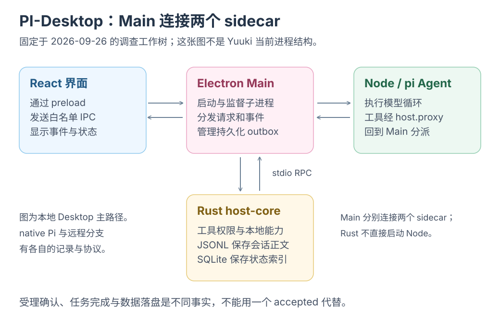
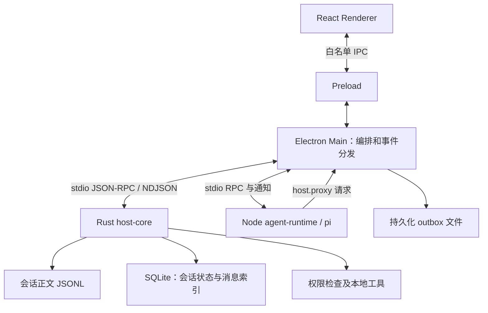

# PI-Desktop：从真实混合系统抽出一个小型 Rust host 骨架

[调查入口](README.md) · [为什么选 Rust](01-why-rust.md) · [Zed 的组合方式](02-zed-architecture.md) · [对 yuuki-box 的启示](04-yuuki-box.md)

PI 保留 React/Electron、Node/pi Agent，把持久化、工具权限与系统能力集中到 Rust host。整体已不极简，可提炼的是<mark class="key">状态归属、进程交接与失败收尾</mark>，不是全部目录。

基线为 2026-09-26 本地 `my-test`，HEAD `e0d142ba56ced0c1d76eba8ab2a96c07959ad4e6`，版本 `0.15.7-beta.1`；已有 44 项暂存改动，多为语音，非本轮产生。以下不等于纯 HEAD 或已发布版，状态见[清单](inventory.json)。未运行应用、模型、构建或测试。

## 1. 单一 Rust crate，不等于单一应用模块

workspace 仅列 `crates/host-core`，生成 `pi-desktop-host-core`；内部仍含数据库、会话、工具、权限、插件与配置同步，依赖 Tokio/rusqlite/Serde。单 crate 不等于小业务。workspace[^pi-1]、manifest[^pi-2]

apps/packages 直接子包有 11 份 manifest，加根包、文档站、内置文件管理插件共 14 份；按责任阅读：

| 部分 | 责任与阅读位置 |
|---|---|
| `apps/desktop` | Electron main/preload、React 界面和桌面集成；窗口安全配置[^pi-3] |
| `crates/host-core` | 本地权威状态、持久化、工具及权限入口；RPC 分派[^pi-4] |
| `packages/agent-runtime` | pi agent 实例、模型运行、事件与工具调用；Agent 创建[^pi-5] |
| `packages/host-runtime` | Rust/Node 子进程连接、监督和可供无界面 host 使用的 turn 生命周期；RuntimeService[^pi-6] |
| `packages/agent-host` | 面向调用者的 agent host 业务边界，含身份、队列和运行端口；ports[^pi-7] |
| `apps/pi-host`、`packages/racp` | 无界面 host 与远程控制协议/传输；服务组装[^pi-8] |
| `packages/shared` | 跨边界共享契约、错误和超时规则；超时定义[^pi-9] |
| `plugin-sdk`、`plugin-devkit`、`i18n`、`voice-runtime` | 插件契约及开发工具、语言资源、语音运行能力；具体包清单见[采样记录](inventory.json) |

包、进程、权限是不同边界。host-runtime 是共享 TypeScript，不是另一个 Rust host；shared 名称不保证协议一致。

**推断：**先在单二进制内按领域分模块，需独立生命周期的 Agent 才分进程；出现复用、依赖或编译需求再拆 crate。这不是作者长期计划，单 crate 也不代表只读一文件。

## 2. 为什么把 Rust 放在这里

ADR 0010 为文件/命令、插件隔离、安全存储与长驻服务选 Rust，保留可行的 TypeScript main 思路，不重写 pi、loop 或 UI。0001 保留 Electron 的 Node/pi、打包和调试生态；0012 拒绝重写供应商 SDK。Rust 决策[^pi-10]、非目标[^pi-11]、Electron[^pi-12]、供应商[^pi-13]

按责任组合生态：JS 管 UI/Agent，Rust 管宿主。ADR `Accepted` 不表示目标均已实现或性能获证；0011 才确定 Rust sidecar、stdio NDJSON 和独占 SQLite。传输与所有权[^pi-14]

## 3. 实际拓扑：Main 居中，连接两个 sidecar

以下为本地桌面的概念/协议拓扑，省略 Chromium 辅助进程、插件和语音服务，不是依赖图。

Renderer 经 preload 白名单访问 `window.piDesktop`，开启 contextIsolation/sandbox、关闭 nodeIntegration。Main 用 HostProcess 启动 Rust，以 ID、pending、超时和握手管理管道 RPC；协议版本 11。preload[^pi-15]、启动[^pi-16]、版本[^pi-17]

Agent 以 `process.execPath`、`ELECTRON_RUN_AS_NODE=1` 使用 Electron Node，非 Bun。host.proxy 经 Main 白名单转发唯一 host，部分由 Main 本地处理；不是 Rust 启动 Node，也非全部工具在 Rust 内。Node 启动[^pi-18]、请求[^pi-19]、转发[^pi-20]

三者可分别重启/刷新，代价是序列化、响应丢失、迟到通知和 pending 清理。进程隔离不等于 OS 沙箱，Rust 内存约束也不替代路径、权限和分派策略。

## 4. 真实链一：用户 prompt 如何开始并结束

以下仅为 Desktop 本地会话。`native:` 转交 nativePiService，由原生 AgentSession 管 canonical JSONL；native.agent.event 直达 UI，不走 Desktop outbox/Host queue/turn。native 分支[^pi-21]、事件例外[^pi-22]

1. Renderer 乐观更新后，经 api.prompt 调 IPC；出现消息仅表示开始提交。queue slice[^pi-23]、API[^pi-24]
2. Main 确认 session/模型/项目，Rust beginTurn 建持久 turn，再 appendMessage 保存输入；失败不启动模型。turn[^pi-25]、保存顺序[^pi-26]
3. Main 发 agent.prompt，Node 异步运行 runtime.prompt，立即回 `{ accepted: true, turnId }`；<mark class="caution">受理不是推理完成</mark>，之后仍可失败或取消。sidecar[^pi-27]
4. pi Agent.prompt 事件经 agent.event→Main→Renderer/持久化；agent_end 才完成/报错，仍须核对 turn，防旧事件结束新任务。模型入口[^pi-28]、分发[^pi-29]、终止[^pi-30]

请求、流式事件和持久状态各有职责：IPC 返回值不替代状态机，session ID 不替代 turn ID。

如取消 A 后启动 B，同 session 的旧终止事件不能结束 B。保存响应丢失后重发，消息 ID 稳定而 RPC ID 可变；会话、轮次、消息、传输请求四种身份不能混为一谈。

## 5. 真实链二：assistant 回复如何变成可恢复历史

message_end 到 Main 后先处理 checkpoint，再进文件 outbox，保存队列后顺序 appendMessage。`session-message-outbox.json` 上限 1024 项，处理重复 ID、永久拒绝和孤立会话；是有界恢复，不保证永不丢失。消息处理[^pi-31]、outbox[^pi-32]

Rust 校验 UiMessage 的会话、turn 和重复 ID，先追加 JSONL 正文，再提交 SQLite 索引。JSONL 经 write_all/flush/sync_data 落盘，文件写完而索引未提交时可据正文恢复；不是全部正文存 SQLite。RPC[^pi-4]、校验[^pi-33]、顺序[^pi-34]、正文[^pi-35]、落盘[^pi-36]

启动处理 orphan/inflight；握手后的 outbox drain/ready 顺序避免先读后补。<mark class="caution">Rust 不提供跨文件与数据库的原子事务</mark>，这是应用恢复协议。启动恢复[^pi-37]、时序[^pi-38]

按故障位置看恢复职责：

| 中断位置 | 当前机制试图解决的问题 |
|---|---|
| 模型尚未启动，用户消息保存失败 | 不发起模型执行，避免历史缺少输入 |
| 最终消息待写，Rust host 不可用 | outbox 保留待投递项，恢复连接后继续 |
| host 已写入，但 Main 未收到确认 | 利用稳定消息 ID 消化重复投递 |
| JSONL 已追加，SQLite 尚未提交 | 将正文作为事实源，修复派生索引 |
| 某项保存会永远被拒绝 | 记录并移除阻塞项，让后续队列继续 |

永久拒绝项可丢弃，暂时错误保留队头重试，满容量无法清空则新入队报错。最终 checkpoint 是先观察快照、发起异步 flush，再调 outbox，并未等落盘；发起、确认、持久化不同。错误分类[^pi-39]、异步 checkpoint[^pi-40]

## 6. 工具、权限、取消与重启如何配合

runtime 经 host.proxy 请求 tools.execute，Rust 按数据库会话绑定项目根，必要时发 permissions.request，等批准或超时拒绝；请求自带路径/权限不作权威。工具入口[^pi-41]、项目根[^pi-42]、权限等待[^pi-43]

每轮 permissionMode override 仍是 **log-only stub**；审批查询 host-core 的已存会话模式。字段存在不代表已执行每轮权限上限。stub[^pi-44]

生命周期需分别定义：

- **超时：**RPC 默认 130 秒，权限 120 秒；Bash 为权限 120+命令 60+缓冲 10 秒，插件/MCP 另有队列与执行预算。调用者需容纳下游等待，避免先超时而下游仍执行。预算[^pi-9]
- **取消：**abort 带 turn ID；runtime 取消 pi/retry/compaction，host 用 tools.abort/tombstone 处理取消先到竞态。agent[^pi-45]、runtime[^pi-46]、host[^pi-47]、tombstone[^pi-48]
- **重启：**每进程两分钟最多三次，并发请求合并；0.5 秒起指数退避，封顶 4 秒。恢复进程不等于重跑旧命令。策略[^pi-49]
- **限额：**RPC 最多 32 个在途任务，以 Tokio mutex 保护状态；背压与资源管理仍须显式实现。限额[^pi-50]、状态[^pi-51]

退出先关闭 host stdin、以 EOF 停机并结束 pending RPC，宽限后才强杀。它结束整个 host，不等于取消单 turn；不能让停止生成影响其他会话。dispose[^pi-52]

## 7. remote 是可选外层

桌面按 session owner 选 backend；远端 startTurn 经 RACP WebSocket 发 turn/start。pi-host 组装 AgentHost、RuntimeService、Rust host 和 Node sidecar，无需远程 Electron UI，复用上述职责。路由[^pi-53]、启动[^pi-54]、组装[^pi-55]

远端启动拒绝附件，共享包不证明插件 UI/OAuth 等价；未验证配对、断网或远程恢复。附件边界[^pi-56]

## 8. 从现有系统抽出真正的小骨架

沿“一个 prompt、一个工具、一条最终消息”阅读：

1. 先读 ADR 0010[^pi-57] 与 0011[^pi-58]，固定 UI、编排、Rust host、Node agent 四个角色。
2. 对照 HostProcess[^pi-16] 和 agent sidecar[^pi-21]，理解 Main→Rust、Main→Node 两条 RPC 连接以及 Node→Main 的 host proxy。
3. 顺着本章两条真实链，看清 `beginTurn → append user → prompt → events → append assistant → finish turn`；随后读一次工具批准与取消。
4. 最后读 outbox、监督与恢复。remote、插件生态、语音、配置同步可留到骨架明确后，再按真实需求加入。

教学示例可先留一个 Rust crate、Node Agent、薄编排层和 UI；显式 schema、session/turn/request ID 定义交接。outbox、双存储和远端按恢复/索引/访问需求加入；这是建议，不是已验证的独立 demo。

检查四问：刷新后从哪恢复？谁批准写文件？取消先到怎么办？保存后丢回复如何去重？删目录不能代答。只展示一次请求、没有本地工具/长期数据时，也无需先做全套恢复。

收益是 Rust 集中数据/权限、Node 复用 pi、UI 协议解耦；成本是多进程发布、双语言契约、顺序、重启/重投、取消和 host 差异。源码仅证明机制存在，不证明吞吐、内存、安全或恢复完备；先迁移所有权和完整工作链，再按本地职责决定是否加 Rust。

## 本地源码引用说明

PI 引用定位 2026-09-26 本地工作树，无公开链接；含 HEAD 外暂存改动，不能只凭提交号重建，本次未重验运行行为。

[^pi-1]: `PI-Desktop/Cargo.toml:1`，来自上述本地调查记录。
[^pi-2]: `PI-Desktop/crates/host-core/Cargo.toml:8`，来自上述本地调查记录。
[^pi-3]: `PI-Desktop/apps/desktop/electron/main/bootstrap/window.ts:206`，来自上述本地调查记录。
[^pi-4]: `PI-Desktop/crates/host-core/src/rpc/mod.rs:2392`，来自上述本地调查记录。
[^pi-5]: `PI-Desktop/packages/agent-runtime/src/runtime.ts:1870`，来自上述本地调查记录。
[^pi-6]: `PI-Desktop/packages/host-runtime/src/runtime-service.ts:103`，来自上述本地调查记录。
[^pi-7]: `PI-Desktop/packages/agent-host/src/ports.ts:10`，来自上述本地调查记录。
[^pi-8]: `PI-Desktop/apps/pi-host/src/app.ts:247`，来自上述本地调查记录。
[^pi-9]: `PI-Desktop/packages/shared/src/rpc-timeouts.ts:3`，来自上述本地调查记录。
[^pi-10]: `PI-Desktop/docs/adr/0010-rust-backend-host-core.md:8`，来自上述本地调查记录。
[^pi-11]: `PI-Desktop/docs/adr/0010-rust-backend-host-core.md:47`，来自上述本地调查记录。
[^pi-12]: `PI-Desktop/docs/adr/0001-use-electron.md:14`，来自上述本地调查记录。
[^pi-13]: `PI-Desktop/docs/adr/0012-universal-provider-model-coverage.md:39`，来自上述本地调查记录。
[^pi-14]: `PI-Desktop/docs/adr/0011-host-rpc-and-storage-defaults.md:20`，来自上述本地调查记录。
[^pi-15]: `PI-Desktop/apps/desktop/electron/preload/index.ts:12`，来自上述本地调查记录。
[^pi-16]: `PI-Desktop/packages/host-runtime/src/host-process.ts:94`，来自上述本地调查记录。
[^pi-17]: `PI-Desktop/crates/host-core/src/state.rs:18`，来自上述本地调查记录。
[^pi-18]: `PI-Desktop/apps/desktop/electron/main/agent-sidecar.ts:50`，来自上述本地调查记录。
[^pi-19]: `PI-Desktop/packages/agent-runtime/src/parent-host-proxy.ts:93`，来自上述本地调查记录。
[^pi-20]: `PI-Desktop/packages/host-runtime/src/agent-sidecar.ts:459`，来自上述本地调查记录。
[^pi-21]: `PI-Desktop/packages/agent-runtime/src/sidecar.ts:385`，来自上述本地调查记录。
[^pi-22]: `PI-Desktop/apps/desktop/electron/main/runtime/sidecar.ts:173`，来自上述本地调查记录。
[^pi-23]: `PI-Desktop/apps/desktop/src/stores/slices/queue-slice.ts:437`，来自上述本地调查记录。
[^pi-24]: `PI-Desktop/apps/desktop/src/lib/api.ts:887`，来自上述本地调查记录。
[^pi-25]: `PI-Desktop/apps/desktop/electron/main/ipc/agent-ipc.ts:415`，来自上述本地调查记录。
[^pi-26]: `PI-Desktop/apps/desktop/electron/main/ipc/agent-ipc.ts:543`，来自上述本地调查记录。
[^pi-27]: `PI-Desktop/packages/agent-runtime/src/sidecar.ts:401`，来自上述本地调查记录。
[^pi-28]: `PI-Desktop/packages/agent-runtime/src/runtime.ts:8005`，来自上述本地调查记录。
[^pi-29]: `PI-Desktop/apps/desktop/electron/main/runtime/sidecar.ts:225`，来自上述本地调查记录。
[^pi-30]: `PI-Desktop/apps/desktop/electron/main/runtime/event-persistence.ts:172`，来自上述本地调查记录。
[^pi-31]: `PI-Desktop/apps/desktop/electron/main/runtime/event-persistence.ts:255`，来自上述本地调查记录。
[^pi-32]: `PI-Desktop/apps/desktop/electron/main/persistence-outbox.ts:30`，来自上述本地调查记录。
[^pi-33]: `PI-Desktop/crates/host-core/src/sessions.rs:1822`，来自上述本地调查记录。
[^pi-34]: `PI-Desktop/crates/host-core/src/sessions.rs:2099`，来自上述本地调查记录。
[^pi-35]: `PI-Desktop/crates/host-core/src/transcripts.rs:1`，来自上述本地调查记录。
[^pi-36]: `PI-Desktop/crates/host-core/src/transcripts.rs:617`，来自上述本地调查记录。
[^pi-37]: `PI-Desktop/crates/host-core/src/state.rs:80`，来自上述本地调查记录。
[^pi-38]: `PI-Desktop/docs/adr/0041-bounded-host-runtime-and-persistence-outbox.md:22`，来自上述本地调查记录。
[^pi-39]: `PI-Desktop/apps/desktop/electron/main/persistence-outbox.ts:86`，来自上述本地调查记录。
[^pi-40]: `PI-Desktop/apps/desktop/electron/main/runtime/event-persistence.ts:259`，来自上述本地调查记录。
[^pi-41]: `PI-Desktop/packages/agent-runtime/src/runtime.ts:3109`，来自上述本地调查记录。
[^pi-42]: `PI-Desktop/crates/host-core/src/rpc/mod.rs:3450`，来自上述本地调查记录。
[^pi-43]: `PI-Desktop/crates/host-core/src/rpc/mod.rs:3571`，来自上述本地调查记录。
[^pi-44]: `PI-Desktop/packages/agent-runtime/src/sidecar.ts:406`，来自上述本地调查记录。
[^pi-45]: `PI-Desktop/packages/agent-runtime/src/sidecar.ts:485`，来自上述本地调查记录。
[^pi-46]: `PI-Desktop/packages/agent-runtime/src/runtime.ts:8193`，来自上述本地调查记录。
[^pi-47]: `PI-Desktop/crates/host-core/src/rpc/mod.rs:3919`，来自上述本地调查记录。
[^pi-48]: `PI-Desktop/crates/host-core/src/state.rs:70`，来自上述本地调查记录。
[^pi-49]: `PI-Desktop/packages/host-runtime/src/runtime-supervisor.ts:1`，来自上述本地调查记录。
[^pi-50]: `PI-Desktop/crates/host-core/src/rpc/mod.rs:287`，来自上述本地调查记录。
[^pi-51]: `PI-Desktop/crates/host-core/src/main.rs:78`，来自上述本地调查记录。
[^pi-52]: `PI-Desktop/packages/host-runtime/src/host-process.ts:366`，来自上述本地调查记录。
[^pi-53]: `PI-Desktop/apps/desktop/electron/main/ipc/register.ts:175`，来自上述本地调查记录。
[^pi-54]: `PI-Desktop/apps/desktop/electron/main/remote/remote-backend.ts:127`，来自上述本地调查记录。
[^pi-55]: `PI-Desktop/apps/pi-host/src/app.ts:129`，来自上述本地调查记录。
[^pi-56]: `PI-Desktop/apps/desktop/electron/main/remote/remote-backend.ts:131`，来自上述本地调查记录。
[^pi-57]: `PI-Desktop/docs/adr/0010-rust-backend-host-core.md:18`，来自上述本地调查记录。
[^pi-58]: `PI-Desktop/docs/adr/0011-host-rpc-and-storage-defaults.md:18`，来自上述本地调查记录。
