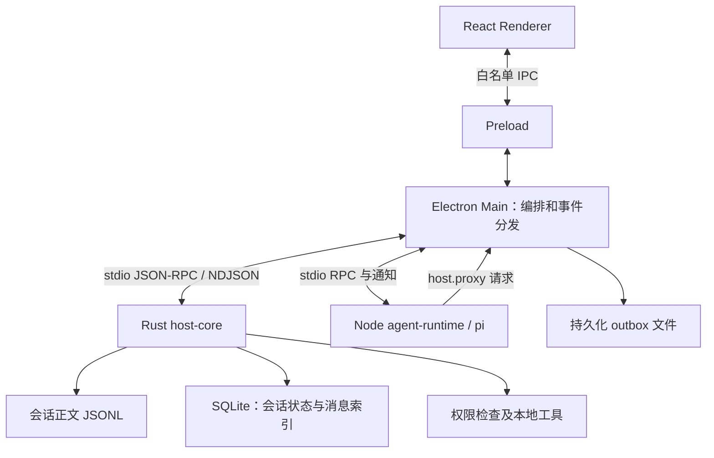

# PI-Desktop：从真实混合系统抽出一个小型 Rust host 骨架

[调查入口](README.md) · [为什么选 Rust](01-why-rust.md) · [Zed 的组合方式](02-zed-architecture.md) · [对 yuuki-box 的启示](04-yuuki-box.md)

PI-Desktop 提供了一个比 Zed 更容易看清的 Rust 使用边界：保留 React/Electron 界面和 Node/pi agent，把持久化、工具权限与本地系统能力集中到 Rust host。它适合作为“小型架构骨架”的来源，但当前整个项目已经不极简。学习重点应是**谁拥有状态、跨进程如何交接、失败后谁负责收尾**，而不是照搬全部目录。

本章研究 2026-09-26 的本地工作树：分支 `my-test`，HEAD `e0d142ba56ced0c1d76eba8ab2a96c07959ad4e6`，包版本 `0.15.7-beta.1`。采样时有 44 项已暂存改动，主要涉及语音；这些改动并非本次调查产生。因此下文描述“当时磁盘上的实现”，不能把所有观察归属于该提交或已发布版本。完整状态与 manifest 清单保存在[调查清单](/Users/chp/explore/yuuki-box/docs/deep/2026-09-26-zed-pi-rust/inventory.json:31482)。本次没有启动应用、调用模型、构建或运行测试。

## 1. 单一 Rust crate，不等于单一应用模块

根 Cargo workspace 只列出 `crates/host-core`；它生成 `pi-desktop-host-core` 可执行文件。Rust 内部仍有数据库、会话、工具、权限、插件、配置同步等模块，并依赖 Tokio、rusqlite、Serde 等成熟库。单 crate 只是编译组织上的选择，不表示业务量很小。[根 workspace](/Users/chp/codex/PI-Desktop/Cargo.toml:1)、[host-core manifest](/Users/chp/codex/PI-Desktop/crates/host-core/Cargo.toml:8)

`apps/*` 与 `packages/*` 的直接子目录合计有 11 个 package manifest；连同根包、文档站、内置文件管理插件，共发现 14 个 `package.json`。这些包可以按责任阅读：

| 部分 | 责任与阅读位置 |
|---|---|
| `apps/desktop` | Electron main/preload、React 界面和桌面集成；[窗口安全配置](/Users/chp/codex/PI-Desktop/apps/desktop/electron/main/bootstrap/window.ts:206) |
| `crates/host-core` | 本地权威状态、持久化、工具及权限入口；[RPC 分派](/Users/chp/codex/PI-Desktop/crates/host-core/src/rpc/mod.rs:2392) |
| `packages/agent-runtime` | pi agent 实例、模型运行、事件与工具调用；[Agent 创建](/Users/chp/codex/PI-Desktop/packages/agent-runtime/src/runtime.ts:1870) |
| `packages/host-runtime` | Rust/Node 子进程连接、监督和可供无界面 host 使用的 turn 生命周期；[RuntimeService](/Users/chp/codex/PI-Desktop/packages/host-runtime/src/runtime-service.ts:103) |
| `packages/agent-host` | 面向调用者的 agent host 业务边界，含身份、队列和运行端口；[ports](/Users/chp/codex/PI-Desktop/packages/agent-host/src/ports.ts:10) |
| `apps/pi-host`、`packages/racp` | 无界面 host 与远程控制协议/传输；[服务组装](/Users/chp/codex/PI-Desktop/apps/pi-host/src/app.ts:247) |
| `packages/shared` | 跨边界共享契约、错误和超时规则；[超时定义](/Users/chp/codex/PI-Desktop/packages/shared/src/rpc-timeouts.ts:3) |
| `plugin-sdk`、`plugin-devkit`、`i18n`、`voice-runtime` | 插件契约及开发工具、语言资源、语音运行能力；具体包清单见[采样记录](/Users/chp/explore/yuuki-box/docs/deep/2026-09-26-zed-pi-rust/inventory.json:31546) |

这里的包边界、进程边界、权限边界是三件事。`host-runtime` 是 TypeScript 共享实现，不是另一个 Rust host；`shared` 也不会因为名称叫 shared 就自动保证双方协议一致。

与 Zed 大量 crate 的拆法相比，这个布局给出另一种起点：先在一个二进制内部按领域分模块，把真正需要独立生命周期的 agent 放到另一个进程。只有出现复用、独立依赖或编译边界需求时，再考虑拆 crate。这个推断来自当前组织方式，不是作者已经承诺的长期拆分计划；尤其不能由“只有一个 crate”推导出“只需要学一个文件”。

## 2. 为什么把 Rust 放在这里

ADR 0010 直接列出动机：文件系统工具、命令执行、插件隔离边界、安全存储适配及长期运行服务；作者认为纯 TypeScript main 可以工作，但希望获得更强的系统能力、隔离与性能余量。同时明确不重写 pi、不替换 pi agent loop、不把 UI 搬到 Rust。ADR 0001 则保留 Electron，以利用 Node/pi 生态与成熟的打包、调试能力；ADR 0012 也拒绝重写全部供应商 SDK。[Rust 决策](/Users/chp/codex/PI-Desktop/docs/adr/0010-rust-backend-host-core.md:8)、[明确非目标](/Users/chp/codex/PI-Desktop/docs/adr/0010-rust-backend-host-core.md:47)、[Electron 决策](/Users/chp/codex/PI-Desktop/docs/adr/0001-use-electron.md:14)、[供应商覆盖](/Users/chp/codex/PI-Desktop/docs/adr/0012-universal-provider-model-coverage.md:39)

因此这里的选型逻辑是按责任组合生态：界面与 agent 集成继续使用已有 JS 能力，Rust 承担需要稳定所有权和系统控制的 host。ADR 的 `Accepted` 表示决策被接受，不能据此认定每项目标都实现，更不能认定已经测出性能优势。后续 ADR 0011 才把传输收敛为 Rust sidecar + stdio NDJSON，并冻结 Rust 独占 SQLite 的规则。[传输与数据所有权](/Users/chp/codex/PI-Desktop/docs/adr/0011-host-rpc-and-storage-defaults.md:20)

## 3. 实际拓扑：Main 居中，连接两个 sidecar

以下是本地桌面主路径的**概念/协议拓扑**，省略 Chromium 辅助进程与可选插件、语音等服务；箭头不是 Cargo/npm 依赖图。

Renderer 通过 preload 的白名单接口访问 `window.piDesktop`；窗口开启 `contextIsolation` 和 sandbox，关闭 `nodeIntegration`。Main 使用带 stdin/stdout pipe 的 `HostProcess` 启动 Rust，再以请求 ID、pending 表、超时及握手管理 RPC。当前 Rust 协议版本常量为 11。[preload](/Users/chp/codex/PI-Desktop/apps/desktop/electron/preload/index.ts:12)、[host 进程启动](/Users/chp/codex/PI-Desktop/packages/host-runtime/src/host-process.ts:94)、[协议版本](/Users/chp/codex/PI-Desktop/crates/host-core/src/state.rs:18)

agent sidecar 使用 `process.execPath` 与 `ELECTRON_RUN_AS_NODE=1` 启动，即 Electron 所携带的 Node 模式，**不是 Bun**。Node 需要 host 能力时，经 `host.proxy` 回到 Main，由白名单检查后转发给唯一 host；部分能力由 Main 的本地 handler 处理。不能把历史 ADR 中的简略箭头读成“Rust 直接拥有和启动 Node”，也不能把所有工具执行都画在 Rust 进程内。[Node 启动](/Users/chp/codex/PI-Desktop/apps/desktop/electron/main/agent-sidecar.ts:50)、[代理请求](/Users/chp/codex/PI-Desktop/packages/agent-runtime/src/parent-host-proxy.ts:93)、[代理白名单与转发](/Users/chp/codex/PI-Desktop/packages/host-runtime/src/agent-sidecar.ts:459)

这样设计的直接作用，是让 host 重启、agent 重启、界面刷新成为可以分别处理的事件。代价是对象不能直接共享：参数要序列化，响应可能丢失，通知可能晚到，进程退出时必须结束等待中的请求。单独进程有助于故障隔离，但它本身不等于操作系统沙箱；host 是否允许某项操作，仍由路径校验、权限规则和分派实现决定。这里应把“Rust 语言的内存约束”与“产品授予工具的权限”分开判断。

## 4. 真实链一：用户 prompt 如何开始并结束

以下追踪普通 Desktop 管理的本地会话。`native:` 会话是明确例外：sidecar 转交 `nativePiService`，其原生 Pi `AgentSession` 自己维护 canonical JSONL；`native.agent.event` 直接转发界面，不走 Desktop outbox 和 Host queue/turn 状态。不能把后面的持久化链推广到这一分支。[native prompt 分支](/Users/chp/codex/PI-Desktop/packages/agent-runtime/src/sidecar.ts:385)、[事件例外](/Users/chp/codex/PI-Desktop/apps/desktop/electron/main/runtime/sidecar.ts:173)

1. Renderer 的 queue slice 先做乐观更新，再调用 `api.prompt`；API 转为 `IPC.invoke.agentPrompt`。界面出现用户消息，仅表示客户端开始提交。[queue slice](/Users/chp/codex/PI-Desktop/apps/desktop/src/stores/slices/queue-slice.ts:437)、[API](/Users/chp/codex/PI-Desktop/apps/desktop/src/lib/api.ts:887)
2. Main handler 确认 session、模型与项目，调用 Rust `session.beginTurn` 获得持久 turn 身份，然后 `session.appendMessage` 保存用户消息。保存失败时不启动模型，避免“模型已经执行，用户输入却没落盘”。[turn 建立](/Users/chp/codex/PI-Desktop/apps/desktop/electron/main/ipc/agent-ipc.ts:415)、[先保存再启动](/Users/chp/codex/PI-Desktop/apps/desktop/electron/main/ipc/agent-ipc.ts:543)
3. Main 发送 `agent.prompt`；Node 找到对应 runtime 后异步调用 `runtime.prompt`，立即回复 `{ accepted: true, turnId }`。这是受理确认，**不是推理完成**，之后仍可能发生准备失败、provider 错误或取消。[sidecar 受理](/Users/chp/codex/PI-Desktop/packages/agent-runtime/src/sidecar.ts:401)
4. runtime 调用 pi 的 `Agent.prompt`，把 pi 事件转成 `agent.event` 通知；Main 将它们分发给 Renderer，并进入持久化分支。`agent_end` 等终止事件才进入 turn 完成/错误处理，还要检查事件是否属于当前 turn，防止旧事件结束新任务。[模型入口](/Users/chp/codex/PI-Desktop/packages/agent-runtime/src/runtime.ts:8005)、[事件分发](/Users/chp/codex/PI-Desktop/apps/desktop/electron/main/runtime/sidecar.ts:225)、[终止判定](/Users/chp/codex/PI-Desktop/apps/desktop/electron/main/runtime/event-persistence.ts:172)

这条链最值得学习的是请求、流式事件和持久状态分别承担不同职责：IPC 返回值不能代替完整状态机；session ID 也不足以识别一轮工作，还需要 turn ID。

例如，同一个会话中用户先取消 A，再启动 B：两轮共用 session ID，但 A 的延迟终止事件不能结束 B。另一方面，同一条保存请求可能因响应丢失而重发，此时业务消息 ID 必须保持稳定，RPC 请求 ID 却可以不同。因此至少要分别理解会话身份、执行轮次身份、消息身份和一次传输请求的身份。把它们都压成一个字符串，省掉的是字段，增加的却是恢复时的歧义。

## 5. 真实链二：assistant 回复如何变成可恢复历史

流式渲染与最终保存不是同一次操作。普通 assistant 的 `message_end` 到达 Main 后，先进入 checkpoint 处理，再进入文件支持的 outbox；outbox 保存队列后顺序调用 host `session.appendMessage`。队列文件为 `session-message-outbox.json`，上限 1024 项，包含重复 ID、永久拒绝及孤立会话等处理。因此 outbox 是有界恢复机制，不能宣称为无限缓冲或绝不丢失。[完成消息处理](/Users/chp/codex/PI-Desktop/apps/desktop/electron/main/runtime/event-persistence.ts:255)、[outbox](/Users/chp/codex/PI-Desktop/apps/desktop/electron/main/persistence-outbox.ts:30)

Rust 接收 `UiMessage`，验证会话、turn 和重复消息，再执行关键顺序：**先追加 canonical JSONL 正文，再提交 SQLite 消息索引事务**。`transcripts` 明确声明正文在 JSONL，SQLite 保存索引；不能简写为“所有聊天正文都存 SQLite”。JSONL 写入执行 `write_all`、`flush`、`sync_data`；若文件已写而索引尚未提交，恢复机制可从正文补回派生索引。[RPC 输入](/Users/chp/codex/PI-Desktop/crates/host-core/src/rpc/mod.rs:2392)、[消息验证](/Users/chp/codex/PI-Desktop/crates/host-core/src/sessions.rs:1822)、[写入顺序](/Users/chp/codex/PI-Desktop/crates/host-core/src/sessions.rs:2099)、[正文所有权](/Users/chp/codex/PI-Desktop/crates/host-core/src/transcripts.rs:1)、[文件落盘](/Users/chp/codex/PI-Desktop/crates/host-core/src/transcripts.rs:617)

启动恢复还处理 orphan/inflight 状态；host 重新握手时，outbox drain 与 ready 状态有顺序要求，避免恢复后第一次读取抢在补写前发生。这些都是应用协议与恢复设计的收益，不能归功于 Rust 自动提供了跨 JSONL、SQLite、Main 队列的原子事务。[启动恢复](/Users/chp/codex/PI-Desktop/crates/host-core/src/state.rs:80)、[恢复时序的决策记录](/Users/chp/codex/PI-Desktop/docs/adr/0041-bounded-host-runtime-and-persistence-outbox.md:22)

把几种故障分开，才能理解这些额外代码的必要性：

| 中断位置 | 当前机制试图解决的问题 |
|---|---|
| 模型尚未启动，用户消息保存失败 | 不发起模型执行，避免历史缺少输入 |
| 最终消息待写，Rust host 不可用 | outbox 保留待投递项，恢复连接后继续 |
| host 已写入，但 Main 未收到确认 | 利用稳定消息 ID 消化重复投递 |
| JSONL 已追加，SQLite 尚未提交 | 将正文作为事实源，修复派生索引 |
| 某项保存会永远被拒绝 | 记录并移除阻塞项，让后续队列继续 |

最后一行尤其说明恢复机制的取舍：某些条目会被丢弃，而暂时性错误会保留队头等待重试；到达容量上限且无法清空时，新入队会报错。源码也不是“等待最终 checkpoint 落盘完成才入队”：它先观察最终快照、启动异步 flush，再调用 outbox。顺序发起、完成确认和持久化成功是不同事实。[outbox 的错误分类](/Users/chp/codex/PI-Desktop/apps/desktop/electron/main/persistence-outbox.ts:86)、[最终 checkpoint 的异步调用](/Users/chp/codex/PI-Desktop/apps/desktop/electron/main/runtime/event-persistence.ts:259)

## 6. 工具、权限、取消与重启如何配合

工具调用从 runtime 经 `host.proxy` 请求 `tools.execute`。Rust 依据数据库会话绑定项目根，并经过权限申请；需要批准时发出 `permissions.request`，等待批准或超时拒绝。工具请求传来的路径和权限字段不能自行成为权威。[runtime 工具入口](/Users/chp/codex/PI-Desktop/packages/agent-runtime/src/runtime.ts:3109)、[项目根绑定](/Users/chp/codex/PI-Desktop/crates/host-core/src/rpc/mod.rs:3450)、[权限等待](/Users/chp/codex/PI-Desktop/crates/host-core/src/rpc/mod.rs:3571)

必须保留一个实现边界：`agent.prompt` 接受的每轮 `permissionMode` override 目前是源码注明的 **log-only stub**，工具批准仍查询 host-core 中会话已存储的模式。字段存在或类型检查通过，不代表每轮权限上限已经被执行。[stub 注释与分支](/Users/chp/codex/PI-Desktop/packages/agent-runtime/src/sidecar.ts:406)

生命周期控制也不是一个通用超时数字可以覆盖：

- **超时预算**：普通 RPC 默认 130 秒，权限等待 120 秒；Bash 默认预算组合权限 120 秒、命令 60 秒及缓冲 10 秒。插件/MCP 分派另有队列与执行预算。调用者要容纳下游实际等待，不能先超时却让下游继续执行。[预算定义](/Users/chp/codex/PI-Desktop/packages/shared/src/rpc-timeouts.ts:3)
- **取消关联**：agent abort 带预期 turn ID；runtime 取消 pi、provider retry 与 compaction，host 另有 `tools.abort`。host 保存 abort tombstone，覆盖“取消先于工具请求到达”的竞态。[agent abort](/Users/chp/codex/PI-Desktop/packages/agent-runtime/src/sidecar.ts:485)、[runtime 收尾](/Users/chp/codex/PI-Desktop/packages/agent-runtime/src/runtime.ts:8193)、[host abort](/Users/chp/codex/PI-Desktop/crates/host-core/src/rpc/mod.rs:3919)、[tombstone](/Users/chp/codex/PI-Desktop/crates/host-core/src/state.rs:70)
- **有限重启**：每个子进程在两分钟内最多重启三次，同一子进程的并发重启合并为一次；退避从 0.5 秒开始，指数增加，上限 4 秒。恢复进程不等于重新执行已经启动过的命令。[监督策略](/Users/chp/codex/PI-Desktop/packages/host-runtime/src/runtime-supervisor.ts:1)
- **资源限额**：host RPC 有最多 32 个并行在途任务的入口限制，状态由 Tokio mutex 保护。Rust 仍需要显式背压和锁；它并不会自动阻止任务或外部进程耗尽资源。[RPC 限额](/Users/chp/codex/PI-Desktop/crates/host-core/src/rpc/mod.rs:287)、[共享状态](/Users/chp/codex/PI-Desktop/crates/host-core/src/main.rs:78)

正常退出也有专门协议：先关闭 host stdin，用 EOF 表达优雅停机，再结束等待中的 RPC；宽限期后仍不退出才强制终止。它与取消某个 turn 的含义不同。前者结束整个 host 生命周期，后者应只影响对应工作；混用两者会让一个“停止生成”按钮影响其他会话。[host dispose](/Users/chp/codex/PI-Desktop/packages/host-runtime/src/host-process.ts:366)

## 7. remote 是可选外层

桌面按 session owner 选择本地或远程 backend；远程 `startTurn` 通过 RACP WebSocket 发 `turn/start`。远端 `pi-host` 组装 AgentHost、RuntimeService、Rust host 与 Node sidecar，复用核心责任分工，不需要远程 Electron 界面。这解释了为何会有独立 `agent-host`、`host-runtime` 与 `racp` 包。[owner 路由](/Users/chp/codex/PI-Desktop/apps/desktop/electron/main/ipc/register.ts:175)、[远程启动](/Users/chp/codex/PI-Desktop/apps/desktop/electron/main/remote/remote-backend.ts:127)、[headless 组装](/Users/chp/codex/PI-Desktop/apps/pi-host/src/app.ts:129)

它不是完整桌面的无损远程映射：当前远程启动显式拒绝附件，桌面插件 UI、OAuth 等能力也不能仅凭共享 package 就推定等价。本次没有验证配对、真实网络中断或远程恢复。[附件边界](/Users/chp/codex/PI-Desktop/apps/desktop/electron/main/remote/remote-backend.ts:131)

## 8. 从现有系统抽出真正的小骨架

建议沿“一个 prompt、一个工具、一个最终消息”的路径阅读，而不是从所有 ADR 或最大文件开始：

1. 先读 [ADR 0010](/Users/chp/codex/PI-Desktop/docs/adr/0010-rust-backend-host-core.md:18) 与 [0011](/Users/chp/codex/PI-Desktop/docs/adr/0011-host-rpc-and-storage-defaults.md:18)，固定 UI、编排、Rust host、Node agent 四个角色。
2. 对照 [HostProcess](/Users/chp/codex/PI-Desktop/packages/host-runtime/src/host-process.ts:94) 和 [agent sidecar](/Users/chp/codex/PI-Desktop/packages/agent-runtime/src/sidecar.ts:385)，理解 Main→Rust、Main→Node 两条 RPC 连接以及 Node→Main 的 host proxy。
3. 顺着本章两条真实链，看清 `beginTurn → append user → prompt → events → append assistant → finish turn`；随后读一次工具批准与取消。
4. 最后读 outbox、监督与恢复。remote、插件生态、语音、配置同步可留到骨架明确后，再按真实需求加入。

若据此制作教学示例，可以只保留一个 Rust crate、一个 Node agent、一个薄编排层和一个 UI；用显式 schema 表达请求/事件，用 session/turn/request ID 区分三种身份。文件型 outbox、双存储和远程协议则应按示例是否真的需要崩溃恢复、索引查询和远程访问决定。这是从实际系统抽出的建议骨架，不是声称仓库已有同等精简且验证通过的独立 demo。

判断是否读懂骨架，可以提出四个具体检查题：界面重新加载后从哪里恢复历史；模型运行中谁有权执行文件写入；取消请求比工具请求先到时怎么办；Rust 已保存但调用方没收到回复时如何避免重复。若这些问题仍答不清，继续删目录通常不会让架构变简单，只会把未决定的责任藏起来。反过来，若产品只需要展示一次请求结果，尚无本地工具和长期数据责任，也无需为了模仿这份仓库提前引入它全部的恢复设施。

PI-Desktop 展示的收益是可指认的：Rust 集中本地数据与权限入口，Node 保留 pi 生态，UI 通过协议与两者分离；成本同样明确：多进程打包、两种语言契约、跨进程状态顺序、重启与重复投递、取消竞态、不同 host 的能力差异。源码证明这些机制存在，尚不能证明其吞吐、内存、安全完备性或全部恢复场景。对小项目最有价值的迁移对象是**明确的所有权和完整的一条工作链**；是否值得增加 Rust，应由要承担的本地责任决定。
