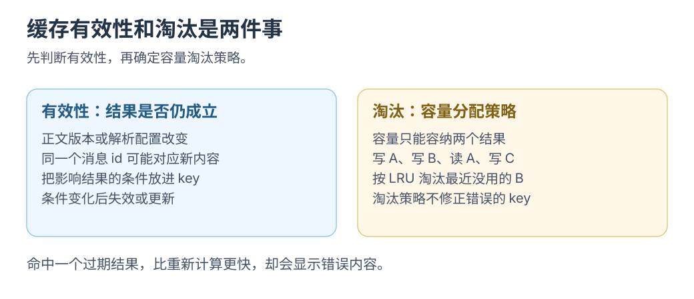

# 缓存为什么也有成本

[学习入口](README.md) · [上一篇 key 与 Map](keys-and-maps.md) · [选读：KV 为什么这么大](../kv-cache/00-why-so-large.md)

缓存<mark class="key">用保留空间换重复计算</mark>，也增加查找和维护。

## 保存引用和复制内容分别发生了什么

```js
const message = { id: 1, text: '一段很长的回答' };
const byId = new Map([[message.id, message]]);
console.log(byId.get(1) === message); // true
```

Map 保存同一对象的引用，不深复制文字，但索引与强引用仍占空间、保留对象。新增解析树、像素或数值数组还会增加结果数据。

对象条目数不能精确推算堆内存，布局、字符串与分配均有开销；数值缓冲区可先查有效数据量：

```js
const vector = new Float32Array(128);
console.log(vector.byteLength); // 512
```

Float32Array 每元素 4 字节，128 个共 512 字节，未含视图等开销。[MDN](https://developer.mozilla.org/en-US/docs/Web/JavaScript/Reference/Global_Objects/Float32Array)

<div class="heading-alias" id="先估算一次交换是否值得" aria-hidden="true"></div>

## 缓存成本估算

成本包括：

```text
缓存路径耗时 ≈ 查找与校验 + 未命中时的计算 + 写入和淘汰
保留空间     ≈ 结果数据 + 索引和元数据 + 因引用而仍被保留的对象
```

数值需实测。计算便宜或输入常变时，维护可能更贵；昂贵结果反复使用时再观察收益。

[](../../site/public/diagrams/frontend-foundations/cache-validity.svg)

## 命中 失效 淘汰各回答一个问题

| 问题 | 机制 | 例子 |
| --- | --- | --- |
| 有没有保存过兼容结果 | 命中判断 | 输入和计算版本是否对应 |
| 保存的结果还正确吗 | 失效规则 | 原文、字号或模型配置改变 |
| 正确但暂时不用的结果还要留多少 | 淘汰策略 | 容量上限、最近使用顺序或到期时间 |

缓存键可能漏依赖，TTL 到期前也可能过时；先明确有效条件，再决定保留多久。

## 在前端常遇到的四笔成本

- **重复计算。** 每次增量都重新解析整段历史。
- **数据保留。** 会话已经关闭，外部 Map 仍持有解析结果或大对象。
- **同步维护。** 数组更新了，按 ID 建立的索引还指向旧版本。
- **数据搬运。** 计算放进 Worker 后，每次却复制整份历史数据。

前两项连接到[前缀增量计算](../kv-cache/01-from-frontend.md)，最后一项连接到[Worker 与内存](../wasm/workers-and-memory.md)。

<div class="heading-alias" id="做一次失效实验再决定往哪走" aria-hidden="true"></div>

## 失效验证

缓存一条消息的解析结果，保持 `id`、修改正文。若仍返回旧内容，补上遗漏的版本条件；再查新正文与不变正文，确认失效和复用都正确。

验证<mark class="key">失效条件与容量淘汰规则</mark>后，继续读 [Worker 与搬运](../wasm/workers-and-memory.md)，或选读模型缓存。

## 把问题带进模型缓存

权重决定计算，K/V 是输入产生的中间状态。推理引擎保留历史 K/V 继续生成，数据按层与位置组织。

按每位置数据量、位置数与并发序列计算[KV 容量](../kv-cache/00-why-so-large.md)；KV 与 Map 的复用规则不同。
