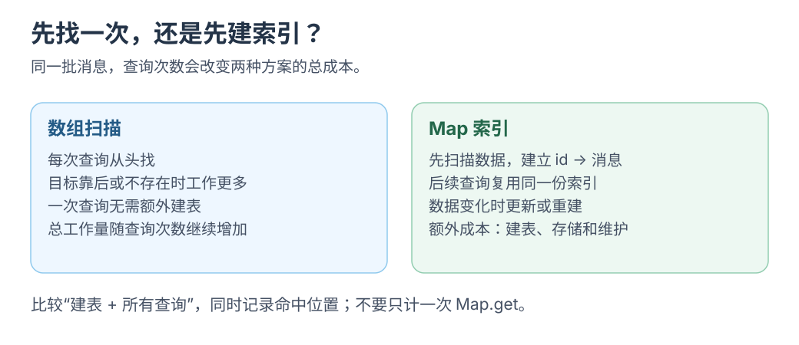

# key Map 与前端的查找结构

[学习入口](README.md) · [下一篇 缓存的成本](cache-cost.md)

收到消息增量时，先按 `messageId` 找对象，再判断要重算或重渲染什么。

[](../../site/public/diagrams/frontend-foundations/scan-index.svg)

## 数组查找和索引各做什么

```js
const rows = [
  { id: 1, text: '你好' },
  { id: 2, text: '继续回答' },
];

const foundByScan = rows.find(row => row.id === 2);
const byId = new Map(rows.map(row => [row.id, row]));
const foundByIndex = byId.get(2);

console.log(foundByScan === foundByIndex); // true
```

前者顺序检查，后者先建索引再按 ID 查找。<mark class="key">规模、查询次数与更新成本</mark>决定是否值得建表。[浏览器实验](../../site/src/pages/labs/lookup.astro)可对照。

<details class="qa">
<summary>Map 查找一定是 O(1) 吗？</summary>

规范仅要求平均访问时间为次线性，不保证严格常数时间。[MDN Map](https://developer.mozilla.org/en-US/docs/Web/JavaScript/Reference/Global_Objects/Map)

</details>

## Object Map WeakMap 怎样选择

| 结构 | 容易理解的使用场景 | 需要考虑什么 |
| --- | --- | --- |
| Object | 一份有字段含义的记录，例如 `{ id, title, status }` | 属性键和原型语义；动态字典可考虑 `Object.create(null)` |
| Map | 动态索引、经常增删、需要直接读取 `size` 的键值集合 | 索引构建、键的相等规则、容量与更新同步 |
| WeakMap | 给已有对象附加跟随其生命周期的元数据 | 不能枚举所有条目，不能把它当作可观测容量的 LRU |

Object 键为字符串或 Symbol；Map 可用任意值。对象键按身份比较，同字段的新对象仍是不同键。[对象比较](https://developer.mozilla.org/en-US/docs/Web/JavaScript/Reference/Global_Objects/Map#objects_vs._maps)

```js
const key = { id: 1 };
const cache = new Map([[key, '已解析']]);
console.log(cache.get(key));       // 已解析
console.log(cache.get({ id: 1 })); // undefined
```

WeakMap 支持对象和符合条件的 Symbol 弱键，不因关联阻止对象回收；回收时机由运行时决定。它不能枚举或查询 `size`。[MDN WeakMap](https://developer.mozilla.org/en-US/docs/Web/JavaScript/Reference/Global_Objects/WeakMap)

可为消息对象附加解析结果；对象不再被引用时允许回收。要明确限制 128 项，改用可管理容量的结构。

## 同样叫 key 作用可能不同

| 名称 | 用来解决什么问题 |
| --- | --- |
| 消息 ID | 标识业务实体 |
| React 列表的 `key` | 让 React 在插入、删除和重排后对应原来的列表项 |
| Map 的键 | 定位某个存储的值 |
| 计算缓存的键 | 判断能否复用一次派生计算 |
| Attention 的 Key | 与 Query 做数值运算，计算读取 Value 的权重 |

React key 要在同级间唯一、稳定，用于对应列表项与组件；它不建立业务 Map，也不检查计算依赖。[React key](https://react.dev/learn/rendering-lists#keeping-list-items-in-order-with-key)

Attention 的 Key 是向量，见[因果 Attention](../kv-cache/02-attention-and-kv.md)，不是字典键。

## 缓存键需要表达哪个版本的结果

流式消息 `id` 不变，正文仍在变化；缓存解析结果时记录内容与解析器版本：

```js
const cacheKey = JSON.stringify([
  message.id,
  message.contentVersion,
  parserVersion,
]);
```

数组表达固定依赖；也可保存对象与版本或分层索引。分开判断消息身份与结果有效性。

## 用 Map 理解一个有容量的缓存

Map 保留插入顺序，删除再插入可记录最近访问。以下只演示容量与访问顺序：

```js
const cache = new Map();
const capacity = 128;

function remember(key, value) {
  cache.delete(key);
  cache.set(key, value);
  if (cache.size > capacity) cache.delete(cache.keys().next().value);
}

function read(key) {
  if (!cache.has(key)) return { hit: false };
  const value = cache.get(key);
  remember(key, value);
  return { hit: true, value };
}
```

片段表达 LRU 顺序；版本、错误缓存和整体清空仍由调用方规定。<mark class="caution">淘汰管容量，失效管正确性</mark>。

<details class="qa">
<summary>容量 2，写 A、B，读 A，再写 C，淘汰谁？</summary>

B。读取 A 后它变为最近使用项，写 C 时淘汰 B。

</details>

下一步：[缓存的成本](cache-cost.md)。
