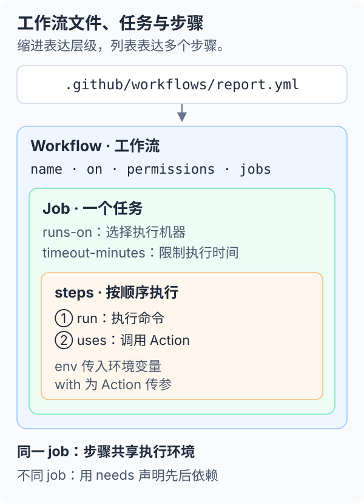

---
prev:
  link: /github-actions/
  label: GitHub Actions：从一次运行到自动化系统
next:
  link: /github-actions/01-repository-tasks/
  label: 事件触发与仓库任务
---

# 工作流文件与常用命令

工作流通常由 **YAML 配置、仓库脚本和外部 Action** 组成。YAML 安排事件与步骤；脚本实现具体逻辑；GitHub CLI（`gh`）负责从终端查看或操作 GitHub 上的运行。

本页为写法与命令参考，未执行示例。`gh workflow run` 会真实启动远程工作流，可能产生费用；本地阅读或保存这些文档不会启动它。

## 文件放在哪里

```text
仓库根目录/
├── .github/
│   └── workflows/
│       └── report.yml        # 工作流：触发条件、job、步骤
└── scripts/
    └── report.mjs            # 可选：较复杂的报告逻辑
```

GitHub 识别 `.github/workflows/` 中的 `.yml` 或 `.yaml` 文件。文件名便于在命令中定位，`name` 则是 Actions 页面显示的名称；仓库可以有多个工作流文件。

[](../../site/public/diagrams/github-actions/workflow-anatomy.svg)

简单命令直接写在 `run` 中；逻辑变长后写成脚本，再由步骤调用，例如 `run: node scripts/report.mjs`。调用仓库脚本前，要先检出代码并准备相应运行环境。

## 先读懂 YAML 层级

- **缩进**：用空格表示父子关系，通常每层两个空格；不要使用 Tab。
- **映射**：`name: Report` 是一个键值对；`jobs:` 下面是按任务 ID 命名的映射。
- **列表**：`steps:` 下面用 `-` 开始每一个步骤，按顺序执行。
- **多行命令**：`run: |` 保留换行，适合几条连续命令；每行继续缩进。
- **字符串**：版本号、cron 和可能含 YAML 特殊字符的内容加引号，例如 `'22'`、`'17 1 * * *'`。
- **表达式**：`${{ ... }}` 由 Actions 计算；`$VARIABLE` 则由 shell 读取环境变量。

`run` 与 `uses` 是一个步骤的两种主要写法，不能在同一步骤中同时使用：

```yaml
steps:
  - name: 执行命令
    run: printf 'hello\n'
  - name: 调用组件
    uses: actions/checkout@v4
    with:
      persist-credentials: false
```

这里的 `with` 是传给 Action 的参数，具体键名由该 Action 定义；`env` 才是提供给进程的环境变量。片段需要放在某个 job 下，不能直接作为完整文件使用。

本页 shell 示例使用 Bash。Linux／macOS 通常使用 Bash，Windows runner 默认使用 PowerShell，读取环境变量时写成 `$env:VARIABLE`。需要明确解释器时，在步骤中设置 `shell: bash` 或 `shell: pwsh`，并确保 runner 安装了对应程序。

## 一份完整的手动报告文件

以下为完整的 `report.yml` 示例：选择报告类型，生成 Markdown，把内容写入运行摘要，并保存一个可下载产物。它不读取仓库代码，因此不需要 `checkout`。

```yaml
name: Report

on:
  workflow_dispatch:
    inputs:
      kind:
        description: 报告类型
        type: choice
        options: [summary, full]
        default: summary
        required: true

permissions: {}

jobs:
  report:
    runs-on: ubuntu-latest
    timeout-minutes: 2
    steps:
      - name: 生成报告
        env:
          REPORT_KIND: ${{ inputs.kind }}
          REPOSITORY: ${{ github.repository }}
        run: |
          mkdir -p report
          printf '# 仓库报告\n\n' > report/report.md
          printf '仓库：%s\n类型：%s\n' "$REPOSITORY" "$REPORT_KIND" >> report/report.md
          cat report/report.md >> "$GITHUB_STEP_SUMMARY"
      - name: 保存报告
        uses: actions/upload-artifact@v4
        with:
          name: report
          path: report/report.md
          if-no-files-found: error
          retention-days: 3
```

- **`on`**：只接受手动触发；`kind` 是选项输入，本例仅把选择记录进报告。
- **`permissions`**：本例不需要仓库 `GITHUB_TOKEN` 的读写权限；artifact 上传使用 Actions 提供的运行时凭据。
- **`jobs.report`**：`report` 是任务 ID；`runs-on` 选择执行机器，`timeout-minutes` 限制任务时长。
- **`env` 与引用**：先把输入传到环境变量，再用双引号引用；不要把评论、标题等外部文本直接拼进 shell 命令源码。
- **摘要与文件**：`$GITHUB_STEP_SUMMARY` 展示 Markdown；artifact 保存文件，供运行页或 CLI 下载。

示例中的 Action 主版本标签用于说明写法，不代表最新推荐。正式使用前核对维护状态与兼容性，需要固定供应链版本时使用已核对的完整 commit SHA。

## 提交文件与启动运行是两件事

下面展示后续启用流程时的 Git 操作；本专题本身没有创建 `.github/workflows/report.yml`。

```bash
# 查看当前分支与改动
git status --short
git branch --show-current

# 暂存并检查工作流改动
git add .github/workflows/report.yml
git diff --cached

# 创建提交
git commit -m "ci: add manual report workflow"

# 推送当前工作分支
git push -u origin HEAD
```

先确认当前处于准备提交的工作分支，再执行推送。按仓库协作规则通过 PR 合入默认分支，不要把示例中的操作理解为直接推送主分支。

`git commit` 只产生本地提交，`git push` 把它交给远程仓库。是否自动运行取决于工作流的事件配置：本例只有 `workflow_dispatch`，推送本身不会启动报告；第一次手动使用前，文件需要已存在于默认分支。

## 用 gh 查看与操作工作流

先安装 [GitHub CLI](https://cli.github.com/)，在仓库目录中使用。以下命令按当前仓库定位；处理其他仓库时可显式加 `--repo OWNER/REPO`。本次未安装或运行 CLI。

### 登录与查看

```bash
# 登录 GitHub
gh auth login

# 查看登录状态
gh auth status

# 列出工作流
gh workflow list

# 查看配置
gh workflow view report.yml --yaml

# 查看最近运行
gh run list --workflow report.yml --limit 10
```

认证需要具备目标仓库的相应权限；组织策略或令牌权限也可能限制读取和手动运行。不要把 token 写进工作流、命令示例或提交记录。

### 手动触发

```bash
gh workflow run report.yml --ref docs/actions-guide -f kind=summary
```

- `report.yml`：工作流文件名，也可以用已查询到的工作流 ID。
- `--ref`：指定已有的分支或标签；将 `docs/actions-guide` 替换为实际目标，该版本也需包含工作流文件。
- `-f`：传入字符串形式的输入，本例的值必须符合 `kind` 选项。

命令成功表示提交了启动请求，不代表 job 已成功。接着用 `gh run list` 找到对应分支、事件和提交的运行记录，避免误选其他并发运行。

### 查看日志与下载产物

先从列表确认运行 ID，将下例的数字替换为实际值；不要照抄示意 ID 操作其他运行。

```bash
RUN_ID=1234567890

# 查看运行概况
gh run view "$RUN_ID"

# 查看失败日志
gh run view "$RUN_ID" --log-failed

# 等待完成，并返回失败退出码
gh run watch "$RUN_ID" --exit-status

# 下载 report 产物
gh run download "$RUN_ID" --name report --dir ./downloads/report
```

`watch` 观察已有运行，不创建新任务。`download` 需要目标运行已保存对应产物且尚未过期；其他工作流的产物名可能不同。

### 重跑与取消

```bash
# 重跑失败任务
gh run rerun "$RUN_ID" --failed

# 取消正在执行的运行
gh run cancel "$RUN_ID"
```

两条命令是按情况选择的操作，不应连着执行。重跑会重新消耗资源，并继续使用原运行对应的提交；若要使用刚修正的代码，应触发新运行。取消不会撤回之前已产生的外部写入或费用。

## 本地命令与远程命令的区别

- **`pnpm docs:build`**：在当前机器构建本项目文档；它不会上传工作流或创建 Actions run。当前脚本还包含构建结果检查。
- **`git push`**：上传提交，可能触发仓库配置的事件。
- **`gh workflow run`**：请求 GitHub 在指定版本上运行工作流，命令所在电脑并不因此成为 runner。
- **YAML 中的 `run`**：在该 job 选择的 runner 上执行命令，目录、工具和凭据要由工作流准备。

本地成功不能证明远程环境齐备；应比较系统、工具版本、工作目录、依赖和权限。常见故障入口见[事件触发与仓库任务](01-repository-tasks.md#失败时先看哪一层)。

<details>
<summary>选读：脚本、工作目录与跨步骤环境</summary>

在已经检出代码、准备好运行环境的 job 中，可这样调用脚本：

```yaml
steps:
  - name: 生成报告
    shell: bash
    working-directory: scripts
    run: node report.mjs
```

这里只展示调用步骤。`working-directory` 指定这个 `run` 的工作目录；也可以用 job 下的 `defaults.run.working-directory` 设置默认值，它不影响 `uses` 的参数路径。

同一 job 的后续步骤可以读取前面生成的文件，但每个 `run` 都会开启新的 shell。前一步的 `cd` 或 `export` 不会自动延续；持久传值可使用 `$GITHUB_ENV`：

```yaml
steps:
  - name: 保存变量
    run: printf 'REPORT_NAME=report.md\n' >> "$GITHUB_ENV"
  - name: 读取变量
    run: printf '%s\n' "$REPORT_NAME"
```

写入 `$GITHUB_ENV` 的值从后续步骤开始生效。跨 job 仍需显式输出或 artifact，不能共享当前 shell。

</details>

<details>
<summary>选读：输入、变量、密钥与步骤输出</summary>

以下均为配置片段，需放到对应层级。

**传入不同来源的值。** `inputs` 来自本次运行，`vars` 是配置变量，`secrets` 是受保护的秘密值；变量未配置或当前事件无权访问时，可能得到空值。

```yaml
env:
  REPORT_KIND: ${{ inputs.kind }}
  REPORT_REGION: ${{ vars.REPORT_REGION }}
  REPORT_API_KEY: ${{ secrets.REPORT_API_KEY }}
```

凭据只交给需要调用 API 的步骤，脚本先检查是否存在，不打印其内容。`inputs` 还支持 `boolean` 等类型；布尔条件可写为 `if: ${{ inputs.publish }}`，同时需要在触发输入中声明该布尔值。

**把一个步骤的结果交给后续步骤或 job。** 下面的 `jobs` 片段演示 `id`、`$GITHUB_OUTPUT`、job `outputs` 与 `needs` 的对应关系：

```yaml
jobs:
  prepare:
    runs-on: ubuntu-latest
    outputs:
      version: ${{ steps.meta.outputs.version }}
    steps:
      - id: meta
        run: printf 'version=demo-1\n' >> "$GITHUB_OUTPUT"
      - name: 查看步骤输出
        env:
          VERSION: ${{ steps.meta.outputs.version }}
        run: printf '%s\n' "$VERSION"
  consume:
    needs: prepare
    runs-on: ubuntu-latest
    steps:
      - name: 使用任务输出
        env:
          VERSION: ${{ needs.prepare.outputs.version }}
        run: printf '%s\n' "$VERSION"
```

输出适合版本号等小型数据；文件用 artifact 传递，秘密值不作为普通输出传播。`$GITHUB_ENV` 用于给同一 job 的后续步骤设置环境变量，不能代替跨 job 输出。

</details>

<details>
<summary>选读：事件过滤、条件与并发的放置位置</summary>

- **`on` 顶层**：配置 `push`、`pull_request` 的分支与路径过滤，或 `schedule` 的 cron。示例与跳过必需检查的注意点见[事件配置](01-repository-tasks.md#选择合适的触发事件)；普通 cron 按 UTC 表达。
- **Job 或 step 的 `if`**：判断是否执行；不要把“步骤运行了”当作上游结果合格。
- **Job 或 step 的 `timeout-minutes`**：限制执行时长；外部重试也需设限。
- **工作流或 job 的 `concurrency`**：控制同组任务的竞争，按任务性质选择是否取消旧运行。
- **Job 的 `needs`、`strategy.matrix`**：分别声明依赖与多组组合，详见[多任务编排与交付](02-orchestration.md)。

进一步查阅：[工作流语法](https://docs.github.com/en/actions/writing-workflows/workflow-syntax-for-github-actions)、[GitHub CLI 手册](https://cli.github.com/manual/)。链接为资料入口，本次未联网核验。

</details>
