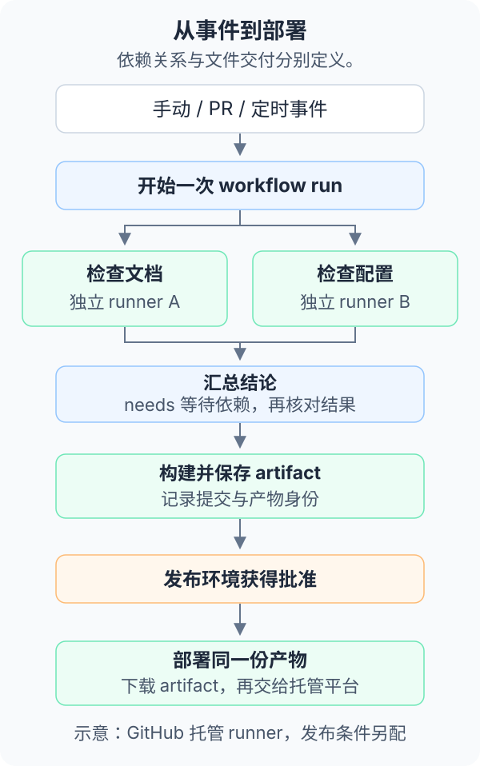

---
prev:
  link: /github-actions/01-repository-tasks/
  label: 事件触发与仓库任务
next:
  link: /github-actions/03-systems/
  label: 跨系统自动化
---

# 2 · 多任务编排与交付

当一个任务要支持多个系统、多人复用，或需要先检查再发布时，可以把工作流拆成多个 job。复杂度主要来自任务间的数据、依赖与权限关系。

以下展示配置能力与建议结构，未运行或部署。

## 先后关系与并行

例如发布一份文档：两个检查任务先并行，汇总结论后构建并保存文件，再经过环境批准，部署同一份产物。

[](../../site/public/diagrams/github-actions/execution-flow.svg)

- **`needs`**：让后续 job 等待指定任务完成。默认情况下，上游失败或被跳过会影响依赖任务。
- **`if`**：按事件、分支、输入或上游结果决定是否执行。例如只允许主分支进入生产部署。
- **Job outputs**：传递版本号、产物名称、布尔结果等小型数据；步骤通过 `$GITHUB_OUTPUT` 写出值，再显式映射为 job 输出。
- **Artifact**：保存并传递构建包、报告等文件。后续 job 需要显式下载。

<mark class="key">不同 job 不应依赖同一份本地目录</mark>。GitHub 托管 runner 的普通 job 通常各用独立环境；即使自托管任务碰巧落在同一机器，也不能把残留文件当作可靠的数据接口。

通知或汇总任务可在失败后运行，但需要检查每个必需任务的 `result`。`if: always()` 只改变执行条件，不会把失败结果变成发布许可；复杂取消场景也需单独设计。

## 矩阵：把同一任务展开多份

下面是 job 配置片段：

```yaml
strategy:
  fail-fast: true
  max-parallel: 2
  matrix:
    os: [ubuntu-latest, windows-latest, macos-latest]
    node: ['22', '24']
runs-on: ${{ matrix.os }}
```

3 个系统 × 2 个 Node 版本会产生 **6 个 job**。每个 job 的步骤都要显式使用 `matrix.node` 配置 Node；不同系统的 shell、依赖与打包工具也可能不同。

- **适用任务**：跨系统测试、不同语言版本、CPU 架构、数据库版本、应用包类型。
- **`include` / `exclude`**：增加特殊组合或排除不支持的组合。
- **`max-parallel`**：限制同时运行的 job 数，降低瞬时负载；完成相同工作量时，不会自动减少累计分钟。
- **`fail-fast`**：某个非容许失败的矩阵任务失败时，停止部分剩余任务；需要完整兼容性报告时可关闭。

并行缩短等待时间，也可能更快消耗额度。首次只检查一种 Linux 环境，确有兼容性需求后再扩大矩阵。

## 缓存与产物分别解决什么

| 类型 | 主要用途 | 不能依赖它做什么 |
| --- | --- | --- |
| Cache | 复用包下载或编译中间结果，减少重复工作 | 不能保证永久存在，也不是发布结果的权威来源 |
| Artifact | 保存一次运行的构建包、报告或截图 | 有保留期限，不自动成为长期下载服务 |
| Release / 包仓库 | 面向使用者分发版本包或依赖 | 有各自权限、大小与计费规则 |

缓存键通常包含系统、工具版本与锁文件哈希。命中缓存后仍需完成必要安装或校验；缓存缺失时流程应能正常重建。不要在缓存或产物中放 token、私钥和包含凭据的配置。

产物名称应能区分矩阵组合和提交。部署阶段记录来源 run、commit SHA 与内容摘要，避免下载到其他运行的同名包。缓存和产物的存储费用分别看[费用说明](04-costs.md)。

## 并发、超时与重试

PR 频繁更新时，可以取消已被新提交替代的构建。以下为工作流级配置片段：

```yaml
concurrency:
  group: ${{ github.workflow }}-${{ github.ref }}
  cancel-in-progress: true
```

它适合允许重做的构建。生产部署被取消可能留下部分已完成的外部写入，因此通常需要串行发布、明确取消边界，并保证重复执行不会造成重复发布。

- **超时**：设置 job 或 step 的 `timeout-minutes`，限制卡住的程序与等待外部 API 的时间。
- **重试**：只重试短暂网络失败，限制次数并记录结果；重复运行也消耗资源。
- **并发组**：控制同一组工作的竞争，不是可靠的先进先出队列；不能保证保留并按顺序执行所有提交。
- **撤销**：取消工作流不会撤回已发出的消息、已上传的文件或已生效的部署。

## 从构建走向发布

一个可审查的发布流程可分为：生成候选包 → 核对同一包 → 批准环境 → 发布该包 → 保存版本与回退信息。

- **Environment**：给 `preview`、`staging`、`production` 等目标分别配置变量、密钥与保护规则。
- **审批与分支限制**：在平台功能可用时要求指定人员批准，并限制可部署的分支或标签。可用范围受套餐与仓库可见性影响。
- **权限分离**：构建阶段只读代码；部署阶段才取得发布凭据。环境审批不会检查产物是否正确，仍需有明确验收依据。
- **OIDC**：云平台支持时，用短期身份换取有限权限，减少长期云密钥；具体身份范围见[跨系统自动化](03-systems.md#cloud-identity)。

在 Yuuki Box 中，静态文档包可以交给 Cloudflare 或其他托管平台。阅读同步还涉及 Functions、数据库和登录配置；仅上传静态页面不足以完成整个应用部署。

GitHub Pages 适合静态内容，不能直接承载本项目现有的服务端同步接口；Mac 应用分发还可能需要签名与公证。Actions 可以安排这些步骤，账号与服务能力仍需另行准备。

<details>
<summary>选读：复用流程与临时服务</summary>

- **Composite action**：复用同一个 job 中的一组步骤，例如环境准备或报告整理。
- **Reusable workflow**：通过 `workflow_call` 复用多个 job、输入和输出，适合多个仓库共用构建或发布标准。调用链不能凭空扩大调用方已有的 token 权限。
- **Service containers**：在支持的 Linux runner 上为任务临时启动 PostgreSQL、Redis 等服务，适合集成检查；数据不应被当作长期数据库保存。
- **动态矩阵**：先由脚本计算本次受影响的包，再用输出生成后续矩阵，适合大型仓库按变更范围安排工作。

流程拆分不等于权限隔离。复用工作流、共享缓存和可写 runner 的边界都需要单独确认；复杂脚本继续放在普通源码文件中。字段如何组成 YAML，见[工作流文件与常用命令](00-files-and-commands.md)。

</details>
