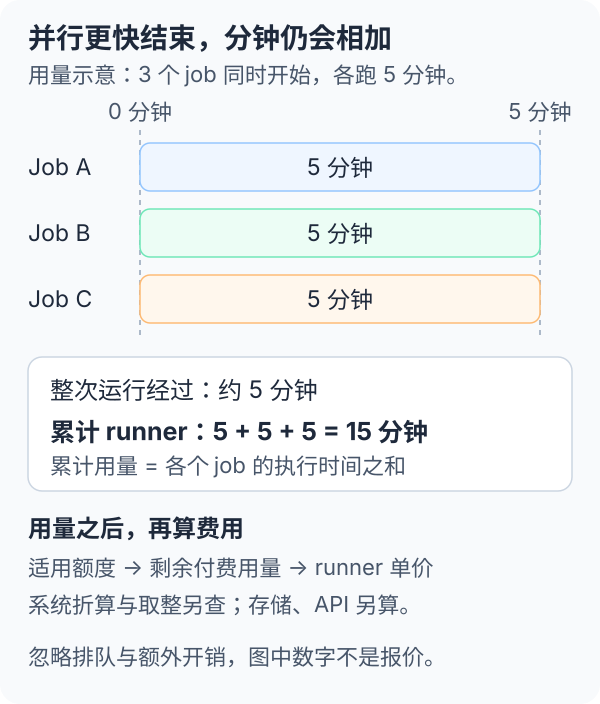

---
prev:
  link: /github-actions/03-systems/
  label: 跨系统自动化
next:
  link: /appendix/openai-api-models/
  label: OpenAI API 模型分类与选型
---

# 4 · GitHub Actions 额度与费用

**编写于 2026-11-12，基于已有知识，未联网核价。** 下文的历史套餐数字仅供理解量级；演算单价是明确假设，均不代表当前报价。实际账单应以仓库所有者的 GitHub 计费页、当前价格表与合约为准。

<mark class="key">Actions 的主要成本是执行时间、保存资料和它调用的外部服务。</mark> YAML 文件写得长不会直接增加费用；被触发的任务数、机器规格、执行时间和保留资料量才会影响用量。

<div class="heading-alias" id="费用来自哪里" aria-hidden="true"></div>

## 1 · 哪些情况可能免费

先看仓库可见性与 runner 类型，再看付费账户和额度。

| 执行方式 | 费用判断 |
| --- | --- |
| 公开仓库＋标准 GitHub 托管 runner | 通常享有免费执行权益；仍受使用限制及政策约束 |
| 私有仓库＋标准托管 runner | 套餐通常附带一定执行额度；超额处理取决于付款及预算设置 |
| 大型托管 runner | 按机器规格另有价格，不能预设公开仓库免费或可抵扣普通免费分钟 |
| 自托管 runner | 自备电脑、云主机及维护费；GitHub 平台费须按当前政策另查 |

大型 runner 通常提供更多 CPU、内存或其他规格，部分能力也受套餐及平台支持范围限制。不能只看到 `runs-on` 就认定费率相同。

自托管 runner 历史上不收取 GitHub 标准托管 runner 的执行分钟费，但这不等于成本为零，也不能据此保证当前或未来没有平台费。本章没有核对 2026 年的自托管计费政策。

### 私有仓库的历史额度量级

以下为常见的历史套餐口径，**不是 2026-11 的即时方案表**。分钟与存储是两种额度，不能互相换算。

| 套餐 | 每月分钟 | Actions 存储额度 |
| --- | ---: | ---: |
| GitHub Free | 2,000 | 500 MB |
| GitHub Pro | 3,000 | 1 GB |
| GitHub Team | 3,000 | 2 GB |

额度通常归仓库所有者账户或组织，按其计费规则共享。个人拥有三个私有仓库，不代表每个仓库各送一份完整额度；Team 的分钟也不能直接按成员数倍增。大型 runner、企业合约或其他特殊方案需另外核对。

开始估算前，先确认：

1. 仓库归个人还是组织，费用记到哪个账户。
2. 本月还有多少可用额度，其他仓库已消耗多少。
3. 选用的 runner 是否适用这份额度。
4. 额度用完后，是停止新任务，还是继续产生付费用量。

## 2 · 分钟怎么累积

<mark class="key">按各个 job 的执行用量累积，不能只看整条 workflow 的总耗时。</mark>

例如三个 job 同时执行，各跑 5 分钟：页面上约 5 分钟完成，但合计约为 15 个 runner 分钟。初始化、安装依赖和上传产物等占用 runner 的工作也可能包含在计费时长中。

[](../../site/public/diagrams/github-actions/billed-minutes.svg)

常见的用量放大方式：

- **矩阵：** 3 个系统 × 2 个语言版本形成 6 个 job；每个 5 分钟，合计约 30 分钟。
- **高频触发：** 每小时一次、每次 5 分钟，以 30 天计约为 `24 × 30 × 5 = 3,600` 分钟。
- **重跑：** 失败的 job 已使用的时间通常不退回；重新执行会再产生用量。
- **重复事件：** 同一提交同时触发 push 和 PR 工作流，可能执行两遍相同工作。
- **等待外部 API：** 如果 job 已启动，脚本一直轮询或等待回应，runner 仍被占用。

等待排队、等待 environment 批准，与已在 runner 里执行等待脚本是不同状态；前两者一般不等同于 runner 执行分钟。取消执行可以减少后续用量，但不会清除已产生的费用。

具体的计费起止点、取整方式、最小计费单位和 runner 费率需查当前规则。很多短 job 分开计费时，不能假设账单等于所有秒数相加后再取整一次。

<details>
<summary>选读：系统倍率与单价的区别</summary>

历史上，标准托管 runner 常见的免费分钟折算倍率为 Linux 1、Windows 2、macOS 10。这说明同样执行一分钟，消耗套餐分钟的方式可能不同；不代表当前所有机器都沿用这套倍率。

估算时分开处理：

1. 依当前额度规则，计算有多少用量可以抵扣。
2. 依具体 runner 的当前单价，计算剩余付费用量。

若价格表已给出某种 macOS runner 的每分钟价格，不要再因历史倍率额外乘以 10。大型 runner 和不同架构也不能直接套用标准 runner 的历史倍率。

</details>

## 3 · 一个月大概多少钱

下面只演算**私有仓库、同一种标准 Linux runner**，作如下假设：

- 每月有 2,000 分钟可抵扣，且没有其他仓库使用这份额度。
- 超额部分为 **0.01 美元／分钟**；这是方便演算的假设价格，并非 GitHub 报价。
- 每个 job 均为整数分钟；忽略取整差异、存储、外部 API、税费及汇率。

```text
当月执行分钟 = 执行次数 × 每次 job 数 × 每个 job 分钟
当月执行费 = max(0, 当月执行分钟 - 2,000) × 0.01 美元
```

| 使用情境 | 月执行分钟 | 假设执行费 |
| --- | ---: | ---: |
| 每天 1 次，每次 1 个 job，各 2 分钟 | 60 | $0 |
| 每月 200 次，每次 4 个 job，各 5 分钟 | 4,000 | $20 |
| 每小时 1 次，每次 6 个 job，各 5 分钟 | 21,600 | $196 |

第一行按 30 天计算。第三行为 `24 × 30 × 6 × 5 = 21,600` 分钟；扣除假设额度后，`19,600 × $0.01 = $196`。

这也说明：偶尔构建文件的用量可能很小，但把任务改成每小时执行，再加六组矩阵，就会明显放大成本。公开仓库的标准 runner 若适用免费执行政策，不能直接套用这张私有仓库费用表。

实际混用多种 runner 时，应分组估算，不能把所有分钟乘同一个价格。

## 4 · 不是只有执行分钟

### 产物与缓存

**Artifact** 保存构建包、报告或其他交付文件，供下载或后续 job 使用。大量产物长期保留会持续占用存储；删除后不会追溯抹去之前已发生的存储用量。

**Cache** 保存可重新产生的依赖或中间结果，用于加快后续执行。它有自己的容量、保留、淘汰及可能的超额规则；不能把历史 artifact 额度直接当作所有 cache 的免费容量。

存储计费可能按占用量和保留时间累积。每天产生 1 GB、各保留 7 天，稳定时约会同时保留 7 GB；每份保留 30 天则可能累积到约 30 GB。这是容量估算，并非账单公式。

日志、Actions artifacts、cache、Release 附件与 GitHub Packages 是不同用途的资料。它们的限制、免费权益和计费口径不能混成一项；容器镜像或套件还需查 Packages 的存储及传输规则。

### 外部服务

Actions 负责安排调用，外部服务各自计费：

- **模型 API：** 依模型与输入、输出等用量收费；GitHub 免费分钟不抵扣模型账单。
- **网站与云端部署：** 构建完成后，托管平台、数据库、对象存储及流量可能继续收费。
- **通知与资料来源：** 邮件、短信、付费 API 等可能另有配额或费用。
- **自托管机器：** 云主机开机时间、硬盘、网络、电费及维护成本由使用方承担。

执行中的 runner 若要等待模型生成，可能同时产生 Actions 时间费和模型 API 费。工作流结束也不会自动删除它建立的付费云端资源。

## 5 · 从小用量开始

1. **先选标准 Linux runner。** 确有系统依赖需求时，再加入 Windows、macOS 或更大机器。
2. **缩小触发范围。** 用分支、路径和事件条件，避免与任务无关的改动也触发工作。
3. **减少重复执行。** 对可被新提交取代的检查，使用 `concurrency` 取消旧任务；发布任务需另定取消规则。
4. **限制执行时间。** 配置 `timeout-minutes`，让失去进展的 job 停止；外部重试也设次数上限。
5. **控制矩阵。** 常见组合随 PR 执行，全面组合按需或定期执行；`max-parallel` 限制同时执行数，并不直接减少总 job 数。
6. **保存必要产物。** 只上传需要交付或排查的文件，设置合适的 `retention-days`，避免保存依赖目录和重复的大文件。
7. **分别检查预算。** GitHub 和模型商、云平台各自设置用量通知及可用的停止条件。

缓存命中可能缩短安装时间，但恢复和保存缓存也有成本。只有节省的时间与存储需求合适，才值得保留该缓存。

### 预算通知不一定会停止执行

在仓库所有者的 **Settings → Billing / Billing and licensing** 中查看适用的 Actions 用量、预算及付款设置；界面名称可能变动。

<mark class="caution">预算通知不等于硬性停机上限。</mark> 应检查是否提供并启用了「达到预算后停止用量」之类的选项、适用哪些产品，以及已启动任务怎样处理。不能只收到通知设置成功，就认为费用绝不会超过该数字。

额度耗尽且没有可用的付费方式，或设置了阻止超额的规则时，新任务可能无法执行。具体行为需依当前账户设置确认。用量报表也可能有延迟，应为已启动的工作预留余量。

## 6 · 对本项目的建议

可先从手动生成报告或少量文件构建开始：一个标准 Linux job、几分钟超时、短期保留产物。需要多系统打包时，再增加对应的 runner；需要 AI 修复时，再另外估算模型用量与验证成本。

预算表至少分成「Actions 执行」「Actions 存储」「外部 API」「部署与资料存储」四项。Issue 自动化的路线比较集中在[既有方案的路线与费用](../issue-garden/README.md#routes)。本章只提供估算方法，没有启用或执行任何付费工作流。

<details>
<summary>补充资料：正式使用前的价格入口</summary>

下列为官方查阅入口，本次未访问或核对内容：

- [GitHub Actions 计费说明](https://docs.github.com/en/billing/managing-billing-for-your-products/managing-billing-for-github-actions/about-billing-for-github-actions)：适用额度、计费方式与超额政策。
- [GitHub 套餐](https://github.com/pricing)：账户及组织方案。
- [GitHub Actions 使用限制](https://docs.github.com/en/actions/reference/limits)：执行时间、并发与其他限制。
- [GitHub Packages 计费](https://docs.github.com/en/billing/managing-billing-for-your-products/managing-billing-for-github-packages/about-billing-for-github-packages)：套件存储和传输的另一套规则。

核价时记录日期、仓库可见性、账户套餐、runner 标签与规格，再将价格代入本章公式。旧文章中的单价和倍率不能单独作为当前预算依据。

</details>
