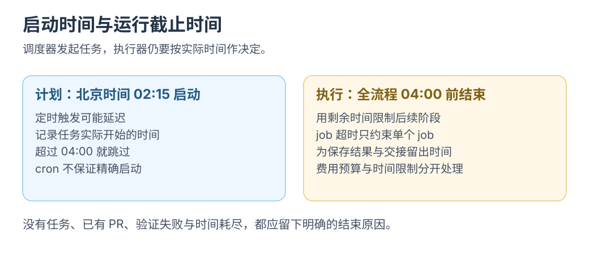

# 3 · 定时 Issue 处理流程

定时领取一个 Issue，修改、检查，再交回可验收的草稿 PR。

**把人工判断变成交接规则。** 扫描、验证与发布仍需在目标仓库连接。

本篇用 Actions + 模型 API。已有 Dot 与产品额度时，走[用 Dot 接手 GitHub 开发任务](04-dot-shift.md)。

API 执行使用[Codex Action](05-codex-api.md)或 [Agentic Workflows](06-agentic-workflows.md)；本篇补充调度、去重与失败处理。并行对照须固定[共同基线](../codex-cloud/05-issue-to-pr.md)。

## 一次只领一个 Issue

每天扫描所有未关闭 Issue，然后按明确规则选一个：

```text
未关闭 + 维护者添加 ai-ready
  → 检查是否已有进行中的任务或待验收 PR
  → 选择一个问题
  → 记录任务归属和本次默认分支的提交 SHA
  → 准备依赖，调用 AI，运行检查
  → 保存改动和检查结果
  → 创建草稿 PR，关联原 Issue
```

沿用[第一篇](01-first-scan.md)分页读取；<mark class="caution">选择、去重和时限由程序执行</mark>。

## 把手动修复接到 Actions

使用官方 `openai/codex-action@v1`；先配置 Actions secret `OPENAI_API_KEY`、依赖与任务输入。 [OpenAI Docs：Codex GitHub Action](https://learn.chatgpt.com/docs/github-action)

下面是 **AI 执行步骤的片段**，用于已经检出仓库、准备好依赖的 job：

```yaml
- name: 修复当前选择的 Issue
  uses: openai/codex-action@v1
  with:
    openai-api-key: ${{ secrets.OPENAI_API_KEY }}
    sandbox: workspace-write
    prompt-file: .github/codex/fix-issue.md
```

`.github/codex/fix-issue.md` 可以从[第二篇的任务指令](02-first-repair.md)开始：说明只处理当前选中的一个问题、必须运行哪些检查，以及缺少条件时怎样报告。

将 Issue 保存为 JSON，让指令引用；不直接拼进 shell。凭据仅传给需要的步骤。 [GitHub：防止脚本注入](https://docs.github.com/en/actions/reference/security/secure-use#use-an-intermediate-environment-variable)

片段只执行 AI；筛选、补丁、独立验证与 PR 发布按官方模式另接。 [OpenAI Docs：自动修复示例](https://learn.chatgpt.com/docs/non-interactive-mode#example-autofix-ci-failures-in-github-actions)

## 把修改与发布分开

| 阶段 | 做什么 | 需要的权限与输入 |
| --- | --- | --- |
| 扫描与选择 | 读取 Issue、检查已有 PR，确定本次任务 | Issue / PR 只读，固定的选择规则 |
| 生成修改 | 检出记录的提交、准备依赖、调用 Codex | 仓库只读令牌、AI 凭据、本地工作区写权限 |
| 验证 | 对修改后的代码运行相关检查 | 同一基线与补丁、项目规定的验证环境 |
| 发布 | 在干净 checkout 应用补丁，推送分支，创建草稿 PR | 仓库与 PR 写权限、检查结果 |

发布任务不执行补丁脚本；PR 保留 Issue、基线 SHA、检查与待验项。

仓库还需要允许 Actions 创建 PR；组织策略也可能限制这项能力。[GitHub Actions 仓库设置](https://docs.github.com/en/repositories/managing-your-repositorys-settings-and-features/enabling-features-for-your-repository/managing-github-actions-settings-for-a-repository)

[](../../site/public/diagrams/issue-garden/time-budget.svg)

## 时间段需要两道判断

假设只允许北京时间 **02:15—04:00** 工作：

1. 用 `schedule` 请求每天 02:15 启动；这一步可能延迟。
2. 任务实际启动时检查当前时间，过了 04:00 就跳过；仍在窗口内时，把剩余时间作为整个执行流程的截止限制。

`timeout-minutes: 30` 只限单个 job 的运行时长；固定收工时间与多 job 总时长另算。 [定时调度](https://docs.github.com/en/actions/reference/workflows-and-actions/events-that-trigger-workflows#schedule)、[任务超时](https://docs.github.com/en/actions/reference/workflows-and-actions/workflow-syntax#jobsjob_idtimeout-minutes)

<div class="heading-alias" id="首版规则可以很少" aria-hidden="true"></div>

## 首版执行规则

| 情况 | 建议行为 |
| --- | --- |
| 没有可处理的 Issue | 写一条运行摘要，正常结束 |
| 上一次还没结束 | 用仓库内固定的 concurrency group 避免重叠执行 |
| 已经有待验收 PR | 跳过同一个 Issue，等待人工验收 |
| 复现不了、测试失败、超过截止时间 | 留下运行记录，Issue 保持未解决，等待补充条件 |
| AI 凭据无效或额度不足 | 停止并记录原因 |
| 检查通过且确实有修改 | 创建一个关联 Issue 的草稿 PR |

concurrency 只限当前运行；跨天去重仍需查状态和关联 PR。 [GitHub 并发控制](https://docs.github.com/en/actions/how-tos/write-workflows/choose-when-workflows-run/control-workflow-concurrency)

首版每晚最多尝试一个 Issue；运行时限与费用控制分别设置。

<div class="heading-alias" id="正式上夜班前排练一次交接" aria-hidden="true"></div>

## 启用定时前的验证

手动跑一个可复现问题，核对唯一草稿 PR 与检查证据；重跑应跳过已有任务。再验无任务、检查失败、超时，最后启用定时。

只读 PR 与摘要，应能找出任务、改动、检查和下一步；缺项回到对应阶段补齐。

**交付须列明实际完成项。** 上述连接仍待目标仓库实现；本仓库未部署自动修复。
