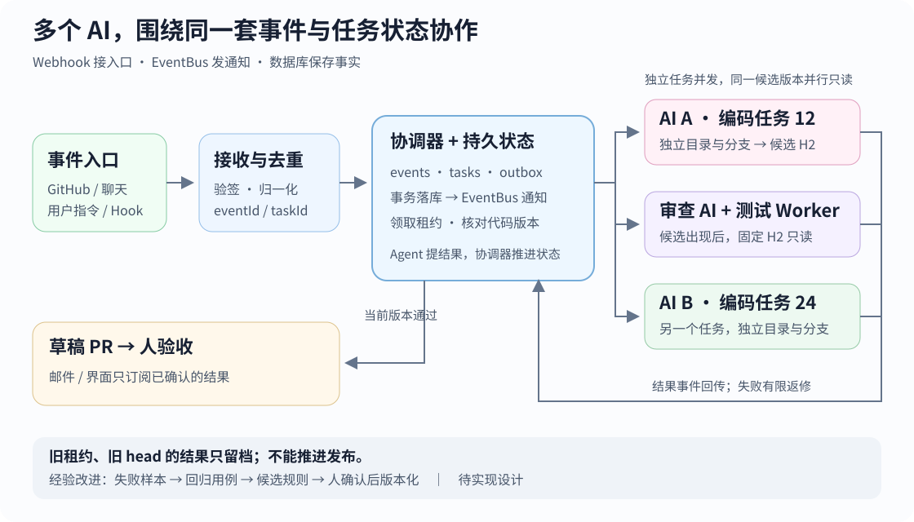

# 多 AI 协作演进：从 EventBus 到任务总线

**像 EventBus 一样发布、订阅；用持久任务状态决定谁执行、哪个结果有效。**

[](../../site/public/diagrams/issue-garden/multi-agent-event-bus.svg)

## 用前端经验理解

| 熟悉的概念 | 多 AI 系统中对应什么 |
| --- | --- |
| 外部回调 | Webhook：接 GitHub、聊天或告警 |
| `emit / on` | 进程内 EventBus：唤醒订阅者 |
| Store | 持久任务表：状态、版本、当前执行者 |
| 异步任务 | 队列与 Worker：领取、执行、回传结果 |

Webhook 是入口；EventBus 是通知；重启后的恢复依据是数据库。

## 多个 AI 怎么同时推进

不同任务独立目录、分支；<mark class="key">同任务只有一个编码者</mark>。测试、审查可并行读同一 head SHA，各领子任务与租约。

```text
接单 → 编码 → 测试 + 审查 → 草稿 PR → 人验收
          ↑       不通过：最多返修两轮
```

Agent 交结果，协调器核对再推进；按类型和状态路由，回写不重复开任务。

## 首版怎样落地

**Node 协调器 + SQLite + 独立 Worker 进程**，先做单机、小并发。

Worker 经本地 HTTP 或 IPC 领取、回传；协调器定期扫描过期任务与待发记录。

- `events / tasks / outbox`：事件、任务状态、待发记录同事务落库，提交后再通知。
- 协调器唯一写库；Worker 领取带租约的任务，重领时递增 `leaseEpoch`。
- 结果先核对轮次与租约；编码核对领取时的 base 后登记新 head，审查与测试只认该 head。
- 发布前按任务、固定分支查已有 PR；失败重试更新原交付，避免重复创建。

一条结果事件可以很小：

```json
{
  "id": "evt-42", "causeId": "evt-41", "type": "candidate.ready",
  "taskId": "issue-12", "workId": "code-1",
  "attempt": 1, "leaseEpoch": 3,
  "baseSha": "B", "headSha": "H2", "artifact": "patch-42"
}
```

`id` 去重，`causeId` 串因果，`workId` 定子任务，`artifact` 指补丁；B/H2 保存完整 SHA。数据库事务不能保证远端副作用仅发生一次。

## 怎样让它逐步演进

失败样本做回归，有效做法存候选规则；通过回归、人工确认后版本化，任务记录所用版本。

每次改进保留来源、适用范围与回归结果。

## 三个验收演练

1. **重投、重启：** 同一 Webhook 发两次，入库后重启；恢复后仍只有一个逻辑任务。
2. **抢单、迟到：** A 失联，B 取得新租约；A 的旧结果不能推进状态或发布 PR。
3. **版本变化：** H1 审查通过后出现 H2；H1 不能批准 H2，返修超限转人工。

先用两个假 Worker 演练，再接 Agent；邮件与界面分别订阅结果和任务事件。

与[转发器](07-automation-options.md#如果自制一个转发器)、[Harness 状态与恢复](../architecture/mac-local-harness.md)衔接；[Agent Symphony](../codex-cloud/04-agent-symphony.md)目前是观察与回放参考。

设计日期：2026-11-01。本文及 SVG 是待实现方案，尚未运行多 AI 调度或演进实验。
