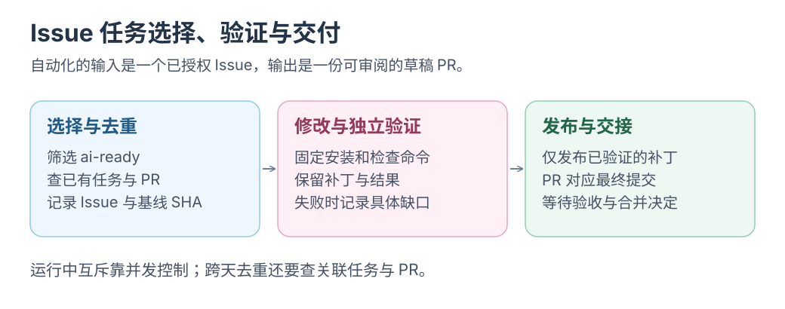
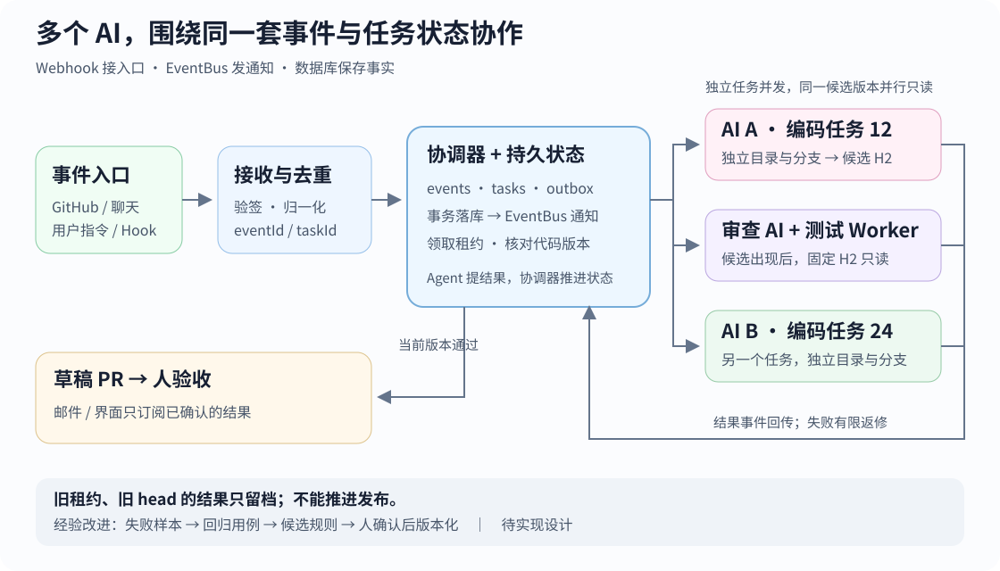

# Issue 自动化与 AI 协作：完整方案

围绕一个 Issue，串起修复、独立审查、通知与多 AI 演进。起步只做一次手动交付，定时、转发器与多 AI 在单次流程稳定后选读。<mark class="key">先完成一次可验收交付，再接持续流程</mark>。

<div class="heading-alias" id="workflow" aria-hidden="true"></div>
<div class="heading-alias" id="先认识今晚的搭档" aria-hidden="true"></div>
<div class="heading-alias" id="角色与职责" aria-hidden="true"></div>
<div class="heading-alias" id="一次夜班会发生什么" aria-hidden="true"></div>
<div class="heading-alias" id="处理流程" aria-hidden="true"></div>

## 完整流程

```text
人工定义 Issue 与验收条件
  → 手动或授权事件触发 → 领取已批准内容的 ai-ready 任务
  → 独立分支编码 → 同一提交的测试与独立审查
  → 不通过：原任务返修，最多两轮
  → 草稿 PR → 人工验收与合并 → 邮件通知
```

GitHub 保存任务与交付，Actions 或 Dot 安排执行，编码 Agent 提交改动，独立审查者只报告问题。合并决定由维护者作出。

[](../../site/public/diagrams/issue-garden/handoff.svg)

“扫描所有 Issue”与“执行哪些 Issue”分别决定。可以每天扫描指定仓库的全部未关闭问题，再从 `ai-ready` 中选择已批准内容的小问题；已经有待验收 PR 的任务跳过。批准者、任务内容和代码基线都需要明确，详见[接单规则与安全检查](03-night-shift.md#什么样的-issue-可以接单)。

这是一种建议的首版规则。API 示例仍为手动实验，任务摘要和独立检查解决部分已复现的问题；尚未完成面向不可信代码的远端隔离验收。

<div class="heading-alias" id="task" aria-hidden="true"></div>
<div class="heading-alias" id="写-issue-可以很短" aria-hidden="true"></div>
<div class="heading-alias" id="issue-最小描述" aria-hidden="true"></div>

## 任务约定

```text
现象：目录链接打开了错误页面。
复现：进入目录 → 点击 TTS 教程。
期望：打开中文语音合成教程。
验收：目标页正确，附近链接仍可用。
```

- **领取：** 维护者批准任务内容与代码基线，`ai-ready` 只作筛选；已有运行任务或待验 PR 时跳过。同一任务只有一个编码者。
- **隔离：** 每个任务独立目录、分支，记录 Issue、base/head SHA 与检查命令。
- **交付：** 保留 diff、复现前后结果、审查结论与待验项；新提交重新检查。
- **停止：** 无法复现、缺少条件、超时、额度不足或返修超限时，记录缺口并转人工。

任务状态由程序保存；提示词不能替代去重、截止时间与权限控制。

<div class="heading-alias" id="roadmap" aria-hidden="true"></div>
<div class="heading-alias" id="三班练习一班比一班多接一点活" aria-hidden="true"></div>
<div class="heading-alias" id="分阶段实践" aria-hidden="true"></div>

## 实施顺序与验收

| 阶段 | 完成条件 |
| --- | --- |
| 1 · 扫描 | Actions 生成 Issue 清单；无需 AI key |
| 2 · 单次交付 | 手动批准一个 `ai-ready` Issue 的具体内容，修复、验证并交草稿 PR |
| 3 · 审查返修 | 独立会话核对最终 head；确认的问题最多返修两轮 |
| 4 · 事件与通知 | 接标签或定时触发；新 Issue、新 PR、合并均收到 Outlook 邮件 |
| 5 · 多 AI | 先用两个假 Worker 演练，再接真实 Agent |

<div class="heading-alias" id="routes" aria-hidden="true"></div>

## 路线与费用

| 已有条件 | 路线 | 首轮目标 |
| --- | --- | --- |
| OpenAI API key | **Codex Action** | Actions 修复一个 Issue，独立验证后交草稿 PR |
| Dot／Codex 产品权限 | Dot + Cloud | 委派编码、独立审查与有限返修 |
| 希望用 Markdown 定义工作流 | Agentic Workflows | 编译为 Actions，经 safe outputs 提议 PR |
| 需要比较其他 Agent | Claude Code Action | 用评论触发编码或审查，另配所需凭据 |
| 跨平台连事件 | n8n 或自制转发器 | 先接事件，再接执行器与通知 |

**已有 API key，先用 Codex Action 手动跑一次。** Dot 使用产品额度；Codex Action／上述 Agentic Workflows 示例使用 OpenAI API 项目额度，Actions 用量另计。

<mark class="caution">ChatGPT 订阅额度与 API 额度分别计费</mark>。订阅赠额不含通过 API key 使用 Codex；其他赠额核对适用范围与到期日。预算告警、job 超时都不是硬性费用封顶。[费用范围](https://developers.openai.com/api/docs/guides/chatgpt-api-credits#what-the-credits-cover)

<div class="heading-alias" id="review" aria-hidden="true"></div>

## 独立审查与返修

编码者 A 修改，独立会话 B 审查；B 可用同模型新会话或另一模型。<mark class="key">测试与审查必须对应同一个 head SHA</mark>。

```text
审查输入：Issue、base/head SHA、diff、相关源码与检查结果。
审查输出：文件位置、触发条件、影响、验证方法。
处理规则：确认的问题交回 A；修改后重验重审，最多两轮。
```

B 只读提意见，区分已确认问题与证据不足的猜测；没有发现问题时直接说明。审查可能漏报、误报，仍需复现与人工验收。

按需补上 Issue 澄清、修复前失败／修复后通过的回归测试、浏览器验收与 CI 返修。验收摘要只列关键变化、证据与待判断项。

<div class="heading-alias" id="events" aria-hidden="true"></div>

## 触发与转发

| GitHub 机制 | 用途 |
| --- | --- |
| `workflow_dispatch` | 首轮手动运行 |
| `issues: labeled` | 添加标签后核对授权者、批准内容与基线，再领取 |
| `issue_comment` | 授权人的命令评论触发返修 |
| `schedule` | 定时扫描；实际启动时仍检查截止时间 |
| `repository_dispatch` | 聊天或监控等外部系统触发 Actions |

先用 GitHub 已有机制。<mark class="key">跨平台或跨仓库统一调度时，再增加转发器</mark>：

```text
GitHub / 聊天 / 告警 → 接收器 → 持久队列 → Agent → 验证 → 草稿 PR
```

- **接收：** 验证 GitHub 原始请求体签名，限制仓库、事件与触发人；入队后快速回 2XX。
- **去重：** `X-GitHub-Delivery` 防重复投递，任务表保证同一 Issue 不重复执行。
- **执行：** GitHub App 按需授权，Worker 隔离运行；重试沿用原任务、分支与 PR。
- **发布：** 验证与写入分开，干净 checkout 应用已验补丁；发布步骤不执行补丁脚本。

定时可能延迟，`concurrency` 只防运行重叠；跨次去重仍需查任务与 PR。Issue 正文、评论和外部内容作为数据读取，不直接拼入 shell。

<div class="heading-alias" id="notifications" aria-hidden="true"></div>

## GitHub → Outlook 通知

<mark class="key">优先原生邮件，无需 AI key 或 Outlook API</mark>。

1. [Settings → Emails](https://github.com/settings/emails)：添加并验证 Outlook 地址。
2. [Settings → Notifications](https://github.com/settings/notifications)：Watching／Participating 启用 **Email**，默认通知邮箱选 Outlook。
3. 仓库 **Watch → Custom**：勾选 **Issues、Pull requests**。
4. 需要接收当前账号的操作时，启用 **Your own updates**。

原生通知覆盖新 Issue、新 PR 和合并，也包括评论、评审。Outlook 可用规则归档 GitHub 邮件。

<details>
<summary>选读：只接收三类事件</summary>

| 事件 | Actions 条件 |
| --- | --- |
| 新 Issue | `issues: opened` |
| 新 PR | `pull_request_target: opened` |
| PR 合并 | `pull_request_target: closed` 且 `github.event.pull_request.merged == true` |

关闭对应原生邮件通知以免重复。工作流只读事件，不运行 PR 代码；发信需 SMTP／邮件 API，`GITHUB_TOKEN` 不能通用发信。机器人 PR 另测触发链，关闭但未合并的 PR 不发信。

</details>

<div class="heading-alias" id="multi-agent" aria-hidden="true"></div>

## 多 AI 演进

Webhook 接入口，EventBus 发通知，数据库保存任务事实。<mark class="key">通知可重发，状态必须可恢复</mark>。

| 组件 | 职责 |
| --- | --- |
| HTTP 接收器 | 验签、归一化事件、去重 |
| 协调器 + SQLite | 保存 `events / tasks / outbox`，管理任务状态、轮次与租约 |
| EventBus / 队列 | 提交通知、唤醒订阅者、安排 Worker |
| 独立 Worker | 编码，或并行只读测试与审查；回传结果 |

首版采用 **Node 协调器 + SQLite + 独立 Worker 进程**，本地 HTTP 或 IPC 通信。不同任务可并发；同任务只有一个编码者，测试与审查读取同一候选提交。

<details>
<summary>选读：架构图与状态约束</summary>

[](../../site/public/diagrams/issue-garden/multi-agent-event-bus.svg)

- 协调器唯一写库；事件、任务与 outbox 同事务落库，提交后再通知，定期补发未完成记录。
- Worker 领取带租约的子任务；租约过期重领时递增 `leaseEpoch`。
- 编码结果核对轮次、租约与领取时的 base，再登记新 head；测试与审查只认该 head。
- 旧租约、旧 head 的结果只留档；发布前按任务与固定分支查已有 PR，重试更新原交付。

```json
{
  "id": "evt-42", "causeId": "evt-41", "type": "candidate.ready",
  "taskId": "issue-12", "workId": "code-1",
  "attempt": 1, "leaseEpoch": 3,
  "baseSha": "B", "headSha": "H2", "artifact": "patch-42"
}
```

`id` 去重，`causeId` 串因果，`workId` 定子任务，`artifact` 指补丁；B/H2 保存完整 SHA。数据库事务不能保证远端副作用只发生一次。

多 AI 首轮验证三种故障：

1. **重投与重启：** 同一 Webhook 投两次，落库后重启，仍只有一个逻辑任务。
2. **抢单与迟到：** A 失联、B 取得新租约后，A 的旧结果不能推进或发布。
3. **版本变化：** H1 通过后出现 H2，H1 结论不能批准 H2；返修超限转人工。

比较不同路线时，固定同一基线与验收条件，分别记录正确性、用量、人工验收时间和合并后返工；单一样本不代表普遍优劣。

</details>

演进从失败样本开始：回归用例 → 候选规则 → 回归通过 → 人工确认后版本化。保留来源、适用范围与结果，任务记录所用规则版本。

<div class="heading-alias" id="implementation" aria-hidden="true"></div>

## 选读：配置与示例

<details>
<summary>执行时查阅具体配置</summary>

- **只读扫描**：[扫描工作流与分页](01-first-scan.md)。
- **手动修复**：[任务指令与交付模板](02-first-repair.md)。
- **持续处理**：[调度、截止时间、权限与发布](03-night-shift.md)。
- **Dot / Cloud**：[连接、环境与任务指令](04-dot-shift.md)。
- **Codex Action**：[API、独立验证与草稿 PR](05-codex-api.md)。
- **Agentic Workflows**：[编译、safe outputs 与后续 CI](06-agentic-workflows.md)。
- **同基线比较**：[三路线并行实验](../codex-cloud/05-issue-to-pr.md)。
- **本地运行控制**：[Harness 状态与恢复](../architecture/mac-local-harness.md)。

</details>

## 验证状态与来源

本页与 SVG 是教学及待实现方案；本仓库尚未启用持续领取、自动审查、邮件发信或多 AI 调度。记录核对日期：2026-10-21—11-01。

<details>
<summary>公开依据与案例</summary>

- 单次交付：[GitHub Secret Protection 团队案例](../ai-practices/02-issue-to-pr.md)；独立审查：[CodeRabbit 公开记录](../ai-practices/01-coderabbit-review.md)。
- 执行器：[Codex Action](https://github.com/openai/codex-action)、[Claude Code Action](https://github.com/anthropics/claude-code-action)、[Agentic Workflows](https://github.com/github/gh-aw)。后者仍为公开预览；[迭代记录](https://github.com/github/gh-aw/blob/main/CHANGELOG.md)含 2025-12、2026-01 更新。
- GitHub：[工作流触发](https://docs.github.com/en/actions/reference/workflows-and-actions/events-that-trigger-workflows)、[Webhook 实践](https://docs.github.com/en/webhooks/using-webhooks/best-practices-for-using-webhooks)、[验签](https://docs.github.com/en/webhooks/using-webhooks/validating-webhook-deliveries)、[邮件通知](https://docs.github.com/en/subscriptions-and-notifications/get-started/configuring-notifications)。
- 可视化接入：[n8n GitHub Trigger](https://github.com/n8n-io/n8n-docs/blob/main/docs/integrations/builtin/trigger-nodes/n8n-nodes-base.githubtrigger.md)，原调研仅核对触发节点。
- 其他实验：[故障驱动、自动实验、模拟验收、规格驱动与知识整理](../ai-ideas/02-five-new-directions.md)。

</details>
