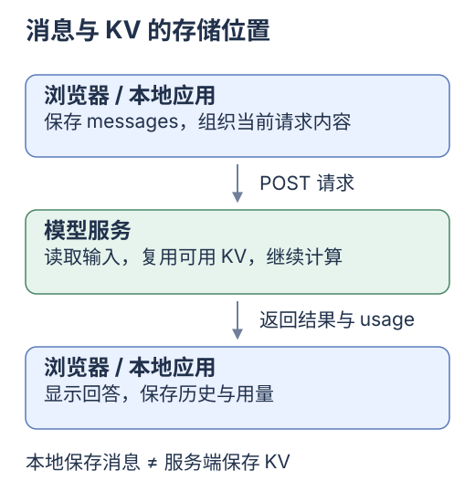
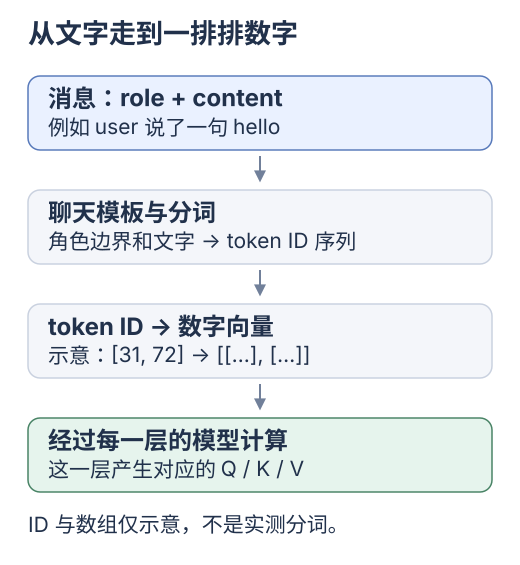

# 第一站：你发出一条消息，模型收到了什么？

[专题入口](README.md) · [下一站 前端数组与前缀](01-from-frontend.md)

**这一站只弄清：消息是什么，KV 又在哪里。** 先看图和 JavaScript，最后的术语可以按需展开。

## 第一步：先看你认识的消息数组

聊天页面里可以有这样一份数据：

```js
const messages = [
  { role: 'system', content: '请用中文简短回答。' },
  { role: 'user', content: '什么是缓存？' },
];
```

`role` 说明谁在说话；`content` 是说了什么。`system` 在这里放整体规则，`user` 放用户的输入。

**到这里，它还是普通的 JavaScript 数据。** 把数据转成 JSON 发给模型接口，只是请求流程的一段。

[](../../site/public/diagrams/kv-cache/02-request-journey.svg)

先只看两个位置：消息数组在客户端；本专题讨论的托管模型 KV 在服务端。

## 第二步：下一轮，仍然把需要的历史发过去

模型回答之后，你可以组织下一轮消息：

```js
const nextMessages = [
  ...messages,
  { role: 'assistant', content: '缓存会保留可复用的结果。' },
  { role: 'user', content: '那它为什么会失效？' },
];
```

这里的 `assistant` 表示模型此前的回答。`nextMessages` 是新数组，前两条消息的文字和顺序仍然保留。

**上下文**就是这次实际交给模型的内容。上面的例子包含规则、旧问题、旧回答和新问题；浏览器里保存着别的记录，并不代表它们也进入了这次请求。

本专题所读的 Yuuki Chat Completions 路径仍发送完整的 `system + history`。服务端缓存可以减少重复计算，但不能替应用补回没有发送的历史。[Yuuki 当前请求入口](../../examples/shared/runtime/Sources/main.swift:351)

## 第三步：文字进入模型后，会变成数字

先认两个新词就够了：

- **token**：模型处理序列中的一个单位；不固定等于一个字或一个单词。
- **向量**：这里先把它看成一个数字数组，例如 `[0.2, -0.1]`。

[](../../site/public/diagrams/kv-cache/03-token-vector.svg)

图里的 ID 和小数组都是示意。真实模型还要处理角色边界和其他控制标记，具体格式随模型而变。[Hugging Face 聊天模板](https://huggingface.co/docs/transformers/en/chat_templating)

文字经过模型各层计算，会产生后续能复用的一部分数字状态。KV Cache 保存的就是其中的 K/V；下一站先用累计和理解「为什么旧结果还能继续用」，再认识它们的正式含义。

## 这一站完成了

指着第一张图说出：**应用保存消息，模型服务保存推理缓存。** 能分清这两处，就可以停在这里。

下次直接从[前端数组：追加一项，哪些结果还有效](01-from-frontend.md)开始。

<details>
<summary>四种消息角色，以及 JSON 与模型输入的区别</summary>

| 角色 | 这个教程里的用途 |
| --- | --- |
| `system` | 整体规则与约束 |
| `user` | 用户输入 |
| `assistant` | 模型回答，也可能包含工具调用请求 |
| `tool` | 工具真正执行后返回的结果，需对应此前的调用 |

JSON 是接口传输的数据格式。模型接口会把消息按模板转换为模型实际读取的序列，所以 JSON 对象的结构与最终 token 序列不能简单画等号。研究缓存时要同时考虑内容、顺序、模板和模型配置。[模板原理](https://huggingface.co/docs/transformers/en/chat_templating)

接口可能采用不同的角色、字段和历史管理方式；上面的数组用于理解本专题的 Chat Completions 路径。

</details>
