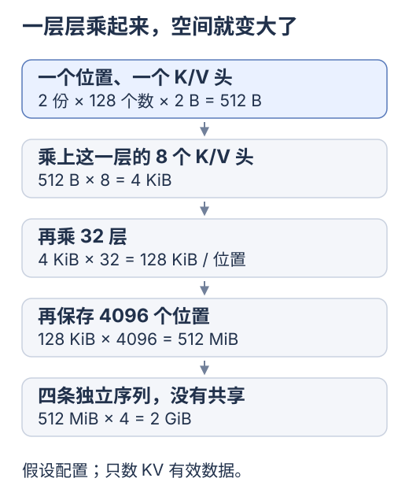

# 为什么 KV Cache 会这么大

[前端基础](../frontend-foundations/README.md) · [KV 专题](README.md) · [浏览器容量实验](../../site/src/pages/labs/kv-memory.astro)

最直接的原因是：**模型为许多位置、许多层和许多 K/V 头保存数值向量。** 单个数值可以很小，重复的维度会把总量乘大。

**这一站只看空间怎样一层层乘大。** 如果 Q/K/V 还陌生，先去[图解 Attention](02-attention-and-kv.md)，理解后再回来。这里不要求先背总公式。

## 先想一份前端的派生数据

一条消息的原文可能很短，但解析树、排版结果或图片解码后的像素，可以比原始输入大。输入大小和中间结果大小，取决于它们各自的表示。

模型同样把 token 转成数值表示，再逐层处理。K/V 缓存保存了供后续 Attention 使用的中间向量。它通过保留这些状态，避免每次从历史输入重新计算。[Hugging Face 缓存原理](https://huggingface.co/docs/transformers/en/cache_explanation)

## 从一个位置算到整段上下文

取一个假设的常规 GQA 配置：32 层，每层 8 个 K/V 头，每头 128 个数，每个数 2 字节，保存完整历史。

先把「头」理解成同一层里的一组 Attention 计算；保存 K/V 的头越多，需要留的数字就越多。下面每个框只比上一个框多乘一个因素。

图里使用二进制单位：`1 KiB = 1024 B`，`1 MiB = 1024 KiB`。B 是字节。「每个数 2 字节」是这个假设配置的精度选择，不能直接套到 JavaScript 普通数组上。

**先停一下：只把保存的位置翻倍，其他条件不变，KV 有效数据也翻倍。** 能解释这一点，就抓住了本篇的核心。

选读：逐项核对图中的字节数

| 保存范围 | 如何计算 | 有效数据量 |
| --- | --- | --- |
| 一个位置、一个头的 K | `128 × 2` | 256 B |
| 加上对应的 V | `256 × 2` | 512 B |
| 这一层的 8 个 K/V 头 | `512 × 8` | 4 KiB |
| 32 层的这个位置 | `4 KiB × 32` | 128 KiB |
| 一条序列的 4096 个位置 | `128 KiB × 4096` | 512 MiB |
| 四条独立序列，各 4096 个位置 | `512 MiB × 4` | 2 GiB |

这是对假设张量形状的元素计数，排除了共享、分配预留、模型权重与其他工作内存。常规 K/V 可按每层 `[序列数, K/V 头数, 已缓存长度, 每头维度]` 理解。[Hugging Face 缓存存储结构](https://huggingface.co/docs/transformers/en/cache_explanation#cache-storage-implementation)

打开[KV 内存计算器](../../site/src/pages/labs/kv-memory.astro)，每次只改一个参数。先把 token 数翻倍，再把 K/V 头数减半，观察两个变化是否抵消。

## 为什么要在每层保存

每层对当前表示使用自己的计算规则，更深层的向量还包含此前层处理上下文的结果。保存第一层的 K/V，无法直接代替后面所有层的状态。

可以借用前端处理链理解：原文、解析树、布局结果位于不同处理阶段，后一阶段的结果包含它自己的计算。这个类比解释分阶段保存；真实 Attention 的投影和多头机制见[原始 Transformer 论文](https://arxiv.org/html/1706.03762v7#S3.SS2)。

## 为什么重复出现同一个词还可能需要新的 KV

当前 token 相同，位置和前面的上下文仍可能不同。特别在深层，它们的表示可能已经不同。按单词建立一个 Map，无法表达完整依赖。

在[两层 Attention 实验](labs/attention-cache.mjs)中，将前缀 `A B` 改成 `A X`，同一位置 C 的第二层 K 随之改变。可以运行脚本直接验证这一点。

## 为什么不只保留原文

只保留输入，后续生成时仍可从头算出对应状态，但会重复执行已经做过的计算。KV Cache 的交换就是：保留较大的派生状态，减少下一步继续生成时的重复工作。

常规完整注意力的新 Query 仍需读取历史 K/V。历史越长，保留与读取的工作也越多。具体过程接着读[因果 Attention 与 KV Cache](02-attention-and-kv.md)。

**这一站完成了：缓存拿空间换取少做重复工作，容量要按具体布局估算。** 下次从[DeepSeek 的请求前缀](03-prefix-cache-and-yuuki.md)继续。

选读：先认识减少空间的方向，暂不要求选择方案

## 能从哪些乘数开始减少

| 方向 | 改变哪一部分 | 需要理解的条件 |
| --- | --- | --- |
| 更短或经过组织的上下文 | 保存的位置数量 | 保留完成任务需要的信息 |
| GQA | K/V 头数 | 属于模型架构，取决于所用模型 |
| 更低精度的 KV | 每元素字节数 | 要考虑数值误差与额外转换 |
| 滑动窗口等结构 | 某些层的历史长度 | 按模型的实际可见范围计算 |
| 兼容的共享前缀 | 不同请求间的重复状态 | 按引擎的共享、持久化和引用管理规则处理 |

GQA 的 K/V 头共享机制见[原始论文](https://arxiv.org/abs/2305.13245)，缓存精度、窗口和卸载的取舍见[Transformers 缓存策略](https://huggingface.co/docs/transformers/en/kv_cache)，跨请求复用接着看[前缀缓存与 Yuuki](03-prefix-cache-and-yuuki.md)。

先掌握容量由什么组成，再进入优化。这样遇到一个方案时，就能具体判断它是在减少有效数据、减少重复状态，还是改善分配与搬运。

