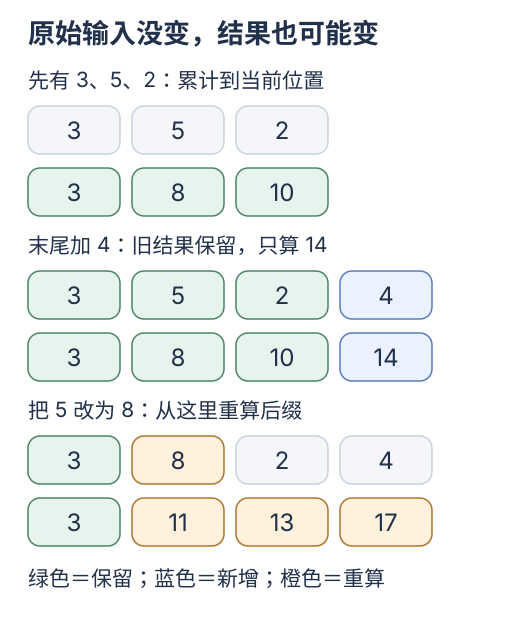

# 从前端数组到前缀复用

[上一站 一条消息的旅程](00-first-request.md) · [专题入口](README.md) · [下一站 因果 Attention](02-attention-and-kv.md)

**这一站只弄清：数组末尾多一项，哪些旧结果还能继续用。** 先用三个数字，暂时不引入模型公式。

## 第一步：区分输入和算出来的结果

你有三个输入，想显示「从开头累计到这里」的数字：

```js
const inputs = [3, 5, 2];
const totals = [3, 8, 10]; // 3；3 + 5；3 + 5 + 2
```

`inputs` 是原始数据，`totals` 是从它计算出来的**派生数据**。前端里的过滤列表、Markdown 解析结果，也属于派生数据。

现在往末尾加一个 `4`。旧的 `3、8、10` 不需要改变，只要接着算：

```js
const nextTotal = totals.at(-1) + 4; // 10 + 4 = 14
```

[](../../site/public/diagrams/kv-cache/04-prefix-change.svg)

先看图的中间一组：绿色旧结果保留，蓝色只算新增部分。这就是我们要研究的增量计算。

## 第二步：前缀是什么，为什么修改会往后传播

**前缀**就是从开头开始连续相同的一段。旧输入 `[3, 5, 2, 4]` 改成 `[3, 8, 2, 4]`，共同前缀只剩 `[3]`。

图的最后一组中，后面的输入 `2、4` 没变，累计结果却变了。因为第三项结果需要第二项累计值，第四项又需要第三项累计值。

**失效**表示旧结果已经不适合当前输入，需要重新计算。这里从第二项开始失效；不能看到后面的数字相同，就直接拿旧结果。

这给模型缓存搭起第一座桥：如果一个位置只依赖自己和前面的输入，末尾追加时，旧位置就有机会保持有效。模型为什么满足这个条件，留到[下一站](02-attention-and-kv.md)看图。

## 第三步：再回头看 useMemo

假设格式化每条消息的函数只依赖该消息的内容：

```jsx
const formatted = useMemo(
  () => messages.map(message => formatMessage(message.content)),
  [messages],
);
```

执行 `[...messages, nextMessage]` 得到新数组时，`messages` 这个依赖变了，React 会重新调用这里的计算。它不会自动把你写的 `map` 改成「只算最后一项」。[React useMemo](https://react.dev/reference/react/useMemo)

[](../../site/public/diagrams/kv-cache/05-cache-granularity.svg)

图上半部分是整个返回值的缓存；下半部分是计算自己实现的前缀复用。先问「缓存的单位是什么」，再问「它省了哪些工作」。React 的依赖数组使用 `Object.is` 比较；模型缓存还要判断模型输入与计算配置，不能把两者的有效条件直接画等号。

## 只跑一个小实验

在仓库根目录执行：

```bash
node docs/kv-cache/labs/prefix-cache.mjs
```

先只找「末尾追加」一行：复用 3 项，新算 1 项。再看「修改第 2 项」一行：只复用第一项，从第二项开始重算。

**这一站完成了：能解释为什么后面的输入没变，结果却可能变。** 今天可以停下；下次从[Q/K/V 是什么](02-attention-and-kv.md)接着读。

<details>
<summary>选读：并非所有数组计算都适合前缀复用</summary>

| 计算 | 依赖什么 | 末尾追加 | 修改中间 |
| --- | --- | --- | --- |
| 每项乘以 2 | 只依赖自己 | 只增加新结果 | 只改对应结果 |
| 累计和 | 到当前位置为止的前缀 | 旧结果有效 | 重算受影响后缀 |
| 每项除以整个数组总和 | 依赖所有输入 | 旧结果也可能变化 | 所有结果都可能变化 |

所以「追加了」本身不能证明缓存有效。固定宽度的独立消息行，和依赖全文的布局、引用解析、统计，也需要分别判断。[流式输出与渲染](../learning/rendering-performance.md)

</details>

<details>
<summary>选读：缓存键还要考虑配置；完整实验数据</summary>

实验的规则是 `total = previousTotal + currentInput * scale`。`scale` 是倍率配置；它变化时，即使输入相同，旧结果也必须失效。

| 操作 | 新输入 | 倍率 | 复用项数 | 新算项数 | 累计结果 |
| --- | --- | --- | --- | --- | --- |
| 首次计算 | `[3, 5, 2]` | 1 | 0 | 3 | `[3, 8, 10]` |
| 末尾追加 | `[3, 5, 2, 4]` | 1 | 3 | 1 | `[3, 8, 10, 14]` |
| 输入不变 | `[3, 5, 2, 4]` | 1 | 4 | 0 | `[3, 8, 10, 14]` |
| 修改第 2 项 | `[3, 8, 2, 4]` | 1 | 1 | 3 | `[3, 11, 13, 17]` |
| 截短序列 | `[3, 8]` | 1 | 2 | 0 | `[3, 11]` |
| 配置改变 | `[3, 8]` | 2 | 0 | 2 | `[6, 22]` |
| 清空 | `[]` | 2 | 0 | 0 | `[]` |

类似地，文本解析结果要考虑文本、解析选项和解析器版本；布局结果还要考虑可用宽度、字体与字号。缓存键需要覆盖实际的计算依赖。

查找共同前缀仍需要扫描，保存状态也占空间。表中的数字只统计派生项数，不能当成真实加速倍数。

</details>

<details>
<summary>选做：故意让配置失效判断漏掉一个条件</summary>

在[实验脚本](labs/prefix-cache.mjs)的副本里，把相同配置判断 `previous?.scale === scale` 改成仅检查 `previous` 是否存在。配置改变一行会触发断言，因为旧结果仍按倍率 1 保存。改回条件，检查结果恢复一致。

也可以把实验中出现的 `8` 一致改成 `9`，先预测累计结果，再运行核对。实验断言用来发现错误，不应为了通过而删去。

</details>
