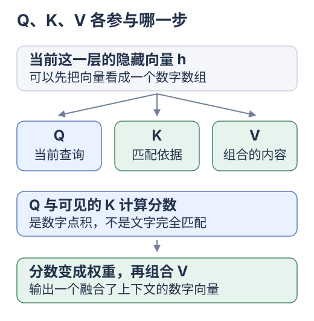
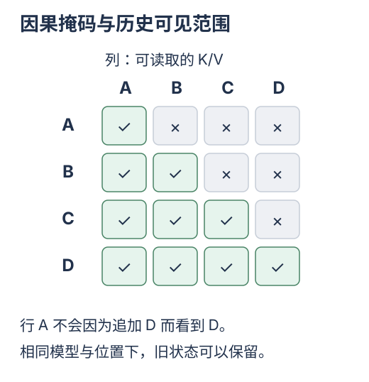
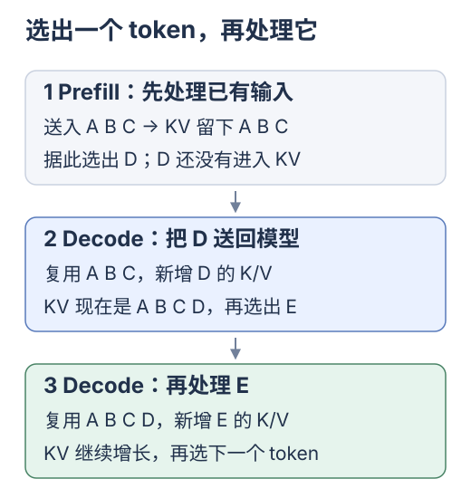

# 从因果 Attention 到 KV Cache

[专题入口](README.md) · [上一篇 前端增量计算](01-from-frontend.md) · [下一篇 前缀缓存与 Yuuki](03-prefix-cache-and-yuuki.md)

用数组认识 Q/K/V 与因果复用；公式和完整实验按需展开。

<div class="heading-alias" id="先把模型里的数据看成数组" aria-hidden="true"></div>

## 模型数据的数组表示

模型把 token ID 转成向量，再逐层处理。实验用 `A B C D` 和固定数组表示这个过程。

| 名称 | 数据形态 | 作用 |
| --- | --- | --- |
| token ID | 一个整数 | 指向词表中的一项 |
| 隐藏向量 `h` | 一个数值数组 | 当前层对这个位置的表示 |
| 模型权重 `W` | 固定的数值矩阵 | 把输入向量变换到不同表示空间 |
| K/V 缓存 | 按层、位置保存的向量集合 | 复用已经处理过的位置状态 |

权重是规则，KV 是当前输入的中间结果；相同权重处理不同输入，状态仍会不同。

一层就是一个处理阶段；下一层继续变换上一层的数字。

## Q K V 各自参与哪一步

分工：<mark class="key">Q 发起读取，K 参与配权，V 被加权组合</mark>。

[](../../site/public/diagrams/kv-cache/06-qkv.svg)

配比由当前 Q 与可见 K 算出，如第一组 V 占 25%、第二组占 75%，随位置变化。

**模型权重**是训练得到的参数；**注意力权重**是本次算出的配比，会随输入变化。

Attention 对多个可见 K 评分并组合 V，不是 `Map.get(key)` 查同一个业务键。

<details>
<summary>用 JavaScript 算一次分数</summary>

「点积」就是对应项相乘，再加起来：

```js
const q = [1, 2];
const k = [2, 1];
const score = q.reduce((sum, value, i) => sum + value * k[i], 0);
// 1 * 2 + 2 * 1 = 4
```

各可见 K 得分后，缩放并经 softmax 转为非负、总和为 1 的权重。如 `[0.25, 0.75]` 组合 V `[10, 0]`、`[0, 20]`，得到 `[2.5, 15]`。

这是运算示意，不代表这几个数字拥有固定的语言含义。

</details>

<details>
<summary>投影、伪代码和单头公式</summary>

单头先将隐藏向量线性投影为 Q/K/V；Q 与可见 K 点积、缩放、softmax 后，加权组合 V。[论文第 3.2 节](https://arxiv.org/html/1706.03762v7#S3.SS2)

对应伪代码：

```js
query = project(hidden, queryWeights);
scores = visibleKeys.map(key => dot(query, key) / Math.sqrt(headDimension));
weights = softmax(scores);
attentionOutput = weightedSum(weights, visibleValues);
```

对应的单头公式是：

```text
Attention(q, K, V) = softmax(q Kᵀ / √d) V
```

`d` 是 Q/K 维度；因果约束可限制 K/V 范围，或在 softmax 前屏蔽不可见位置。

</details>

## 因果约束让旧位置保持有效

**因果**：只读自身与前面的位置；**mask**：屏蔽不允许读取的位置。

[](../../site/public/diagrams/kv-cache/07-causal-mask.svg)

末尾加 D 后，A 仍看不见 D，无需改变旧计算；每层都成立才可复用历史 K/V。

<details>
<summary>因果可见范围</summary>

| 正在计算的位置 | 可以读取的位置 |
| --- | --- |
| A | A |
| B | A B |
| C | A B C |
| D | A B C D |

</details>

追加 D 不改 A/B/C 各层可见前缀；模型、位置与配置一致时，旧表示和 K/V 仍有效。[缓存原理](https://huggingface.co/docs/transformers/en/cache_explanation)

B 改成 X 时，C 的 token、位置未变，可见前缀却变了，深层状态仍可能失效，方向与累计和相同。

## Prefill 和 Decode 怎么衔接

**Prefill** 处理已有输入并填充缓存，**Decode** 逐步处理新 token。两阶段可采用不同的计算路径。[TensorRT-LLM 的上下文与生成阶段](https://nvidia.github.io/TensorRT-LLM/advanced/gpt-attention.html#context-and-generation-phases)

[](../../site/public/diagrams/kv-cache/08-prefill-decode.svg)

<details>
<summary>输入与缓存长度对照</summary>

下面假设没有命中的跨请求前缀，使用普通的一次预测一个 token 的生成循环：

| 阶段 | 本步输入 token | 计算完成后的 KV | 根据输出选出下一个 token |
| --- | --- | --- | --- |
| Prefill | A B C | A B C 的 K/V | D |
| 第一次 Decode | D | A B C D 的 K/V | E |
| 第二次 Decode | E | A B C D E 的 K/V | F |

</details>

<mark class="caution">选出 D 不等于已缓存 D 的 K/V</mark>；下一步把 D 作为输入处理后才缓存。

D 新算自己的 Q/K/V，再用 Q 读取全部可见 K、组合 V。历史 Q 属于旧查询，新位置不用它，所以常规缓存只保留 K/V。[缓存更新](https://huggingface.co/docs/transformers/en/cache_explanation#attention-matrices)

**旧 K/V 留下，新位置用自己的 Q 读取它们。**

## 用 JavaScript 比较两条计算路径

运行[两层因果 Attention 实验](labs/attention-cache.mjs)：

```bash
node docs/kv-cache/labs/attention-cache.mjs
```

查“新 token D”：新算 K/V 从 8 组降为 2 组，QK 点积仍有 8 次。省重算，不省历史读取。

<details>
<summary>实验范围、函数入口和完整计数</summary>

实验使用固定二维向量、两层单头、残差与简单位置输入；不包含分词、训练、归一化、MLP 或词表采样。

函数职责：

1. `fullForward` 在每层重新处理整个序列，作为数值基线。
2. `appendToken` 只处理新 token，并在每层追加 K/V。
3. `checkResult` 对照最后位置输出，以及每一层、每个位置的 K/V。

脚本中的“一组 K/V”指一个位置在一层中的 K 与 V；QK 点积按查询与键的配对次数计数。

| 场景 | 从头算 K/V 组 | 缓存路径新算 K/V 组 | 从头算 QK 点积 | 缓存路径 QK 点积 |
| --- | --- | --- | --- | --- |
| 首次输入 A B C | 6 | 6 | 12 | 12 |
| 追加 D | 8 | 2 | 20 | 8 |
| 将 B 改为 X 后重算后缀 | 8 | 6 | 20 | 18 |

两路径误差须小于 `1e-12`。实验首次输入逐 token 执行，真实 Prefill 可并行；计数不等于真实加速倍数。

追加 D：两层各新算一组 K/V，共 2 组；每层 Q 读取 4 个 K，共 8 次点积。

第三行各层截到共同前缀 A，再处理 X/C/D；C 的第二层 K 随前缀改变。只按 token ID 查深层 K/V 会漏掉此依赖。

</details>

确认两条路径结果一致，再指出省下的工作。接着读[DeepSeek 请求](03-prefix-cache-and-yuuki.md)或[容量图解](00-why-so-large.md)。

<details>
<summary>常规 KV 的内存公式</summary>

## 估算常规 KV 缓存的内存

各层保存完整 K/V、头维度相同的常规 MHA/GQA，可按元素数估算：

```text
字节数 = 2 × B × L × T × H_kv × D × s

2     K 和 V 两份
B     相同长度的序列数量
L     层数
T     每条序列已缓存的 token 数
H_kv  每层 K/V 头数
D     每个头的向量维度
s     每个元素的字节数
```

每层通常按 `[B, H_kv, T, D]` 计元素。[存储结构](https://huggingface.co/docs/transformers/en/cache_explanation#cache-storage-implementation)

假设 `B=1`、`L=32`、`T=4096`、`H_kv=8`、`D=128`、每元素 2 字节，得 `536,870,912` 字节，即 **512 MiB**。同结构下长度或序列数翻倍，数据也翻倍。

此数只含 KV 元素；权重、临时张量、分配和预留另计。JS 对象与 `Number` 也不是该布局。

GQA 让一组 Query 头共享 K/V 头，因此估算时使用 `H_kv`，不能直接拿 Query 头数代入。[GQA 原始论文](https://arxiv.org/abs/2305.13245)

滑窗限制历史长度，静态预分配、量化各有容量与速度取舍，须按实际布局重算。[缓存策略](https://huggingface.co/docs/transformers/en/kv_cache)

</details>

## 检查理解

<details class="qa">
<summary>追加 D 能复用 C，修改 B 为什么可能不行？</summary>

追加未来内容不改变 C 的可见前缀；修改 B 则改变了它，深层状态可能失效。

</details>

<details class="qa">
<summary>有历史 KV，为什么还要算 QK 点积？</summary>

读取配比取决于当前 Q 与可见 K，当前查询仍需计算。

</details>

<details class="qa">
<summary>历史更长，为什么仍然更贵？</summary>

缓存更大，新查询需要读取和组合的历史状态也更多。

</details>

下一步：[前缀缓存与 Yuuki](03-prefix-cache-and-yuuki.md)。
