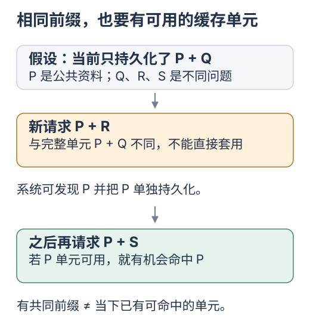
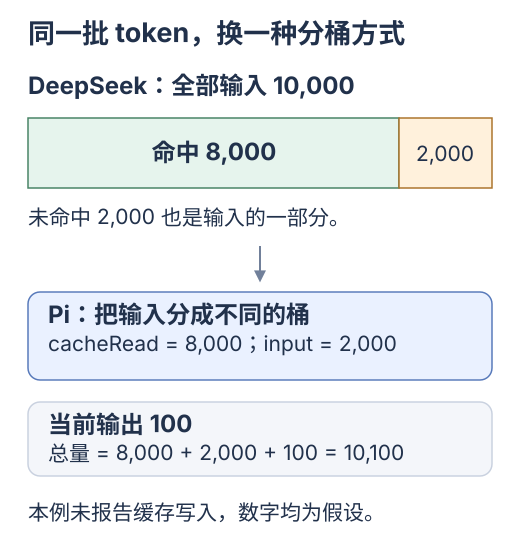

# 从前缀复用回到 Yuuki

[专题入口](README.md) · [上一篇 因果 Attention 与 KV Cache](02-attention-and-kv.md) · [下一篇 DeepSeek Harness](04-deepseek-harness.md)

你已经知道生成新 token 时怎样复用历史 K/V。Agent 还有另一种重复：每轮调用都把 system、历史对话和工具结果发给模型。理解跨请求前缀复用，可以把模型内部原理连接到前端开发者实际组织的请求。

**这一站只看：两次请求前面相同的部分，服务端有没有重新计算。** 先用前端数组圈出相同内容，再看接口报告。

## 先用数组找到不变的部分

```js
const stable = ['整体规则', '固定资料'];
const requestA = [...stable, '问题 Q'];
const requestB = [...stable, '问题 R'];
```

这是消息内容的简写，实际请求还需要角色等字段。两次请求都带着规则和资料，只在末尾换了问题。应用仍会发送所需内容；服务端可以尝试复用前部已经算过的状态。

先记住这个分工：**客户端负责把正确内容发过去，服务端负责判断哪些计算能复用。** JavaScript 数组里看起来相同，仍需按供应商的分词、模板和缓存规则判断。

## 两种复用发生在不同范围

| 机制 | 复用范围 | 主要减少的工作 |
| --- | --- | --- |
| 生成循环中的 KV Cache | 同一次生成过程的已有位置 | 每步重复处理历史位置 |
| 跨请求 Prefix Caching | 已处理请求与新请求的相同前缀 | 新请求中可复用前缀的 Prefill |

前缀缓存复用已有 K/V，后续输出继续由模型计算。vLLM 的自动前缀缓存说明也明确，它减少 Prefill 工作，对后续逐 token 的 Decode 并不直接提供同样的省算效果。[vLLM 自动前缀缓存](https://docs.vllm.ai/en/latest/features/automatic_prefix_caching/)

因此要分别观察“多久开始回答”和“回答开始后生成得多快”。它们对应的工作不同。

## 复用条件包含此前的上下文

把两次请求简写成 token 序列：

```text
第一次  A B C D
第二次  A X C D
```

两次后面的 C/D 相同，深层 K/V 仍可能不同。它们携带了各自前缀的影响，上一节的 Attention 实验已经展示了这一点。

vLLM 的一种具体实现把 KV 分块，块的标识结合父块哈希、当前块 token 和额外配置身份。这样，相同后缀出现在不同前缀之后，会得到不同的缓存身份。这与前端构建缓存考虑输入和依赖的思路相通。[vLLM 前缀缓存设计](https://docs.vllm.ai/en/latest/design/prefix_caching/)

在本地推理中复用状态，还要保持模型与相关配置兼容，并正确管理 token 位置与可见范围；调用托管 API 时，这些底层工作由供应商管理。应用负责提供语义正确的上下文。

## 从前端请求组织开始改善复用机会

考虑一组对同一份资料提问的请求，先固定资料和规则，再追加问题：

```js
const messages = [
  { role: 'system', content: stableInstructions },
  { role: 'user', content: stableDocument },
  { role: 'user', content: currentQuestion },
];
```

如果每次都改动靠前的说明，后面的长资料就不再处于相同前缀之下。这个依赖关系说明了为什么稳定内容的位置值得关注。实际命中长度还取决于服务端的模板、分词和缓存单元。

在保证指令语义和对话关系正确的前提下，可以检查三个地方：

- 固定说明是否混入了每次变化的时间、随机 ID 等内容。
- 历史消息是否持续保留内容与顺序，工具调用和结果是否仍然配对。
- 必要的动态上下文能否放在较晚位置，同时让模型清楚理解它的作用。

这是一种基于前缀依赖的组织方法；具体 API 的缓存行为应按供应商规则观察。

## DeepSeek 的规则要看已持久化的前缀单元

**持久化**在这里指把算好的前缀状态写入可复用的缓存。**命中**指这次真的用到了对应缓存；有共同前缀只是条件之一。

[](../../site/public/diagrams/kv-cache/10-prefix-persistence.svg)

先只跟着 P 走：资料虽然一直相同，也要先有一个当前可用的 P 缓存单元。这张图不承诺第几次一定命中。

截至 2026-10-24，DeepSeek 官方说明上下文缓存默认启用。后续请求需要完整匹配已经持久化的前缀单元，才具备对应命中的条件。单元可以在请求边界、公共前缀发现后或长序列的固定间隔处形成。[DeepSeek 上下文缓存](https://api-docs.deepseek.com/guides/kv_cache/)

假设服务端当前只持久化了 `P + Q`。新请求 `P + R` 虽然与它共享 P，却不能直接复用完整的 `P + Q` 单元；系统可以在发现公共前缀后持久化 P，之后的请求才可能复用 P。官方文档中的这个边界，说明相同前缀与已具备命中条件需要分别考虑。

用响应中的这两个字段看实际结果：

| 字段 | 含义 |
| --- | --- |
| `usage.prompt_cache_hit_tokens` | 输入中命中缓存的 token 数 |
| `usage.prompt_cache_miss_tokens` | 输入中未命中缓存的 token 数 |

缓存属于尽力提供；持久化与清理都影响命中。命中前缀后，新的输出仍然通过推理生成。[DeepSeek 命中统计与补充说明](https://api-docs.deepseek.com/guides/kv_cache/)

## 先核对用量口径，再算命中率

**usage** 是接口返回的用量统计。把它想成响应里的一张计数单，先只看「全部输入」和「命中了多少」。

[](../../site/public/diagrams/kv-cache/11-usage-buckets.svg)

图中绿色与橙色加起来，才是全部输入。缓存命中减少了重复工作，没有把这批输入从上下文里删除。

下面是一份**用于算账的假设响应**，不是本仓库的实测结果：

```json
{
  "prompt_tokens": 10000,
  "prompt_cache_hit_tokens": 8000,
  "prompt_cache_miss_tokens": 2000,
  "completion_tokens": 100,
  "total_tokens": 10100
}
```

DeepSeek Chat Completions 的 `prompt_tokens` 已包含命中部分，等于 `hit + miss`。因此这里的命中率是 80%，总输入仍为 10,000；不能再把 8,000 加到 `prompt_tokens` 上。当前接口还可通过 `prompt_tokens_details.cached_tokens` 报告同一批命中 token，两者也不能相加。[DeepSeek 响应字段](https://api-docs.deepseek.com/api/create-chat-completion/)

在这个口径下，输入费用可以写成 `(hit × 命中输入单价 + miss × 未命中输入单价) / 1,000,000`，单价单位为每百万 token。实验当天从[官方价格页](https://api-docs.deepseek.com/quick_start/pricing)取对应模型的价格，输出费用另计。缓存复用改变计算和计费路径，并没有把上下文长度压缩为 2,000。

Pi 和 DeepSeek Harness 的内部字段采用分桶计数，`input` / `inputTokens` 表示未缓存输入，缓存读取另列。对照上述例子，Pi 会得到 `input=2000`、`cacheRead=8000`。转换过程见[Pi 源码篇](05-pi.md)。另外，`miss` 表示未命中，不能直接改名为 `cacheWrite`；是否写入、是否报告写入，是另一个问题。

**这一站完成了：能读出 10,000 个输入中，8,000 个命中。** 可以先停下；下次看 [Harness 怎样组织这些请求](04-deepseek-harness.md)。下面保留实际研究时要查的细节。

<details>
<summary>选读：SSE 流式响应在哪里取 usage</summary>

### 流式响应在哪里取 usage

**SSE** 是服务端持续向客户端发送事件的一种方式。一个 chunk 是这条流中的一段数据，不保证刚好对应一个 token。

当前 DeepSeek 文档说明：`[DONE]` 前的最后一个完成 chunk 携带整次请求的用量，它仍有一个 `choices` 元素，不另发专门的空 `choices` 用量包。`include_usage: true` 还会让此前 chunk 带上值为 `null` 的 `usage`。解析时检查有效用量对象，不要只处理 `choices: []`。[DeepSeek 流式选项](https://api-docs.deepseek.com/api/create-chat-completion/)

中断可能发生在最终用量到达之前；这种请求的用量应保留为未知。若使用 thinking 模式，还应分别记录首次 reasoning、首次回答文本的时刻，避免把推理阶段的输出误当成最终回答已经出现。

</details>

<details>
<summary>选读：回到 Yuuki 源码，找到请求与观测入口</summary>

## 在 Yuuki 源码里读一次请求

从共享运行时 [Sources/main.swift](../../examples/shared/runtime/Sources/main.swift) 开始，按符号定位：

| 入口 | 当前实现 | 与本专题的联系 |
| --- | --- | --- |
| `history` | 保存供应商对话上下文 | 是后续请求携带的消息数据 |
| `completion` 中的 `system` 和 `payload` | 把 `system + history` 放入 `messages`，按工作区提供工具定义 | 可以检查哪些内容构成稳定前缀 |
| `run` | 追加 assistant 消息和 tool 结果，再进入下一轮调用 | 对话前缀逐轮增长 |
| `completion` 中的 `usageRecorded` | 累加输入、输出、总 token，记录未报告用量的请求 | 可在这里继续理解缓存观测要增加什么 |

当前 `system` 包含工作区路径。改变工作区会改变请求前部的内容；这能直接连接“依赖改变，缓存身份也要改变”的原理。当前用量处理尚未读取缓存命中与未命中字段。

应用保存的 `history` 是消息数据，推理端的 K/V 是由消息经过模型计算产生的状态。即使供应商可能复用前缀，当前 Chat Completions 调用仍按代码发送完整的 `system + history`；缓存不会替应用补齐遗漏的对话。

## 下一次接入观测时记录什么

先按单次请求理解数据，避免把多轮 Agent 总耗时和一次模型请求混在一起：

| 观测值 | 建议定义 | 阅读结果时需要考虑什么 |
| --- | --- | --- |
| 命中与未命中 token | 保存供应商实际报告的两个字段 | 未返回字段的请求记录为未知 |
| 命中比例 | 两个字段有效且总和大于 0 时，`hit / (hit + miss)` | 比较相近输入长度，保留原始数量 |
| 客户端首段文本等待时间 | 从发起请求到收到首个非空 `delta.content` | 包含网络、排队和服务端处理等时间；纯工具响应可能没有文本 |
| 请求总耗时 | 从发起请求到完整结束或失败 | 输出长度、工具请求和中断情况都会影响解释 |
| UI 首次显示时间 | 从发起请求到界面实际展示文本 | 还包含运行时批量发布与 UI 更新开销 |

当前运行时会合并文本增量再发布给 UI。网络接收、运行时发布、界面显示是不同时间点；另外，一段 SSE 文本也可能包含多个 token。沿源码的 `publish` 和 `delta` 分支阅读，再回到[流式输出的渲染说明](../learning/rendering-performance.md)，可以把这几个阶段连起来。

</details>

<details>
<summary>准备动手时再展开：一次只改一个因素的 API 实验</summary>

## 准备一次有对照的 API 实验

这是后续研究步骤，本文没有发起付费请求。先用同一模型、端点、账号和配置，准备一份固定资料 P，以及三个短问题 Q/R/S。

| 请求 | 只改变什么 | 想检验什么 |
| --- | --- | --- |
| `P + Q` | 首次提交 | 建立基线；不要假定服务端一定是冷缓存 |
| `P + Q` | 输入保持相同 | 已持久化的完整前缀是否被复用 |
| `P + R`，随后 `P + S` | 只改末尾问题 | 发现共同前缀 P，与之后真正命中 P 的区别 |
| `P′ + S` | 修改 P 开头一处内容 | 前部变化怎样影响后面的复用 |

每次等请求完成并留出缓存构建时间；官方说明构建需要数秒，不能把紧接着的未命中直接归为 Harness 错误。用多组短请求重复观察，保留所有命中与未命中结果。[DeepSeek 缓存生命周期](https://api-docs.deepseek.com/guides/kv_cache/)

记录模型 ID、请求顺序、间隔、输入/输出长度、原始 usage、首段文本等待时间和结束状态。第一次对照先固定工具定义，暂不同时改变摘要、模型或工具清单。想研究工具循环时，再加入一次完整的 `assistant tool_call → tool result` 往返。

**验收先看缓存字段，再看延迟分布。** 单次变快可能来自网络或排队；单次未命中也不能证明前缀不可复用。输出文字变化则不能证明缓存失效，因为输出仍然重新生成。

## 后续深入的方向

| 继续追问的问题 | 对应内容 | 阅读入口 |
| --- | --- | --- |
| 能否减少每个 token 保存的向量数量 | GQA 共享 K/V 头 | [GQA 原始论文](https://arxiv.org/abs/2305.13245) |
| 长度增长时如何管理缓存容量 | 动态、静态、滑动窗口、量化与卸载 | [Transformers 缓存策略](https://huggingface.co/docs/transformers/en/kv_cache) |
| 多个请求怎样标识和复用共同前缀 | 分块、父前缀身份和缓存生命周期 | [vLLM 前缀缓存设计](https://docs.vllm.ai/en/latest/design/prefix_caching/) |

第一轮先完成一次解释：从“前端派生结果依赖什么”，讲到“因果 Attention 的旧 K/V 为什么有效”，最后在 Yuuki 中指出谁组织请求、谁持有推理状态、谁报告缓存命中。

接着阅读[DeepSeek Harness 怎样保住请求前缀](04-deepseek-harness.md)，看真实工程怎样处理动态提示、工具顺序和缓存统计。

</details>
