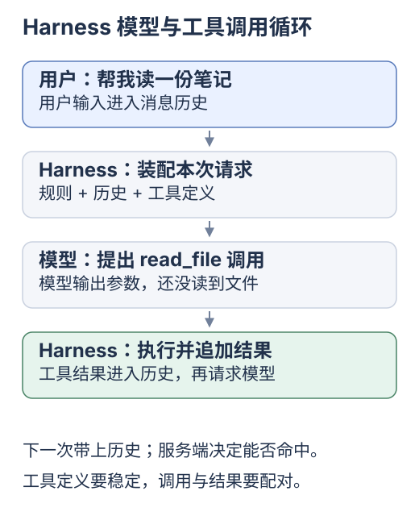
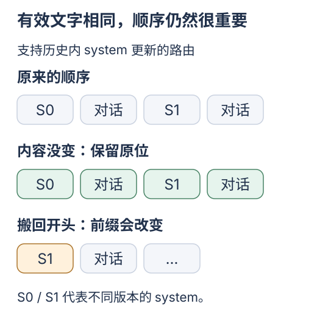

# DeepSeek Harness：怎样保住可复用的请求前缀

[专题入口](README.md) · [上一篇 DeepSeek 缓存规则](03-prefix-cache-and-yuuki.md) · [下一篇 Pi](05-pi.md)

服务端管理 KV，Harness 组织请求。读 `dsh` 时追踪<mark class="key">工具调用后保留了多少原样前缀</mark>。

## 从请求函数理解 Harness

模型提出 `read_file`，Harness 执行并把结果加入下一轮请求。

**装配上下文**：决定本次发送的消息、规则与工具定义。

职责划分：模型提议、Harness 执行与装配、服务端判断缓存命中。

源码追踪：一个判断、五个入口

## 文本未变化时的投影分支

打开 [`SystemPromptProjection.project`](https://github.com/deepseek-ai/deepseek-harness/blob/22ddee3792402c3e70ec5f86a63c3e3e895a2f60/packages/core/agent-loop/src/runtime-context.ts#L88)，找文本一致时返回空更新的分支，再查新请求序列条件。

前缀身份包含内容、位置和序列；system 文本相同，移动位置仍可能损失缓存。

## 沿五个入口读一次请求

| 源码入口 | 追踪什么 | 与缓存的关系 |
| --- | --- | --- |
| [`system-prompt/src/index.ts`](https://github.com/deepseek-ai/deepseek-harness/blob/22ddee3792402c3e70ec5f86a63c3e3e895a2f60/packages/core/system-prompt/src/index.ts#L211) | section、动态 context 和工具装配 | 固定规则与易变内容如何进入请求；工具怎样确定顺序 |
| [`agent-loop/src/agent.ts`](https://github.com/deepseek-ai/deepseek-harness/blob/22ddee3792402c3e70ec5f86a63c3e3e895a2f60/packages/core/agent-loop/src/agent.ts#L439) | 每一步装配、投影与提交 | 工具往返和新序列边界何时改变历史 |
| [`runtime-context.ts`](https://github.com/deepseek-ai/deepseek-harness/blob/22ddee3792402c3e70ec5f86a63c3e3e895a2f60/packages/core/agent-loop/src/runtime-context.ts#L59) | `SystemPromptProjection`、`RuntimeContextProjection` | 未变化的提示保留原位；动态快照只在内容变化时产生候选消息 |
| [`llm-pi-ai/src/adapter.ts`](https://github.com/deepseek-ai/deepseek-harness/blob/22ddee3792402c3e70ec5f86a63c3e3e895a2f60/packages/llm/llm-pi-ai/src/adapter.ts#L126) | `profileOptions` | 把 `cacheRetention` 等选项传入 Pi 的模型层 |
| [`llm-pi-ai/src/stream.ts`](https://github.com/deepseek-ai/deepseek-harness/blob/22ddee3792402c3e70ec5f86a63c3e3e895a2f60/packages/llm/llm-pi-ai/src/stream.ts#L19) | `mapUsage` | 把 Pi 的用量转成 Harness 的流式统计 |

路径：`会话与插件贡献 → 装配请求 → 供应商适配 → 模型服务 → 用量回写`；服务端才保存、匹配 KV。

## 三项工程选择

### 1. 给工具一个确定的顺序

`orderTools` 默认按名称排序；有 `toolOrder` 时先按配置，其余仍保持确定顺序。上游测试了相反注册顺序输出相同列表。[源码](https://github.com/deepseek-ai/deepseek-harness/blob/22ddee3792402c3e70ec5f86a63c3e3e895a2f60/packages/core/system-prompt/src/index.ts#L225)、[测试](https://github.com/deepseek-ai/deepseek-harness/blob/22ddee3792402c3e70ec5f86a63c3e3e895a2f60/packages/core/system-prompt/tests/tool-order.spec.ts#L26)

排序减少加载差异；实际命中还取决于供应商编码，稳定数组不证明命中。

### 2. 动态上下文变化时，再留下新快照

快照保存某时刻内容；投影从记录生成本次表示，类似 state 到视图。

`RuntimeContextProjection.project` 在内容与快照相同时不更新；进程路径、端点归 runtime context 管理。[投影](https://github.com/deepseek-ai/deepseek-harness/blob/22ddee3792402c3e70ec5f86a63c3e3e895a2f60/packages/core/agent-loop/src/runtime-context.ts#L151)、[分区](https://github.com/deepseek-ai/deepseek-harness/blob/22ddee3792402c3e70ec5f86a63c3e3e895a2f60/packages/core/system-prompt/src/index.ts#L178)

未变的内容不重复追加；时间、工作区等必要变化仍需告诉模型。

### 3. 支持历史内 system 更新的路由，才保留这种布局

**路由**包括模型接口与能力；图中 S0 / S1 分别是旧、新规则。

最终指令相同，不代表输入序列相同；移动位置也可能破坏前缀。

`SystemPromptProjection` 按 `inHistory`、当前提示和序列边界选择追加、保留原位或重建头部；<mark class="caution">不能对所有接口一律后加 system</mark>。

上游[修复记录](https://github.com/deepseek-ai/deepseek-harness/blob/22ddee3792402c3e70ec5f86a63c3e3e895a2f60/.agents/notes/implemented/bug-fix/2026-10-22-series-start-unchanged-prompt-prefix.md)：局部历史替换开启新序列时，相同 system 曾被搬回头部；修复后保持原位。本仓库未复现其运行数据。

工具顺序、快照与规则位置都影响前缀。下一篇看 [Pi 用量转换](05-pi.md)。

dsh 与 Pi 的关系，以及两个适配层的字段

## 与 Pi 的关系：模型适配层可以复用

适配器把应用数据转成供应商请求，再把响应转回。

`@deepseek-ai/dsh-llm-pi-ai` 依赖 `@earendil-works/pi-ai`，同仓另有专用 `llm-deepseek`。[包声明](https://github.com/deepseek-ai/deepseek-harness/blob/22ddee3792402c3e70ec5f86a63c3e3e895a2f60/packages/llm/llm-pi-ai/package.json)

复用 Pi 模型层不等于复用它的 Agent 循环；下一篇的独立快照也不代表 dsh 安装的依赖版本。

`mapUsage` 的对应关系很直接：

| Pi 用量 | dsh 用量 | 当前转换行为 |
| --- | --- | --- |
| `input` | `inputTokens` | 未缓存输入 |
| `output` | `outputTokens` | 输出 |
| `cacheRead` | `cacheReadTokens` | 大于 0 时写入 |
| `cacheWrite` | `cacheWriteTokens` | 大于 0 时写入 |
| `totalTokens` | `totalTokens` | 保留 Pi 的总量 |

dsh [`TokenUsage`](https://github.com/deepseek-ai/deepseek-harness/blob/22ddee3792402c3e70ec5f86a63c3e3e895a2f60/packages/llm/llm/src/types.ts#L169) 将输入与缓存分桶互斥计数。Pi 适配层省略 0 值缓存字段，缺失时须回查，不能断言供应商不支持。

专用 `llm-deepseek` 的 [`translate.ts`](https://github.com/deepseek-ai/deepseek-harness/blob/22ddee3792402c3e70ec5f86a63c3e3e895a2f60/packages/llm/llm-deepseek/src/translate.ts#L34) 处理 Messages 风格 `cache_read_input_tokens`；Yuuki 用 Chat Completions。先核对协议与适配器。

上游测试与 Yuuki 练习

## 上游怎样验证，本文验证到了哪一步

[`request-cache.e2e.ts`](https://github.com/deepseek-ai/deepseek-harness/blob/22ddee3792402c3e70ec5f86a63c3e3e895a2f60/packages/core/agent-loop/tests/request-cache.e2e.ts#L76) 用 `DEEPSEEK_API_KEY` 测真实服务：工具往返与后续轮次后，从 `assistant/message` usage 断言出现 `cacheReadTokens > 0`。

| 证据 | 能说明什么 | 还不能说明什么 |
| --- | --- | --- |
| 排序与投影源码、对应测试断言 | 上游如何设计和检查请求稳定性 | 该版本在本机已经通过测试 |
| 真实 API 测试代码 | 上游准备从哪里观察真实缓存命中 | 本次已经发请求并观测到命中 |
| 单次服务端命中字段 | 该请求报告命中了多少输入 | 所有请求必然命中，或端到端延迟必然降低 |

旧测试注释不替代[当前持久化规则](https://api-docs.deepseek.com/guides/kv_cache/)；稳定请求仍受构建、淘汰与尽力命中影响。

## Yuuki 的观测扩展

在 Yuuki [`completion`](../../examples/shared/runtime/Sources/main.swift:351) 定位 system、tools、history、usage 与缓存字段缺口；先实现单次原始缓存用量，验收后再调布局和摘要。

接着用 [Pi](05-pi.md) 核对同组 token 的跨项目转换。

来源与核对范围

2026-10-24 静态阅读 [`22ddee379240`](https://github.com/deepseek-ai/deepseek-harness/tree/22ddee3792402c3e70ec5f86a63c3e3e895a2f60)，未安装、运行上游测试或 API 实验；快照标为 developer preview。[项目说明](https://github.com/deepseek-ai/deepseek-harness/blob/22ddee3792402c3e70ec5f86a63c3e3e895a2f60/README.md)

