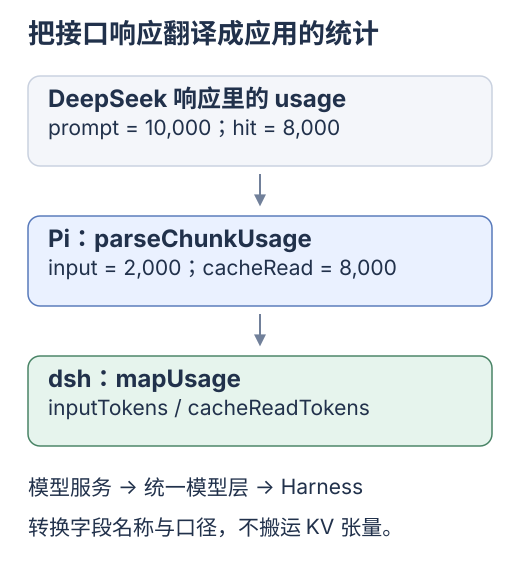
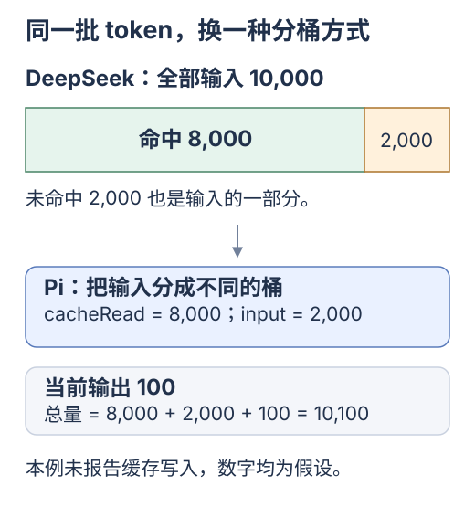

# Pi：缓存用量、保留偏好与预热

[专题入口](README.md) · [上一篇 DeepSeek Harness](04-deepseek-harness.md) · [下一篇 知识地图](06-study-map.md)

Pi 发送上下文、转换用量；先查<mark class="key">同批 token 是否重复计数</mark>。


<div class="heading-alias" id="先想前端里的一层-api-适配" aria-hidden="true"></div>

## API 适配类比

像统一后端的 `list` / `items`，改字段还需核对含义。

先沿 DeepSeek → Pi → dsh 看用量转换；此处 dsh 指 Pi 适配路径。

[](../../site/public/diagrams/kv-cache/14-pi-adapter.svg)

服务端报告，Pi 归一化，Harness 接收统计；不传回 KV 张量。

<div class="heading-alias" id="第一局把-10000-个输入-token-对上账" aria-hidden="true"></div>

## 输入用量对账

源码从 [`deepseekProvider`](https://github.com/earendil-works/pi/blob/136b87e8a7f5a3e5186de0289523ba327dc592fc/packages/ai/src/providers/deepseek.ts) 进入 Chat Completions 的 [`parseChunkUsage`](https://github.com/earendil-works/pi/blob/136b87e8a7f5a3e5186de0289523ba327dc592fc/packages/ai/src/api/openai-completions.ts#L1534)，用于核对统计口径。

假设 DeepSeek 返回：总输入 10,000，命中 8,000，未命中 2,000，输出 100。Pi 把缓存读取单独分桶：

[](../../site/public/diagrams/kv-cache/11-usage-buckets.svg)

| 概念 | DeepSeek 原始字段 | Pi 归一化结果 |
| --- | --- | --- |
| 全部输入 | `prompt_tokens = 10000` | `input + cacheRead + cacheWrite = 10000` |
| 命中输入 | `prompt_cache_hit_tokens = 8000` | `cacheRead = 8000` |
| 未缓存输入 | `prompt_cache_miss_tokens = 2000` | `input = 2000` |
| 缓存写入 | 此例没有单独报告 | `cacheWrite = 0`，不能据此推断没有发生服务端写入 |
| 输出 | `completion_tokens = 100` | `output = 100` |
| 总量 | `total_tokens = 10100` | `totalTokens = 10100` |

命中依次取 `prompt_tokens_details.cached_tokens`、`prompt_cache_hit_tokens`、顶层 `cached_tokens` 的可用值，不相加。未缓存输入为总输入减缓存读写，钳制非负，与[API 口径](03-prefix-cache-and-yuuki.md#先核对用量口径再算命中率)一致。

**总输入 10,000 = `input` 2,000 + `cacheRead` 8,000。** 关联概念见[知识地图](06-study-map.md)。

<details>
<summary>上下文、适配与观测源码</summary>

## 从上下文到缓存观测，源码怎样分工

| 入口 | 负责什么 | 阅读时追问 |
| --- | --- | --- |
| [`agent-loop.ts`](https://github.com/earendil-works/pi/blob/136b87e8a7f5a3e5186de0289523ba327dc592fc/packages/agent/src/agent-loop.ts#L397) | 先 `transformContext`，再 `convertToLlm` | 发送前有没有改写历史前部，工具消息是否合法 |
| [`types.ts`](https://github.com/earendil-works/pi/blob/136b87e8a7f5a3e5186de0289523ba327dc592fc/packages/ai/src/types.ts#L247) | 定义 `cacheRetention`、`sessionId` 和用量类型 | 哪些是调用偏好，哪些是服务返回的观测 |
| [`openai-completions.ts`](https://github.com/earendil-works/pi/blob/136b87e8a7f5a3e5186de0289523ba327dc592fc/packages/ai/src/api/openai-completions.ts#L831) | 协议兼容、请求参数和用量归一化 | 实际发出哪些缓存参数，供应商是否支持 |
| [`cache-stats.ts`](https://github.com/earendil-works/pi/blob/136b87e8a7f5a3e5186de0289523ba327dc592fc/packages/coding-agent/src/core/cache-stats.ts) | 从会话记录估算额外缓存未命中 | 诊断的前提和噪声阈值是什么 |
| [`cache-warmer.ts`](https://github.com/earendil-works/pi/blob/136b87e8a7f5a3e5186de0289523ba327dc592fc/packages/coding-agent/src/core/cache-warmer.ts) | 决定是否额外发请求维持缓存 | TTL、可重放性和预期节省是否成立 |
| [`compaction.md`](https://github.com/earendil-works/pi/blob/136b87e8a7f5a3e5186de0289523ba327dc592fc/packages/coding-agent/docs/compaction.md) | 说明历史压缩与摘要 | 压缩改变了哪个前缀，原始历史怎样保留 |

模块处理消息、参数与统计；`convertToLlm` 不转换服务端 K/V 张量。

</details>

<details class="qa">
<summary>cacheRetention 能保证保留多久吗？</summary>

## `cacheRetention` 是偏好，具体效果沿适配器核对

公共选项有 `none`、`short`、`long` 与 `sessionId`；供应商按能力映射偏好，可忽略不支持的特性。[定义](https://github.com/earendil-works/pi/blob/136b87e8a7f5a3e5186de0289523ba327dc592fc/packages/ai/src/types.ts#L247)

<mark class="caution">偏好不是缓存保证</mark>：`long` 不保证 DeepSeek 留一小时，`none` 不保证全关。`sessionId` 可参与路由，不替代历史或保存客户端 KV。

沿 `调用选项 → 实际请求参数 → 服务支持范围 → 返回用量` 核对效果。

</details>

<details class="qa">
<summary>失效诊断能查明服务端原因吗？</summary>

## 缓存失效诊断，包含应用自己的假设

`cache-stats.ts` 按前次输入与本次读取量估算额外未命中；跳过首轮、无缓存证据和噪声差异，compaction / branch summary 后重置基线。[源码](https://github.com/earendil-works/pi/blob/136b87e8a7f5a3e5186de0289523ba327dc592fc/packages/coding-agent/src/core/cache-stats.ts#L55)

诊断不能直接知道服务端淘汰原因。源码的 5 分钟 TTL 不代表 DeepSeek 有效期；另记模型切换、裁剪、前部修改和空闲时间。

</details>

<details class="qa">
<summary>预热一定省钱吗？</summary>

## 预热是一次额外的模型调用

TTL 是有效期；<mark class="caution">预热是额外付费请求</mark>，尝试延续缓存。

`CacheWarmer` 在预计过期前以小输出上限重放；先查模型声明的档位 TTL、请求可重放性，再算收益。[实现](https://github.com/earendil-works/pi/blob/136b87e8a7f5a3e5186de0289523ba327dc592fc/packages/coding-agent/src/core/cache-warmer.ts#L168)

其经济判断可以概括为：

```text
预期节省 = 继续请求的估计概率 × 丢失缓存后的额外费用 − 本次预热费用
```

概率与价格不是收益保证。快照[默认](https://github.com/earendil-works/pi/blob/136b87e8a7f5a3e5186de0289523ba327dc592fc/packages/coding-agent/src/core/settings-defaults.ts#L61)为 `streaming`，发送仍受前述条件限制；[读取设置](https://github.com/earendil-works/pi/blob/136b87e8a7f5a3e5186de0289523ba327dc592fc/packages/coding-agent/src/core/settings-manager.ts#L930)因费用只接受全局预热配置。预热与正常用量一起记账。

先测自然命中，再按停顿、命中与总费用决定是否预热。

</details>

<details class="qa">
<summary>压缩历史和缓存命中怎样取舍？</summary>

## Compaction 与缓存怎样一起考虑

Compaction 用摘要等方式缩短历史，可能损失旧前缀命中，也能减少输入、避免超限。应比较后续多轮的总费用与质量。

摘要调用避免为一次性提示写缓存。[压缩说明](https://github.com/earendil-works/pi/blob/136b87e8a7f5a3e5186de0289523ba327dc592fc/packages/coding-agent/docs/compaction.md#L23)实际控制能力须查适配器；一直保留全历史，即使命中率高也占窗口、有成本。

按[研究路线](06-study-map.md)只选一个实验：用量、前缀变化或压缩后的多轮开销。

</details>

<details>
<summary>来源与核对范围</summary>

2026-10-24 阅读官方 [`earendil-works/pi`](https://github.com/earendil-works/pi/tree/136b87e8a7f5a3e5186de0289523ba327dc592fc) `136b87e8a7f5` 快照，未运行 Pi 或付费 API。此为 pi / pi-mono 工具链；早期 [PI-Desktop 调研](../deep/2026-09-26-zed-pi-rust/03-pi-desktop.md)是不同日期的桌面应用研究。

</details>
