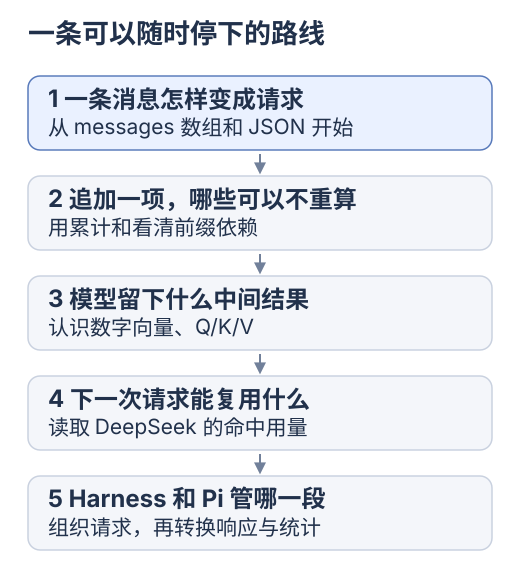

# KV Cache 的关联知识与研究路线

[专题入口](README.md) · [上一篇 Pi](05-pi.md)

研究目标：核对相同资料重复请求时的<mark class="key">复用范围、条件与验证方法</mark>。

整理：2026-10-24。以下是建议路线；本地实验、API 规则和静态源码证据不同，真实命中、费用与性能需另测。

<div class="heading-alias" id="现在只选一个问题" aria-hidden="true"></div>

## 分阶段范围

基础概念见[第一站](00-first-request.md)，后续按待验证问题选择章节。

[](../../site/public/diagrams/kv-cache/01-study-path.svg)

| 阶段 | 研究范围 |
| --- | --- |
| 原理基础 | 数组、派生结果、相同前缀，以及 Q/K/V 的分工 |
| 接口接入 | 命中统计、一次请求的等待时间、流式返回 |
| 容量与命中诊断 | 多头布局、MLA、量化、淘汰、预热和压缩策略 |

术语按需回查，实验范围应对应当前问题。

<details>
<summary>基础词汇对照</summary>

| 词 | 先这样理解 | 再注意一个边界 |
| --- | --- | --- |
| 上下文 context | 这次请求实际交给模型的内容 | 保存过的历史不一定全被发送 |
| token | 模型序列中的处理单位 | 不固定等于一个字、单词或 SSE chunk |
| 向量 vector | 一个数字数组 | 数字的含义由模型计算形成 |
| 隐藏表示 h | 当前阶段对这个位置算出的数字数组 | 不是用户可见的文字内容 |
| 模型权重 | 模型用来变换数字的参数 | 与一次输入产生的 KV 状态不同 |
| 推理 inference | 用已有模型处理输入并生成输出 | 不等于重新训练模型 |
| 前缀 prefix | 从开头开始的一段连续输入 | 相同后缀不能代替相同前缀 |
| 命中 hit | 这次实际复用了可用缓存 | 相同内容本身不能保证命中 |
| 失效 invalidation | 原来的结果不再适合当前依赖 | 先查输入、配置和生命周期 |
| Prefill / Decode | 先处理输入 / 再逐步生成 | 缓存命中主要省重复 Prefill |
| usage | 接口返回的用量计数 | 不同接口字段的统计口径可能不同 |
| 适配器 adapter | 把两边接口的数据翻译成统一格式 | 改字段名时也要核对含义 |

遇到再查，精确定义见正文与来源。

</details>

<details>
<summary>知识地图与一手资料</summary>

## 知识之间怎样连接

| 知识点 | 解决哪个疑问 | 与本专题的连接 | 继续读哪里 |
| --- | --- | --- | --- |
| Token、聊天模板与工具序列化 | 相同文字为何不一定形成相同模型输入 | 缓存匹配最终模型输入及其上下文，JSON 字节相同只是一项排查线索 | [请求前缀](03-prefix-cache-and-yuuki.md) |
| Q/K/V、因果 mask、位置 | 为什么旧状态可复用，修改中间内容却可能失效 | 缓存正确性的前提 | [两层 Attention 实验](02-attention-and-kv.md) |
| Prefill、Decode 与等待时间 | 命中缓存后，回答为什么仍要生成 | 前缀复用减少重复 Prefill，首段等待和逐 token 生成分别观测 | [vLLM 自动前缀缓存](https://docs.vllm.ai/en/latest/features/automatic_prefix_caching/) |
| MHA、MQA、GQA 与缓存容量 | 为什么 Query 头数不能总拿来算 KV 大小 | K/V 的头数和布局决定有效数据量 | [容量推导](00-why-so-large.md)、[GQA 论文](https://arxiv.org/abs/2305.13245) |
| MLA 与模型特定布局 | DeepSeek 的缓存为什么不能直接套常规公式 | DeepSeek-V2 的 MLA 用低秩联合压缩减少 KV；具体模型要按自身结构重算 | [DeepSeek-V2 论文](https://arxiv.org/abs/2405.04434) |
| 滑动窗口、量化、卸载 | 长上下文怎样放进有限内存 | 窗口改变保留范围，量化改变精度，卸载改变存放位置 | [Transformers 缓存策略](https://huggingface.co/docs/transformers/en/kv_cache) |
| 分块、前缀身份、淘汰 | 多个请求怎样共享状态并控制容量 | 一个块的身份还依赖父前缀，生命周期影响是否能命中 | [vLLM 前缀缓存设计](https://docs.vllm.ai/en/latest/design/prefix_caching/) |
| 请求投影、工具顺序与路由能力 | Harness 怎样少制造无意义变化 | 稳定的上下文装配为复用提供条件 | [DeepSeek Harness](04-deepseek-harness.md) |
| 用量分桶、保留偏好与预热 | 如何判断省了多少、是否值得维持缓存 | 统计口径正确之后，才比较费用和延迟 | [Pi 应用](05-pi.md) |
| Compaction、检索与历史保存 | 命中率高了，为什么仍需减少输入 | 选择信息、压缩历史和复用计算是不同工作 | [上下文与运行报告](../agent-engineering/06-context-and-report.md) |

MLA 此处仅指 DeepSeek-V2；<mark class="caution">旧论文形状不代表当前 API 实现</mark>，命中规则也不能反推完整结构。

</details>

<details class="qa">
<summary>不同缓存分别保存什么？</summary>

## 容易混在一起的几种“缓存”

| 保存或复用什么 | 实际作用 | 不能由此推断什么 |
| --- | --- | --- |
| Attention 的 K/V 状态 | 复用模型中已经计算的中间状态 | 模型得到新的事实或更可靠的记忆 |
| 跨请求的共同前缀状态 | 减少重复处理相同前缀的工作 | 新输出直接从旧答案复制 |
| 文件、消息历史、artifact | 保留之后可以读入的资料 | 资料已经进入当前模型输入 |
| 工具结果 | 在有效条件下复用一次外部计算 | 工具结果随环境变化仍然正确 |
| 最终答案或语义近似答案 | 在应用层直接返回已有回答 | 已证明底层 KV 命中 |

KV 是模型向量，不是业务键值；写“缓存”时注明对象、复用条件与失效范围。

</details>

## 按三轮做，每轮都有停点

| 轮次 | 只做什么 | 留下什么 | 何时停下 |
| --- | --- | --- | --- |
| 1 · 本地原理 | 跑现有 Attention 实验，比较追加和修改中间 token | 输出一致性、K/V 组数、QK 次数三项记录 | 能解释省了哪些计算、哪些仍然存在 |
| 2 · 源码应用 | 从 dsh 的 `SystemPromptProjection` 读到 Pi 的 `parseChunkUsage` | 一条请求路径和一份 10,000 token 的用量对账 | 能区分应用的输入、缓存桶与总量 |
| 3 · 服务观测 | 按[DeepSeek 对照步骤](03-prefix-cache-and-yuuki.md#准备一次有对照的-api-实验)改变一个因素 | 原始 usage、配置、请求间隔、等待与总耗时 | 能说明某次结论的证据与未确认原因 |

前两轮无需 key。第三轮先测自然命中，再单独选动态工具、压缩或预热；同组不同时换模型、工具与摘要。

<div class="heading-alias" id="给每轮留一张研究记录" aria-hidden="true"></div>

## 研究记录

记录模板：

```text
问题：
来源与版本：官方文档核对日期 / 仓库 commit / 本地脚本
输入与配置：模型、端点、上下文、工具、输出上限
本次只改变：
直接观察：原始 usage / 数值误差 / 计数 / 时间
我的解释：
尚未排除：
下一次只验证：
```

本地实验验证小模型结果一致；源码解释设计；usage 报告请求命中。结合后再讨论体验与费用，未运行项标为待验。

研究入口：[专题入口](README.md)。
