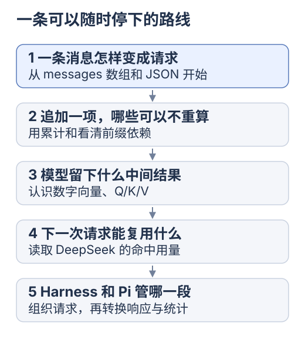

# KV Cache 专题：从前端数组走到 DeepSeek、Harness 与 Pi

先看消息数组，再运行前缀复用实验；理解 K/V 后，按需读容量、API 与工程源码。

本专题研究模型推理状态，借前端数组解释依赖与复用。先分清参数、上下文与生成，必要时回补[模型基础](../ai-from-scaling/01-understand-models.md)；可独立阅读，不是 Agent 入门前置。

更新：2026-10-24。[文档导航](../README.md) · [渲染性能](../learning/rendering-performance.md)。应用篇已查官方文档与固定 commit；真实 API 命中、费用、延迟待测。

<div class="heading-alias" id="今天只从这一页开始" aria-hidden="true"></div>

## 阅读起点

**[消息请求与模型输入](00-first-request.md)**

先分清客户端消息与服务端计算结果。

[](../../site/public/diagrams/kv-cache/01-study-path.svg)

按消息 → 数组复用 → K/V 阅读即可完成基础路线。容量为选读，DeepSeek、Harness 与 Pi 属于应用进阶。

<div class="heading-alias" id="走丢了就回来看这一句" aria-hidden="true"></div>

## 核心概念

<mark class="key">KV Cache 保留已算状态，供后续计算复用</mark>。

依次看：保存什么、何时有效、怎样观察命中。

<details>
<summary>完整目录</summary>

key、Map 和内存基础见[前端基础](../frontend-foundations/README.md)。

| 章节 | 从前端的哪个问题开始 | 读完能解释什么 |
| --- | --- | --- |
| [从一条消息开始](00-first-request.md) | messages 数组怎样到达模型 | 消息、上下文、token 与服务端 KV 的位置 |
| [从 useMemo 到前缀复用](01-from-frontend.md) | 消息列表追加一项，为什么还会重算整份派生数据 | 缓存结果、缓存依赖与增量计算的区别 |
| [从因果 Attention 到 KV Cache](02-attention-and-kv.md) | 已经算好的历史状态，什么时候可以继续使用 | Q/K/V、Prefill、Decode、失效范围与内存成本 |
| [DeepSeek 前缀缓存与 Yuuki](03-prefix-cache-and-yuuki.md) | 每轮请求都发送历史消息，服务端能复用什么 | 持久化单元、usage 口径、SSE 与请求对照实验 |
| [DeepSeek Harness 怎样保住请求前缀](04-deepseek-harness.md) | 插件、动态上下文和压缩怎样影响命中 | system 投影、工具排序、Pi 适配层与上游测试入口 |
| [Pi 怎样使用和观测缓存](05-pi.md) | 统一模型 API 怎样解释不同供应商的缓存 | 用量归一化、保留偏好、失效诊断和预热成本 |
| [关联知识与研究路线](06-study-map.md) | 学到哪里该继续，哪里可以先停 | 原理、工程与实验之间的关系，以及分阶段成果 |

容量单独在[为什么 KV 会这么大](00-why-so-large.md)解释。计算容量时，再打开[浏览器容量实验](../../site/src/pages/labs/kv-memory.astro)。

</details>

<details>
<summary>各层职责</summary>

<div class="heading-alias" id="先认清这几层各自做什么" aria-hidden="true"></div>

## 各层职责

| 对象 | 在本专题中的职责 | 研究入口 |
| --- | --- | --- |
| 模型推理引擎 | 计算、保存与复用 Attention 状态 | [Q/K/V 与生成循环](02-attention-and-kv.md) |
| DeepSeek API | 提供服务端上下文缓存，报告命中用量 | [规则与观测](03-prefix-cache-and-yuuki.md) |
| DeepSeek Harness（`dsh`） | 从会话与插件构造请求，通过模型适配层发出请求 | [固定源码快照](04-deepseek-harness.md) |
| Pi / `pi-ai` | 提供 Agent 循环、供应商适配与缓存用量处理 | [固定源码快照](05-pi.md) |
| Yuuki runtime | 当前发送完整的 `system + history`，尚未读取缓存字段 | [本地源码定位](03-prefix-cache-and-yuuki.md#在-yuuki-源码里读一次请求) |

Harness 有专用与 `pi-ai` 两条适配路径，需分别追踪；应用不直接持有托管模型的 KV 张量。

</details>

<details>
<summary>两个本地实验</summary>

<div class="heading-alias" id="第一局改一个输入看缓存从哪里失效" aria-hidden="true"></div>

## 实验一：输入变化与缓存失效

在仓库根目录执行，使用 Node.js 18 或更高版本：

```bash
node docs/kv-cache/labs/prefix-cache.mjs
```

输入 `[3, 5, 2]` 得到累计值 `[3, 8, 10]`；追加、修改或截短后观察复用，并与从头计算对照。

每位置依赖此前输入：末尾追加不改旧位置，中间修改可能影响整个后缀。[第一篇](01-from-frontend.md)解释它与 KV 的关系。

<div class="heading-alias" id="第二局让两层小模型给出对照" aria-hidden="true"></div>

## 实验二：两层模型对照

第二个实验真正计算因果 Attention，使用固定权重的两层小模型：

```bash
node docs/kv-cache/labs/attention-cache.mjs
```

对照从头计算与 KV 路径，查新算 K/V 组数、QK 点积与数值误差：哪些减少、哪些仍存在？

两份实验均在本地运行，无需安装依赖、下载模型或提供 API key。

</details>

<details>
<summary>每轮研究要留下什么</summary>

<div class="heading-alias" id="学习时持续追问的四件事" aria-hidden="true"></div>

## 四项分析维度

1. **保存什么：** 过滤列表、解析树，或各层 K/V。
2. **依赖什么：** 内容、位置、配置与可见范围。
3. **变化传多远：** 由计算依赖决定复用范围。
4. **还有什么成本：** 匹配、历史读取与新输出计算。

基础部分覆盖旧 K/V 复用与新 Q 的历史读取；应用篇定位 Harness / Pi 的前缀、用量转换和 Yuuki 观测缺口。

</details>

下一步：[从一条消息开始](00-first-request.md)。
