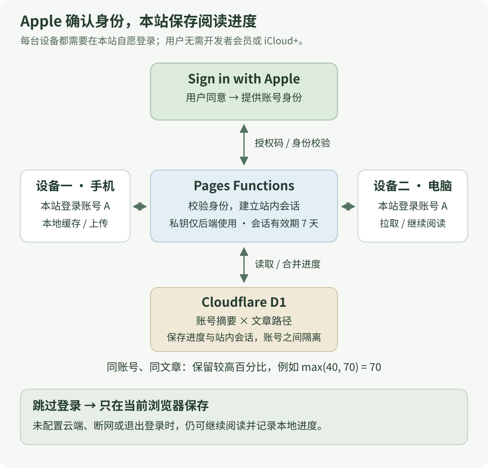
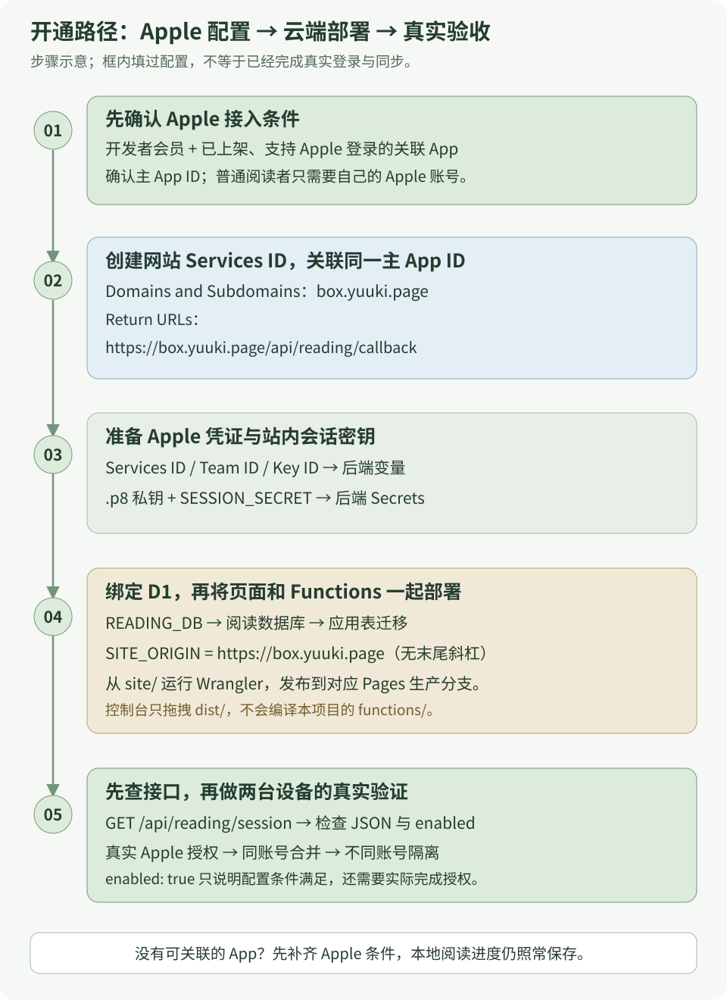
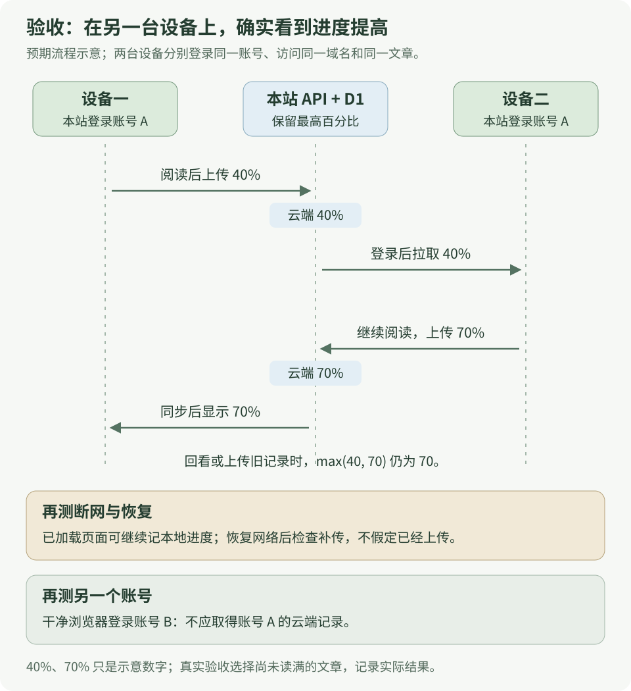

# 最后一课：为本站接入 Apple 登录与阅读同步

读到这里，可以拿本站做一次完整的网站实战：**在手机上读过一篇文章，再到电脑上登录同一个 Apple 账号，看到相同的阅读进度。** 从浏览器本地存储出发，接上身份认证、云端数据库、部署和真实设备验收。

本课使用 `https://box.yuuki.page` 作为正式地址。登录始终可以跳过；不登录时照常阅读，进度留在当前浏览器。三张图均为 SVG，点击图片可打开原图放大。

> **先记录起点。** 2026-10-31 检查时，本站 `/api/reading/session` 返回 HTTP 404 和站点的 HTML 错误页。仓库已有同步代码，但当时线上还没有正常提供这个接口；关联 App、Apple 凭证和两台设备的真实登录尚未验证。下面是接入步骤与预期结果，不能当作已经开通的证明。实际状态按第 6 节重新检查。

## 1 · 谁确认身份，谁保存进度

[](../../site/public/diagrams/learning/apple-reading-sync-architecture.svg)

| 参与者 | 负责什么 | 需要准备什么 |
| --- | --- | --- |
| 站点维护者 | 配置 Apple 登录，部署接口，维护进度数据库 | Apple Developer 会员、符合条件的关联 App、Cloudflare Pages 项目与 D1 |
| Apple | 在用户同意后提供可验证的账号身份 | 用户的普通 Apple 账号及双重认证；用户无需开发者会员 |
| 本站后端 | 校验 Apple 返回结果，建立站内会话，读写进度 | 后端配置与密钥；进度存入本站 D1，不占用用户的 iCloud 空间 |
| 阅读者 | 自愿登录，在不同设备访问同一个网站 | 每台设备分别在本站登录；不登录也能使用本地进度 |

Apple 登录的用户条件见 [Apple 使用说明](https://support.apple.com/en-us/102609)。网页不会仅凭你已登录 iPhone 或 Chrome，就自动取得本站的登录身份。

<details class="qa">
<summary>iOS 上有人用阅读同步吗？和 iCloud 是同一件事吗？</summary>

[Apple Books](https://support.apple.com/en-za/guide/iphone/iphb886e1752/ios) 支持通过 iCloud 同步阅读位置、书签和批注；[GoodLinks](https://goodlinks.app/) 也支持 iCloud 阅读位置同步。它们让用户直接使用 Apple 生态中的存储能力。

本站选择 Apple 登录识别账号，再把进度存在自己的 Cloudflare 数据库。用户无需购买 iCloud+。如果希望数据进入 iCloud，需要另做 CloudKit 接入；Apple 提供 [CloudKit JS](https://developer.apple.com/documentation/cloudkitjs) 让网页访问已配置的 CloudKit 容器，这不是现有方案里的一个开关。

</details>

## 2 · 先看完整开通路径

[](../../site/public/diagrams/learning/apple-reading-sync-setup.svg)

**开发者会员解决的是维护者的资格，关联 App 仍要单独确认。** Apple 当前文档要求：网站登录关联一个已在 App Store 上架、支持 Sign in with Apple 的 App。只有会员、App ID 或普通 Apple 账号，不能直接视为满足全部条件。[Apple 环境配置](https://developer.apple.com/documentation/signinwithapple/configuring-your-environment-for-sign-in-with-apple)

已有符合条件的 App，就继续配置；尚未上架或尚未支持 Apple 登录时，先完成这一前置条件。此时不影响本站继续记录本地阅读进度。

<span id="apple-setup"></span>

## 3 · 在 Apple 后台登记网站

打开 [Certificates, Identifiers & Profiles](https://developer.apple.com/account/resources/identifiers/list)，选择拥有该 App 的开发者 Team。

1. 在 **Identifiers → App IDs** 找到关联 App，确认已经启用 **Sign in with Apple**，并确定其主 App ID。网站与私钥需要关联同一个主 App ID；已有分组时沿用相应配置。
2. 新建 **Services ID**。Description 可填 `Yuuki Box Web`；Identifier 可尝试 `page.yuuki.box.web`，以后台实际注册成功的值为准。它是网站的客户端 ID，后端的 `APPLE_SERVICE_ID` 必须与它一致。
3. 打开该 Services ID，启用 **Sign in with Apple → Configure**，选择上面的 Primary App ID，填写下表后保存。

| Apple 字段 | 本站填写值 |
| --- | --- |
| Domains and Subdomains | `box.yuuki.page` |
| Return URLs | `https://box.yuuki.page/api/reading/callback` |

域名栏不带 `https://`，回调填完整 HTTPS 地址，末尾不加 `/`。步骤以 [Apple 网页登录配置](https://developer.apple.com/help/account/capabilities/configure-sign-in-with-apple-for-the-web) 为准。

4. 到 **Keys** 创建启用了 **Sign in with Apple** 的密钥，关联同一个 Primary App ID，下载 `.p8` 私钥，并记下 **Key ID**。[Apple 私钥配置](https://developer.apple.com/help/account/capabilities/create-a-sign-in-with-apple-private-key)
5. 在开发者账号的 Membership 信息中找到 **Team ID**。到这里应得到 Services ID、Team ID、Key ID，以及本地保存的 `.p8` 文件。

`.p8` 只在后端配置，保存在仓库之外，不粘贴到聊天或前端代码中。本实现只使用稳定的账号标识，不请求姓名和邮箱，用户的 Apple 密码不会交给本站。

<span id="cloudflare-setup"></span>

## 4 · 接上 Cloudflare Pages 与 D1

下列命令在仓库根目录执行。将 `YOUR_PAGES_PROJECT` 替换成**已绑定 `box.yuuki.page` 的 Pages 项目名**，不要把域名直接当作项目名。命令是配置指引，本课没有代替你创建云端资源或发布服务。

### 找到现有项目，保留原配置

```bash
pnpm --dir site exec wrangler login
pnpm --dir site exec wrangler pages project list
```

仓库默认只有 [Wrangler 示例](../../site/wrangler.example.jsonc)。首次接入现有 Pages 项目时，下载它的配置：

```bash
pnpm --dir site exec wrangler pages download config YOUR_PAGES_PROJECT
```

生成的配置位于 `site/`，后面以 `site/wrangler.jsonc` 为例。**如果已有这份文件，先保留本地修改；下载命令会覆盖原配置。** 合并本课字段时保留已有环境变量、其他绑定与环境设置。使用 Wrangler 配置部署后，它会成为 Pages 设置的来源。[Pages 配置规则](https://developers.cloudflare.com/pages/functions/wrangler-configuration/)

### 创建数据库并合并绑定

还没有阅读进度数据库时创建一个；已经创建过则复用对应数据库：

```bash
pnpm --dir site exec wrangler d1 create yuuki-reading
```

将返回的真实 `database_id` 合并到配置中。下面只列本课需要的字段；`YOUR_TEAM_ID`、`YOUR_KEY_ID` 和 `YOUR_DATABASE_ID` 都要替换，Services ID 也要使用实际注册值。

```jsonc
{
  "pages_build_output_dir": "./dist",
  "compatibility_date": "2026-10-26",
  "compatibility_flags": ["nodejs_compat"],
  "vars": {
    "SITE_ORIGIN": "https://box.yuuki.page",
    "APPLE_SERVICE_ID": "page.yuuki.box.web",
    "APPLE_TEAM_ID": "YOUR_TEAM_ID",
    "APPLE_KEY_ID": "YOUR_KEY_ID"
  },
  "d1_databases": [
    {
      "binding": "READING_DB",
      "database_name": "yuuki-reading",
      "database_id": "YOUR_DATABASE_ID",
      "migrations_dir": "./migrations"
    }
  ]
}
```

`READING_DB` 是代码使用的固定绑定名；`SITE_ORIGIN` 没有末尾斜杠。配置示例中已有其他兼容标记或数据库绑定时，合并数组，保留原有项。

先查看待执行迁移，再创建表：

```bash
pnpm --dir site exec wrangler d1 migrations list yuuki-reading --remote
pnpm --dir site exec wrangler d1 migrations apply yuuki-reading --remote
```

确认目标是刚选择的阅读数据库，迁移清单与仓库的 [0001_reading_progress.sql](../../site/migrations/0001_reading_progress.sql) 一致。它创建会话表与阅读进度表；后者以账号和文章路径为联合主键。[D1 迁移说明](https://developers.cloudflare.com/d1/reference/migrations/)

### 设置两个后端 Secret

```bash
pnpm --dir site exec wrangler pages secret put APPLE_PRIVATE_KEY --project-name YOUR_PAGES_PROJECT < /absolute/path/to/AuthKey_YOUR_KEY_ID.p8
pnpm --dir site exec wrangler pages secret put SESSION_SECRET --project-name YOUR_PAGES_PROJECT
```

第一条从本地私钥文件读取，替换成实际路径；第二条在私密输入提示中填写随机会话密钥。可以在自己的终端运行 `openssl rand -base64 32` 生成，然后粘贴到该提示中；不需要把结果发回聊天。

`APPLE_PRIVATE_KEY` 和 `SESSION_SECRET` 使用 Secret 保存，不放进 `vars`。后者需要至少 32 个字符，用于本站登录流程的校验。[Pages 环境变量与 Secrets](https://developers.cloudflare.com/pages/functions/bindings/#secrets)

## 5 · 把接口和页面一起发布

先完成本地检查：

```bash
pnpm --dir site check
pnpm --dir site test
pnpm --dir site check:functions
```

再发布到现有项目的生产分支，把 `YOUR_PRODUCTION_BRANCH` 换成 Pages 后台登记的生产分支名：

```bash
pnpm docs:deploy --project-name YOUR_PAGES_PROJECT --branch YOUR_PRODUCTION_BRANCH
```

仓库的部署脚本先构建并校验页面资源，再从 `site/` 运行 `wrangler pages deploy dist`。这样同级的 `functions/` 会随页面一起编译发布。**仅在控制台拖拽上传 `dist/`，不会编译本项目的 `functions/` 目录**；使用 Git 集成时，也要让构建根目录与 Functions 路径正确对应。[Pages Functions 部署](https://developers.cloudflare.com/pages/functions/get-started/#deploy-your-function)、[Direct Upload 的 Functions 规则](https://developers.cloudflare.com/pages/get-started/direct-upload/#functions)

可以沿着这几个文件检查实际路径：

| 文件 | 作用 |
| --- | --- |
| [ReadingStatus.astro](../../site/src/components/ReadingStatus.astro) | 顶部同步面板、正文进度、定时同步与状态提示 |
| [reading-sync.ts](../../site/src/lib/reading-sync.ts) | 获取站内会话，上传与拉取进度，保留失败待重试的数据 |
| [api/reading/[action].ts](../../site/functions/api/reading/[action].ts) | Pages Functions 接口入口 |
| [reading.ts](../../site/server/reading.ts) | Apple 回调校验、站内会话与数据库读写 |
| [_routes.json](../../site/public/_routes.json) | 只让 `/api/reading/*` 进入 Functions |

普通正文仍是静态页面。`pnpm docs:dev` 只运行内容站，不运行 Pages Functions；本地页面显示云同步未启用，不能据此判断线上配置失败。完整本地 Functions 指引见[站点维护说明](../../site/README.md#验收与本地开发)。

<span id="verify-sync"></span>

## 6 · 先检查接口，再检查真实登录

无需登录即可查看配置状态：

```bash
curl -i --max-time 15 https://box.yuuki.page/api/reading/session
```

| 返回结果 | 能确认什么 | 下一步 |
| --- | --- | --- |
| `404`，返回 HTML 错误页 | 请求尚未拿到预期的同步 API | 核对域名对应的部署、`functions/` 编译结果和 `/api/reading/*` 路由 |
| `200`，`{"enabled":false,"accountId":null}` | 接口已到达，启用条件尚未满足 | 检查 D1 绑定、全部变量与 Secrets，以及请求域名是否等于 `SITE_ORIGIN` |
| `200`，`{"enabled":true,"accountId":null}` | 服务判定配置完整，当前浏览器尚未登录 | 打开顶部「阅读同步」，进行真实 Apple 授权；这一步仍未证明私钥或回调正确 |
| `200`，`enabled:true` 且有 `accountId` | 当前请求已有有效站内会话 | 继续验证两台设备上的进度合并 |
| `503`，例如 `sync_unavailable` | 服务处理失败 | 检查 Functions 日志、D1 绑定与表迁移；不把接口错误当作用户需要购买会员 |

`SITE_ORIGIN` 是正式域名时，其他预览域名会返回未启用。不要把正式回调随意改成 `localhost`；真实授权应在登记的 HTTPS 域名完成。

<details class="qa">
<summary>能出现 Apple 登录按钮，就算完成了吗？</summary>

还需要用户真正完成 Apple 授权，后端校验授权码与身份令牌，创建站内会话，再成功读写 D1。若授权后回到页面却提示失败，核对 Services ID、Team ID、Key ID、私钥归属、Primary App ID 和精确回调地址。

日志只保留错误分类。不要把 `.p8`、授权码、Cookie 或身份令牌复制到公开日志和在线解码网站。

</details>

## 7 · 用两台设备完成验收

[](../../site/public/diagrams/learning/apple-reading-sync-verify.svg)

找一篇尚未读完的文章，使用同一个正式域名逐项验证。图中的 40% 与 70% 是示意，以页面实际显示的整数为准。

1. **先不登录。** 阅读一部分，刷新页面，确认本地进度还在；取消 Apple 授权后也应继续可读。
2. **设备一登录账号 A。** 打开顶部「阅读同步」并授权。原匿名记录会移入当前账号缓存并上传；这一步会将该浏览器先前的阅读记录归入账号 A。
3. **设备二也登录账号 A。** 打开同一篇文章，确认取得设备一的进度，再继续读到更高百分比。
4. **回到设备一。** 聚焦页面或等待前台同步，确认进度提高。当前实现约在停止产生新进度 1.5 秒后上传，前台每 30 秒同步，也会在重新聚焦、联网时检查。它没有即时推送连接。
5. **设备二离线后继续阅读。** 保持页面已加载，断网并滚动；恢复网络后确认待同步记录补传。此步骤不保证离线时还能打开从未缓存的文章。
6. **用干净的浏览器环境登录另一个账号 B。** 不应取得账号 A 的云端记录。再退出，确认当前设备回到匿名记录模式，另一台设备的会话仍有效。退出会保留本地账号缓存，方便该账号下次登录。

同步采用同账号、同文章的最高百分比，例如 `max(40, 70) = 70`。**回看不会降低进度；同步的是已浏览百分比，重新打开文章不会自动滚动到上次位置，也不能据此证明已经理解正文。**

## 8 · 什么证据才算做完

| 证据 | 能支持的结论 |
| --- | --- |
| 类型检查、单元测试、构建通过 | 代码与测试覆盖的场景成立，页面能生成 |
| 模拟 Apple 响应与本地数据库流程通过 | 能检查回调校验、合并、账号隔离及失败恢复；不能证明真实 Apple 配置有效 |
| 正式域名接口返回预期 JSON | 已经能访问部署后的接口，并看到配置或会话状态 |
| 两台真实设备、同账号同步与不同账号隔离通过 | 本次接入完成了真实的跨设备验收 |

把实际验收日期、所用域名、设备与失败现象记下来，再更新开通状态。只有前两项时，保留「尚未完成真实登录验证」的结论。

这次练习把前面学过的浏览器存储、HTTP 请求、身份验证、数据库和失败恢复接回一个真实功能：从一条 `404` 开始，沿请求路径逐段验证，直到另一台设备确实拿到正确的阅读进度。
