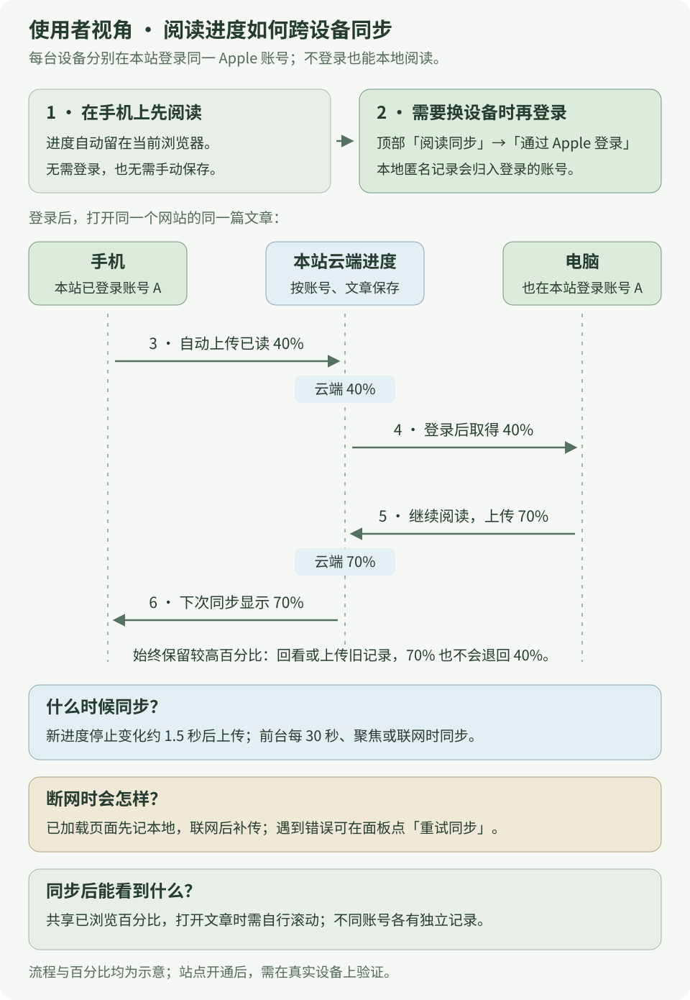
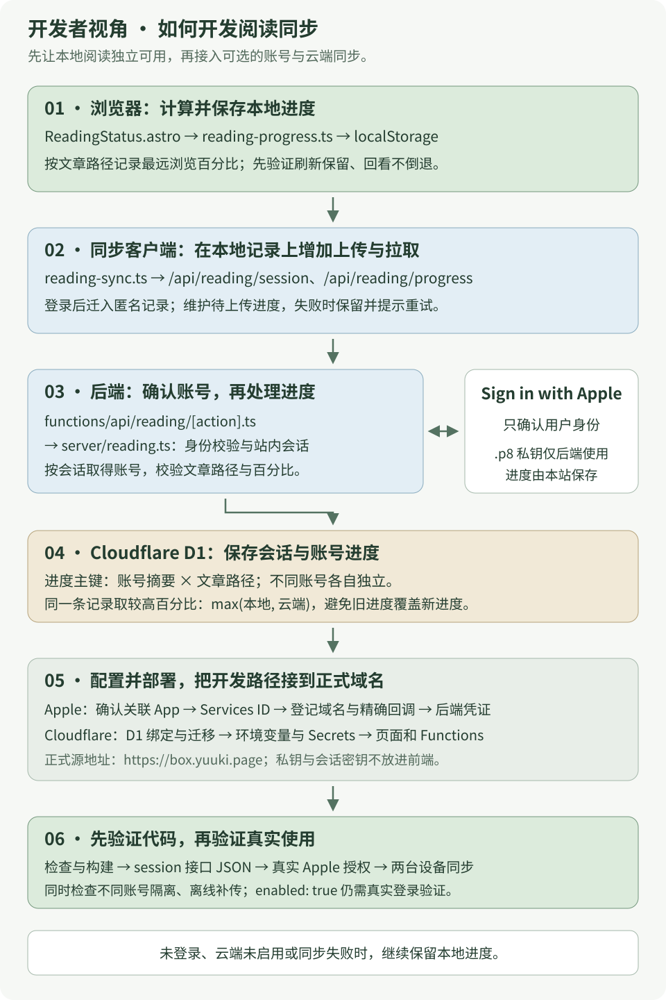

---
next:
  link: /github-actions/
  label: GitHub Actions：从一次运行到自动化系统
---

# 阅读同步：使用流程与实现

同一 Apple 账号在手机和电脑共享进度；先了解使用流程，再按需阅读开发与部署。

- [使用者视角](#user-view)：登录、跨设备同步、断网恢复。
- [开发者视角](#developer-view)（选读）：本地进度 → 登录、接口、数据库 → 部署验收。

正式地址为 `https://box.yuuki.page`。登录可跳过，本地照常记进度；图片可打开 SVG 原图。

> 2026-10-31，`/api/reading/session` 返回 404/HTML；当时接口未正常提供，App、凭据和双设备登录<mark class="caution">尚未真实验证</mark>。以下为实现说明与预期流程；当前状态按[接口检查](#verify-sync)复查。

<span id="user-view"></span>

## 使用者视角 · 如何跨设备同步

[](../../site/public/diagrams/learning/apple-reading-sync-user.svg)

以下为开通后的流程：普通 Apple 账号即可，无需开发者会员或 iCloud+，每台设备分别登录。

1. **手机阅读。** 进度自动保存在当前浏览器，可一直不登录。
2. **需要同步再登录。** 顶部「阅读同步」→「通过 Apple 登录」；匿名记录归入该账号上传，取消仍可本地阅读。
3. **电脑登录同账号。** 打开同一文章，应显示手机已同步的进度，如 40%。
4. **继续阅读。** 电脑到 70%，手机同步后也到 70%。新进度停 1.5 秒后上传，前台每 30 秒、重新聚焦或联网也检查，两端可能稍后才一致。
5. **断网先记本地。** 已加载文章可读，待同步项保留，联网重试；也可点「重试同步」。未缓存文章不保证离线可读。
6. **退出。** 当前设备恢复匿名记录，其他设备不受影响；原账号缓存保留，切换账号各自隔离。

同账号、同文章<mark class="key">取最高百分比</mark>，如 `max(40, 70) = 70`；回看不倒退，不自动定位，也不代表理解。图中数字仅为示意。

<details>
<summary>选读：同步实现与部署</summary>

<span id="developer-view"></span>

## 开发者视角 · 如何开发阅读同步

[](../../site/public/diagrams/learning/apple-reading-sync-developer.svg)

### 1 · 先保存本地进度，再接账号与同步

沿一条进度记录检查：

1. **本地先可用。** `ReadingStatus.astro` 算最远位置，`reading-progress.ts` 按文章保存；刷新恢复，回看不倒退。存储失败提示，当前页仍在内存记录。
2. **同步可选。** `reading-sync.ts` 查会话，登录后迁入匿名记录、上传待同步项、合并更高进度；失败保留记录并提供重试。
3. **后端验身份。** Pages Functions/`reading.ts` 校验 Apple 回调并建会话；接口从会话取账号，验证路径与百分比，再在 D1 合并最高进度。

| 文件 | 开发职责 |
| --- | --- |
| [ReadingStatus.astro](../../site/src/components/ReadingStatus.astro) | 计算与展示进度，提供登录面板，安排定时同步与状态提示 |
| [reading-progress.ts](../../site/src/lib/reading-progress.ts) | 本地存储、匿名与账号缓存、文章路径和百分比校验 |
| [reading-sync.ts](../../site/src/lib/reading-sync.ts) | 检查会话、迁入匿名记录、上传与拉取进度、保留失败待重试的数据 |
| [api/reading/[action].ts](../../site/functions/api/reading/[action].ts) | Pages Functions 接口入口 |
| [reading.ts](../../site/server/reading.ts) | Apple 回调校验、站内会话与数据库读写 |
| [0001_reading_progress.sql](../../site/migrations/0001_reading_progress.sql) | 会话表与按账号、文章路径保存的进度表 |
| [_routes.json](../../site/public/_routes.json) | 只让 `/api/reading/*` 进入 Functions |

代码中的职责与配置由下面几方分担：

| 参与者 | 负责什么 | 需要准备什么 |
| --- | --- | --- |
| 站点维护者 | 配置 Apple 登录，部署接口，维护进度数据库 | Apple Developer 会员、符合条件的关联 App、Cloudflare Pages 项目与 D1 |
| Apple | 在用户同意后提供可验证的账号身份 | 用户的普通 Apple 账号及双重认证；用户无需开发者会员 |
| 本站后端 | 校验 Apple 返回结果，建立站内会话，读写进度 | 后端配置与密钥；进度存入本站 D1，不占用用户的 iCloud 空间 |
| 阅读者 | 自愿登录，在不同设备访问同一个网站 | 每台设备分别在本站登录；不登录也能使用本地进度 |

用户条件见 [Apple 说明](https://support.apple.com/en-us/102609)；系统或浏览器已登录不等于本站已登录。

<details class="qa">
<summary>iOS 阅读同步与 iCloud 的关系</summary>

[Apple Books](https://support.apple.com/en-za/guide/iphone/iphb886e1752/ios)、[GoodLinks](https://goodlinks.app/) 使用 iCloud 同步阅读位置。

本站用 Apple 识别账号、Cloudflare 存进度，无需 iCloud+。若改用 iCloud，需另接 [CloudKit JS](https://developer.apple.com/documentation/cloudkitjs) 与容器，不能直接切换。

</details>

### 2 · 配置前先确认接入条件

维护者需开发者会员；网站还须关联已上架且支持 Sign in with Apple 的 App，仅有会员或 App ID 不够。[Apple 环境配置](https://developer.apple.com/documentation/signinwithapple/configuring-your-environment-for-sign-in-with-apple)

先满足关联 App 条件再配置；本地进度不受影响。

<span id="apple-setup"></span>

### 3 · 在 Apple 后台登记网站

打开 [Certificates, Identifiers & Profiles](https://developer.apple.com/account/resources/identifiers/list)，选择拥有该 App 的开发者 Team。

1. **Identifiers → App IDs**：确认关联 App 已启用 **Sign in with Apple**；网站、私钥关联同一 Primary App ID，已有分组沿用。
2. 新建 **Services ID**，描述可填 `Yuuki Box Web`，Identifier 如 `page.yuuki.box.web`；以实际注册值为准，后端 `APPLE_SERVICE_ID` 与其一致。
3. 打开该 Services ID，启用 **Sign in with Apple → Configure**，选择上面的 Primary App ID，填写下表后保存。

| Apple 字段 | 本站填写值 |
| --- | --- |
| Domains and Subdomains | `box.yuuki.page` |
| Return URLs | `https://box.yuuki.page/api/reading/callback` |

域名不带协议，回调用完整 HTTPS 且无末尾 `/`。[Apple 配置](https://developer.apple.com/help/account/capabilities/configure-sign-in-with-apple-for-the-web)

4. 到 **Keys** 创建启用了 **Sign in with Apple** 的密钥，关联同一个 Primary App ID，下载 `.p8` 私钥，并记下 **Key ID**。[Apple 私钥配置](https://developer.apple.com/help/account/capabilities/create-a-sign-in-with-apple-private-key)
5. 在 Membership 取得 **Team ID**；保存 Services ID、Team ID、Key ID 与 `.p8`。

`.p8` 留后端、仓库外。本实现只用稳定账号标识，不取姓名、邮箱或 Apple 密码。

<span id="cloudflare-setup"></span>

### 4 · 接上 Cloudflare Pages 与 D1

在根目录执行；`YOUR_PAGES_PROJECT` 填已绑定域名的 Pages 项目名，不是域名。本课未代建资源或发布。

#### 找到现有项目，保留原配置

```bash
pnpm --dir site exec wrangler login
pnpm --dir site exec wrangler pages project list
```

仓库默认只有 [Wrangler 示例](../../site/wrangler.example.jsonc)。首次接入现有 Pages 项目时，下载它的配置：

```bash
pnpm --dir site exec wrangler pages download config YOUR_PAGES_PROJECT
```

配置生成于 `site/`，以下以 `wrangler.jsonc` 为例。下载会覆盖文件，先保存本地修改；合入字段时保留既有变量、绑定、环境。部署后以该配置为准。[Pages 配置规则](https://developers.cloudflare.com/pages/functions/wrangler-configuration/)

#### 创建数据库并合并绑定

还没有阅读进度数据库时创建一个；已经创建过则复用对应数据库：

```bash
pnpm --dir site exec wrangler d1 create yuuki-reading
```

合入真实 `database_id`，替换 Team ID、Key ID、Services ID；下例仅列本课字段。

```jsonc
{
  "pages_build_output_dir": "./dist",
  "compatibility_date": "2026-10-26",
  "compatibility_flags": ["nodejs_compat"],
  "vars": {
    "SITE_ORIGIN": "https://box.yuuki.page",
    "APPLE_SERVICE_ID": "page.yuuki.box.web",
    "APPLE_TEAM_ID": "YOUR_TEAM_ID",
    "APPLE_KEY_ID": "YOUR_KEY_ID"
  },
  "d1_databases": [
    {
      "binding": "READING_DB",
      "database_name": "yuuki-reading",
      "database_id": "YOUR_DATABASE_ID",
      "migrations_dir": "./migrations"
    }
  ]
}
```

绑定名固定为 `READING_DB`，`SITE_ORIGIN` 无末尾 `/`；数组保留原有兼容标记与绑定。

先查看待执行迁移，再创建表：

```bash
pnpm --dir site exec wrangler d1 migrations list yuuki-reading --remote
pnpm --dir site exec wrangler d1 migrations apply yuuki-reading --remote
```

核对数据库及 [0001_reading_progress.sql](../../site/migrations/0001_reading_progress.sql)；迁移创建会话和进度表，进度主键为账号+文章路径。[D1 迁移说明](https://developers.cloudflare.com/d1/reference/migrations/)

#### 设置两个后端 Secret

```bash
pnpm --dir site exec wrangler pages secret put APPLE_PRIVATE_KEY --project-name YOUR_PAGES_PROJECT < /absolute/path/to/AuthKey_YOUR_KEY_ID.p8
pnpm --dir site exec wrangler pages secret put SESSION_SECRET --project-name YOUR_PAGES_PROJECT
```

首条读取私钥路径；第二条私密输入随机会话密钥，可本地用 `openssl rand -base64 32` 生成，不发聊天。

两者放 Secret、不放 `vars`；`SESSION_SECRET` 至少 32 字符，用于登录校验。[Pages 环境变量与 Secrets](https://developers.cloudflare.com/pages/functions/bindings/#secrets)

<div class="heading-alias" id="5--把接口和页面一起发布" aria-hidden="true"></div>

### 5 · 发布接口与页面

先完成本地检查：

```bash
pnpm --dir site check
pnpm --dir site test
pnpm --dir site check:functions
```

再发布到现有项目的生产分支，把 `YOUR_PRODUCTION_BRANCH` 换成 Pages 后台登记的生产分支名：

```bash
pnpm docs:deploy --project-name YOUR_PAGES_PROJECT --branch YOUR_PRODUCTION_BRANCH
```

脚本构建、校验后在 `site/` 部署，连同级 `functions/` 一起编译；拖拽 `dist/` 不会编译 Functions，Git 集成也需核对根目录。[Pages Functions 部署](https://developers.cloudflare.com/pages/functions/get-started/#deploy-your-function)、[Direct Upload 的 Functions 规则](https://developers.cloudflare.com/pages/get-started/direct-upload/#functions)

`docs:dev` 只运行静态内容，不含 Functions；本地未启用不代表线上失败。完整本地联调见[站点维护说明](../../site/README.md#验收与本地开发)。

<span id="verify-sync"></span>

### 6 · 先检查接口，再检查真实登录

无需登录即可查看配置状态：

```bash
curl -i --max-time 15 https://box.yuuki.page/api/reading/session
```

| 返回结果 | 能确认什么 | 下一步 |
| --- | --- | --- |
| `404`，返回 HTML 错误页 | 请求尚未拿到预期的同步 API | 核对域名对应的部署、`functions/` 编译结果和 `/api/reading/*` 路由 |
| `200`，`{"enabled":false,"accountId":null}` | 接口已到达，启用条件尚未满足 | 检查 D1 绑定、全部变量与 Secrets，以及请求域名是否等于 `SITE_ORIGIN` |
| `200`，`{"enabled":true,"accountId":null}` | 服务判定配置完整，当前浏览器尚未登录 | 打开顶部「阅读同步」，进行真实 Apple 授权；这一步仍未证明私钥或回调正确 |
| `200`，`enabled:true` 且有 `accountId` | 当前请求已有有效站内会话 | 继续验证两台设备上的进度合并 |
| `503`，例如 `sync_unavailable` | 服务处理失败 | 检查 Functions 日志、D1 绑定与表迁移；不把接口错误当作用户需要购买会员 |

预览域名与 `SITE_ORIGIN` 不同会未启用；真实授权在登记的 HTTPS 域名完成，不改成 `localhost`。

<details class="qa">
<summary>显示 Apple 登录按钮能证明什么？</summary>

还需真实授权、令牌校验、站内会话与 D1 读写。失败时核对 Services/Team/Key/Primary App ID、私钥归属和精确回调。

日志只保留错误分类。不要把 `.p8`、授权码、Cookie 或身份令牌复制到公开日志和在线解码网站。

</details>

<div class="heading-alias" id="7--什么证据才算做完" aria-hidden="true"></div>

### 7 · 验收证据

| 证据 | 能支持的结论 |
| --- | --- |
| 类型检查、单元测试、构建通过 | 代码与测试覆盖的场景成立，页面能生成 |
| 模拟 Apple 响应与本地数据库流程通过 | 能检查回调校验、合并、账号隔离及失败恢复；不能证明真实 Apple 配置有效 |
| 正式域名接口返回预期 JSON | 已经能访问部署后的接口，并看到配置或会话状态 |
| 两台真实设备、同账号同步与不同账号隔离通过 | 跨设备同步与账号隔离已实测 |

记录日期、域名、设备和失败；仅有前两项仍标“未完成真实登录验证”。

部署后按[使用者流程](#user-view)验双设备，再用干净浏览器登录 B，确认不能取得 A 的云端记录。

</details>
