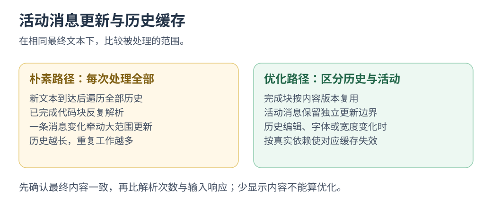

# 五条实现路线与十五个性能场景

选一个场景，<mark class="key">同负载切换两条执行路径</mark>，同时打字、滚动、选字和取消，追踪重复解析、跨桥与迟到结果。

日期：2026-09-26。五个应用的「场景实验」各有三个场景，保留原有 Agent、设置、会话、语音和回放；不需 DeepSeek、Whisper、工作区或外部服务。`terrible` 表示可定位的低效实现，不是框架必然缺陷，也不通过额外忙等制造结论。

当时只做实现、源码阅读与构建，未运行负载、打开应用、测性能或用 computer-use。五路线 `build-all.sh` 成功，Electron 调整取消生命周期后也重新打包；入口见 [examples](../../examples/README.md)。这是历史边界，不免除后续验证；指标初始为空或零，收益待实测。

## 实验步骤

1. 从 [examples](../../examples/README.md) 选应用，打开「场景实验」，无需 API Key。
2. 选朴素路径，先用小预设或标明的固定上限；持续输入中文、选字、滚动、停止。
3. 核对完成条数、正文、指纹与计数；遗漏事件、终态或草稿不算优化。
4. 同负载切优化路径，重复操作，比工作量、延迟与焦点，再逐级加负载。
5. 阅读维护代价与源码，改一项能力，重验优化假设。

一次只跑一个应用。各路线数据、文本、布局与节奏未统一，<mark class="caution">不能按毫秒给框架排名</mark>；GPUI 默认 dev/debug，正式对照先统一优化构建与负载。

先选 W2/G2，记录历史解析数，再编辑一条旧消息，检查缓存确实失效。

## 十五个具体问题

| 路线 / 场景 | Harness 中的真实情境 | 朴素路径暴露的问题 | 优化路径的机制 | 用户可以观察什么 |
|---|---|---|---|---|
| S1 Swift · 长会话排版 | 输出时回看历史 | 每增量解析全部历史 | 历史缓存、revision、活动消息、合批 | 输入、滚动、解析行数、发布数 |
| S2 Swift · 日志检索 | 快速改查询 | MainActor 筛选、排序 | 缓存索引、后台、取消、代际 | 输入、准备成本、旧结果 |
| S3 Swift · 控制台 | 日志中选字 | 替换全部 NSTextView 文本 | NSTextStorage 追加、选区与锚点维护 | 写入量、选区、阅读位置 |
| G1 GPUI · 事件列表 | 长任务累积事件 | 构建所有行 | `uniform_list` 可见范围 | 行构建数、滚动、输入 |
| G2 GPUI · 流式消息 | 只有活动文本变化 | 全历史解析与更新 | 历史缓存、活动 Entity | 解析数、处理时间、更新范围 |
| G3 GPUI · 产物索引 | 检索大型结果 | UI 线程索引 | 后台 executor、协作停止、generation | 输入、停止、指纹、过期结果 |
| N1 React → AppKit · 快照 | 单条消息增长 | 跨桥发送完整 UI 树 | 稳定 ID、属性 patch、局部应用 | JSON 字节、解码与应用成本 |
| N2 React → AppKit · 工具进度 | 密集短事件 | 逐事件发布桥接状态 | 显示合批，完整归约与终态 | 接收数、发布数、最终进度 |
| N3 React → AppKit · 审批 | 进度刷新中填写备注 | 重建原生控件 | 稳定 ID、复用对象 | 焦点、选区、输入法、草稿 |
| W1 WKWebView · 长日志 | 浏览历史 | 全量 DOM 与协调 | 固定行高窗口 | 挂载数、滚动、输入 |
| W2 WKWebView · 会话解析 | 历史完成、尾部增长 | 重解析全会话 | 缓存完成块 | 解析量、正文、发布成本 |
| W3 WKWebView · 搜索 | 大文本索引 | Web 主线程计算 | Web Worker、取消、过期屏蔽 | 输入、准备成本、结果、终止 |
| E1 Electron · IPC | 多工具输出 | 每事件一条 IPC | 200 条批次、相同确认窗口 | 消息数、字节、条数、指纹 |
| E2 Electron · 产物索引 | main 同时管控制与计算 | 取消排队 | 同函数移入 Node Worker | 控制 RTT、取消、启动/计算成本 |
| E3 Electron · 工具卡片 | 富文本长历史 | 完整 React 卡片与 DOM | 固定行高窗口、memo | 挂载、首次提交、查找限制 |

同名优化仍有不同边界：Web Worker 移走 Web 主线程工作，Electron Worker 移走 main 工作；原生桥维护 AppKit 身份，GPUI 控制 Entity 与元素范围。

## Swift：状态与线程边界

入口：[Swift 场景](../../examples/swift-native/README.md)、[ScenarioLabs.swift](../../examples/swift-native/Sources/ScenarioLabs.swift)。

- **S1：** 固定 180 块，最终正文相同；缓存历史，每 6 块合批。名义间隔 30 ms，中间显示更粗，停止须发尾批。
- **S2：** 后台查询仍需取消、代际校验与失效规则；只处理固定内存数据，未做文件监听或增量索引。
- **S3：** 两边共用 NSTextView 与选区/滚动恢复；比较写入量、时间和操作响应。追加、上翻、选择、容量、重置需分别定义。

维护练习：编辑一条完成消息，追踪 S1 缓存、S2 索引、S3 文本区间的失效与状态所有者。

## Rust / GPUI：能控制绘制，不代表计算会自动避开 UI

入口：[GPUI 场景](../../examples/rust-gpui/README.md)、[scenarios.rs](../../examples/rust-gpui/src/scenarios.rs)。使用发布版 GPUI，不是完整 Zed 框架或 WebView。

- **G1：** 同数据比全量与可见行构建；计数不等于 GPU 帧率，固定行高、身份和访问方式仍影响体验。
- **G2：** 历史缓存和活动 Entity 缩小解析、通知范围，无额外合批。每次消费后均等 16 ms；慢处理自然拖后续，不是固定墙钟推送。
- **G3：** 共用索引函数，后台 executor 仍需协作取消、单作业上限和过期校验；所有权不决定执行线程或恢复策略。

维护练习：G1 改成可展开多行，或让 G3 立即替换旧查询，检查布局、所有权与结果回传。

## React → 原生：组件树与原生对象的桥接边界

入口：[React 原生桥场景](../../examples/react-native-bridge/README.md)。路径为 React 状态 → renderer → JSONL → Swift → AppKit。

- **N1：** 1,200 条历史、180 块输出。只有桥两边都局部更新，patch 才真正省工作。
- **N2：** 24 工具 ×20 次，共 480 事件。显示可合并，逻辑归约与终态须完整；取消先清定时任务，再发最终状态。
- **N3：** 在审批备注中输入中文、选字并刷新进度。朴素重建、优化复用真实控件；输入法体验需实际操作。

维护练习：新增目录选择字段，追踪 props、wire、patch、控件、回传、销毁。这是教学桥，不是 Raycast renderer 复刻。

## WKWebView：DOM、脚本与后台计算

入口：[WKWebView 场景](../../examples/react-webview/README.md)。真实 ReactDOM；W3 由固定打包源码创建 Blob Worker，CSP 允许 `worker-src blob:`，不依赖本地 file URL Worker。

W1 减少挂载，W2 减少解析，两者不能替代。W3 仍需计 Worker 启动、输入复制、索引和回传，区分首次与热查询；取消旧工作并丢弃迟到结果，Swift 桥延迟另查。

维护练习：W1 支持展开、W2 支持历史编辑，检查测量与缓存；虚拟化还会改变长历史复制和系统查找。

## Electron：控制面、跨进程流量和 DOM 是三类独立压力

入口：[Electron 场景](../../examples/electron/README.md)、[scenes.jsx](../../examples/electron/scenes.jsx)、[scene-controller.cjs](../../examples/electron/scene-controller.cjs)、[scene-work.cjs](../../examples/electron/scene-work.cjs)、[scene-worker.cjs](../../examples/electron/scene-worker.cjs)。

- **E1：** 2k/10k/30k 事件，两边均有 200 条确认窗口；区别为逐条/200 条发送。全部计数与指纹，预览留 20 条，确认超 30 秒报错。字节量仅为协议载荷，不含 OS 开销。
- **E2：** 20k/80k/200k 记录，共用生成、解析、归一化、去重、排序、指纹函数。Worker 内生成，只回摘要，未验证大结果复制成本。总耗时含启停，计算另列；槽位保留到线程退出，取消同样处理。
- **E3：** 1k/3k/6k 卡片、112 px 固定高，窗口+memo；计当前挂载节点。首次提交计生成到 layout effect，不含绘制；朴素同步提交不能中途取消，结束后可清空。

E2 每 150 ms 发控制探针，最多一个未完成请求。main 同步忙时，renderer 尚能响应也不代表取消能生效；Node Worker 可独立终止。长 CPU 工作应移出 main，但 Worker 有启动与通信成本。[Electron 性能](https://www.electronjs.org/docs/latest/tutorial/performance)、[Node Worker](https://nodejs.org/api/worker_threads.html)

维护练习：E1 加审批终态、E2 加大回传、E3 改可变高度，分别检查背压、传输与测量。

## 指标与解释范围

| 页面上的数字 | 能支持的判断 | 不能支持的判断 |
|---|---|---|
| 接收/完成数、文本长度/指纹 | 完成输出是否可比、是否疑似丢事件 | 非严格证明或安全哈希，部分运行不可等同完成 |
| 解析行数、格式化、写入量 | 重复工作是否减少 | 用户可见延迟 |
| 元素/控件/DOM 数 | 实际构建或挂载范围 | 整体内存、GPU 或帧率 |
| 状态发布数 | 请求更新频率 | 实际 commit/body/呈现次数 |
| JSON 字节、消息数 | 载荷与跨边界调用量 | OS 字节或 RSS |
| 编码/计算/提交耗时 | 指定代码阶段与线程归属 | 按键到像素延迟 |
| IPC RTT | 请求排队、处理、返回耗时 | 纯底层传输延迟 |

计数、指纹与文案也有开销；教学负载和绝对耗时不代表生产容量。

## 维护成本实验

以下是源码可指出的责任，不是工时估计；精确入口见路线 README。

| 优化类别 | 新增的状态/契约 | 最容易被新功能打破的假设 | 下一项小改动 |
|---|---|---|---|
| 历史缓存与活动消息分离 | key、revision、边界 | 历史、字体、主题不变 | 编辑旧消息并失效缓存 |
| 固定行高窗口 | 高度、范围、ID、锚点 | 等高、无需搜索未挂载内容 | 展开卡片保留位置 |
| 属性 patch 与对象复用 | ID、schema、patch、回传 | 类型/ID 稳定，删除可回收 | 增加可编辑控件 |
| 批量发布与 IPC 窗口 | 状态、批次、确认、终态 | 所有事件可合并 | 加不可覆盖审批/错误 |
| 后台计算 | 所有者、取消、generation、上限 | 结果按序、可及时取消 | 连续查询只保留新结果 |
| 文本追加 | 长度/版本、选区、锚点 | 只追加 | 删除最老日志仍保留选区 |

记录理解、编码、调试、编译等待、实际修改范围、遗漏假设，以及终态/取消是否正确。初学与第二次改动分开；LOC 不能推工时，多 Agent 会话时长不等于单人成本。

## 与统一架构分析工具的关系

已实现的是应用内场景和局部计量；[统一评估工具](../architecture/technology-assessment.md)中的 CLI、Instruments/trace、跨语言报告仍待做。

后续先统一导出场景 ID、负载、模式、终点、计数和构建元数据，再接 trace。首次呈现、卡顿、内存、能耗不能由当前计数代替。

最终判断：哪条路线更容易定位多余工作、缩小更新，并保持功能正确；结论来自操作与代码。

控制面的取消、断连、恢复见 [Harness 场景回归](../agent-engineering/07-scenario-regression.md)，不替代 UI 负载实验。

返回 [文档入口](../README.md) · [examples](../../examples/README.md) · [五路线收益与代价](../../examples/COMPARISON.md)。
