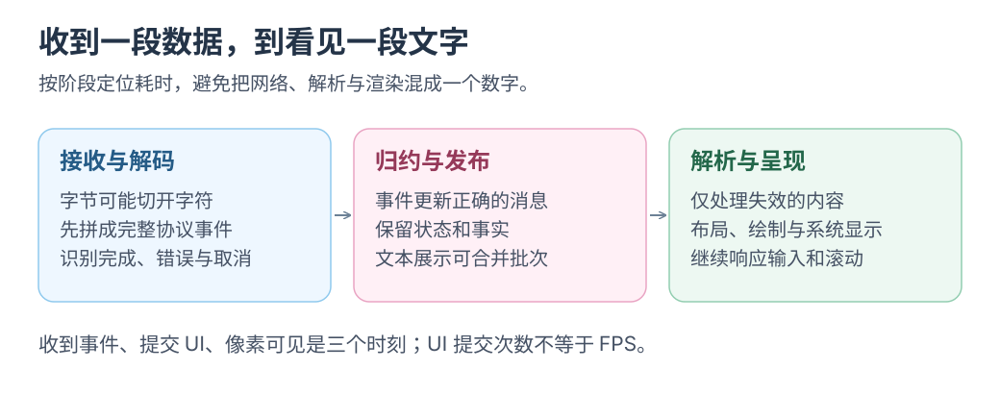

# 渲染性能：工作范围与测量方法

在模型输出、中文输入与滚动并发时定位瓶颈。本文结合 Zed、Raycast、Warp 公开资料，提供五份 UI 样例和四组后续实验。

研究日期：2026-09-26。五份样例已在本机构建，<mark class="caution">运行性能仍未测量</mark>。可从 GPUI、Swift、React 原生桥、WKWebView 或 Electron 任一入口开始。

选读：研究与架构入口

相关入口：[文档导航](../README.md) · [产品实现调研](../research/zed-raycast-warp.md) · [Mac 本地 Harness 架构](../architecture/mac-local-harness.md) · [第一个 Mac 闭环](../plan/first-mac-loop.md) · [直接开始 GPUI](../../examples/rust-gpui/README.md) · [五条路线的收益与代价](../../examples/COMPARISON.md)。

第一轮只做一个[场景 W2 或 G2](harness-scenario-lab.md)：

1. 沿对应示例启动一个应用，用小负载运行朴素路径。
2. 切换优化路径，保持历史与最终文本相同，比较解析次数，同时输入中文。
3. 确认输出一致、输入可用，再解释减少了哪些工作。

首次只需理解下文的界面指标与更新路径；产品架构、专项优化和完整测量按需展开。

## 五条实现路线

| 路线 | 已实现路径 | 入口 |
| --- | --- | --- |
| Swift | SwiftUI 内容、AppKit 窗口 | [Swift 示例](../../examples/swift-native/README.md) |
| Rust + GPUI | Rust 元素树、Metal 绘制 | [GPUI 示例](../../examples/rust-gpui/README.md) |
| React → AppKit | custom renderer、JSON、原生控件 | [原生桥示例](../../examples/react-native-bridge/README.md) |
| WKWebView | Swift 宿主、系统 WebKit、ReactDOM | [WebView 示例](../../examples/react-webview/README.md) |
| Electron | Chromium、Node、ReactDOM | [Electron 示例](../../examples/electron/README.md) |

共同负载：1,000 / 10,000 条历史、全部/工具过滤；模拟流每 50 ms 一条、每轮最多 200 条，历史上限 10,200 条。流不调用模型。更新模块校验清单并比较版本；语音通过共同 Apple Speech helper，由用户启动授权。

2026-09-26 仅完成实现与构建，按当时要求未做测试、界面、麦克风或性能验证；不约束后续验收。下载、签名、安装尚未实现，后文输入法、动态文本、120 秒回放和 Instruments 均为后续实验。

GPUI 当前是 dev/debug。公平比较需统一 Release、负载和呈现能力；现有布局、行高、控件并不完全一致，不能直接排名。

## 1. 界面响应指标

输入延迟、帧间隔、布局稳定和预加载分别测。平均 FPS 无法解释打开面板时的一次停顿；Apple 区分交互延迟与运动 hitch。[界面响应模型](https://developer.apple.com/documentation/xcode/understanding-user-interface-responsiveness/)

- 唤起：快捷键到可见、可输入。
- 操作：输入、选择、滚动、取消的反馈。
- 吞吐：日志与文本处理能否跟上。
- 空闲：无工作时是否仍解析、重绘或唤醒 CPU。

目标是减少无用工作、明确状态归属，并保留必要的边界处理。

## 2. 一次输入如何成为屏幕上的变化

阶段可能重叠；先定位，再换控件或渲染器。

| 阶段 | 工作 | 常见浪费 |
| --- | --- | --- |
| 输入与排队 | 事件送入应用 | 主线程同步 I/O、长任务 |
| 状态更新 | 确定变化范围 | 一个字符更新整段会话 |
| 布局 | 位置、换行、行高 | 全历史重复测量 |
| 文本处理 | shaping、字体回退、排版 | 不变文本重复解析 |
| 绘制准备 | 图层、绘制指令 | 全量重建、离屏效果 |
| GPU | 栅格化、采样、混合 | 无效绘制、资源等待 |
| 系统合成 | 合并窗口与系统 UI | 透明图层开销 |
| 显示 | 呈现、扫描输出 | 等待显示时机 |

GPU 不会加速业务遍历；文本解析、shaping、栅格化与绘制是不同工作。自定义渲染仍需窗口、输入法、可访问性与系统显示链路。

60 Hz 约 16.67 ms，120 Hz 约 8.33 ms，但不是应用独享预算。<mark class="key">帧预算不等于按键到像素延迟</mark>：还存在流水线、提交截止、排队与合成。ProMotion、电源和显示设置也影响结果，指导值不是所有交互的保证。[改善响应性](https://developer.apple.com/documentation/xcode/improving-app-responsiveness)

选读：术语、产品架构与专项优化

## 3. 四组容易混淆的技术词

| 词 | 说明什么 | 不能推出什么 |
| --- | --- | --- |
| 原生应用 | 系统能力或本机交付，须说明范围 | 必用系统控件、低内存 |
| 原生控件 | AppKit/UIKit 参与交互布局 | 纯 CPU、无 GPU |
| 自定义 UI | 自定组件、布局或绘制 | 无需输入法和可访问性 |
| GPU 加速 | 部分绘制/合成在 GPU | 搜索、解析、I/O 自动更快 |
| WebView | 浏览器组件承载内容 | 等于 Electron 或必然慢 |
| 声明式 UI | 按状态协调更新 | 每次重画所有像素 |

SwiftUI、AppKit、Metal、WKWebView 可以共存。比较前固定工作量、文本、窗口、更新频率、效果和输入行为，不能只比语言名。

## 4. 产品架构参考

### Zed：复用昂贵结果

2023 年 GPUI 资料描述自定义 primitive/shader、系统文本 API、shaping 缓存和字形图集。先复用不变历史、代码块和 diff，再考虑 shader；公开帧率不是本项目承诺。[GPUI 图形与文本](https://zed.dev/blog/videogame)

自定义 GPU 后仍需测量与专项优化，后续 Metal pipeline 案例可读问题发现与修复证据。[Metal pipeline 优化](https://zed.dev/blog/120fps)

### Raycast：先辨认版本，再归因

v1 扩展由 React reconciler 描述受控 UI，经通信交给 Swift/AppKit；React 不必在网页里绘制。可借鉴“扩展表达意图，宿主限定展示”。[2023 年架构](https://www.raycast.com/blog/how-raycast-api-extensions-work)

2026 年 v2 已是 Swift/AppKit、WKWebView React/TypeScript、Node 与 Rust 混合架构，不能沿用“全 AppKit”归因。还需预绘、节流和窗口优化；官方内存自述不是独立基准。[新版技术说明](https://www.raycast.com/blog/a-technical-deep-dive-into-the-new-raycast)

### Warp：分离活动数据与历史数据

BlockList 将活跃 GridStorage、紧凑历史 FlatStorage 和 alt screen 分开。Agent UI 也可只让生成中的消息承担编辑成本；不必采用 WarpUI 才能实践。[Warp Block Model](https://www.warp.dev/blog/block-model-behind-warps-agentic-development-environment)

## 5. SwiftUI 路线要保持哪些边界

以下为待验证设计。状态依赖、更新耗时与更新频率分别测。[SwiftUI 性能分析](https://developer.apple.com/documentation/xcode/understanding-and-improving-swiftui-performance)

- 任务列表观察摘要，文本尾部只观察活动消息。
- 实体使用稳定 ID，选择、滚动、草稿跟随身份。
- 搜索、I/O、Markdown 解析移出 body 和同步主线程回调。
- `async` 不保证离开 MainActor；记录执行与状态提交位置。

List/Table 的 identity、行内容影响工作量。[Demystify SwiftUI performance](https://developer.apple.com/videos/play/wwdc2023/10160/)

实测 List 与 LazyVStack；Lazy 不等于分页或有界缓存。可变高度覆盖中英文、emoji、代码、折叠、缩放和字体变化；高度缓存至少包含内容版本、宽度和字体。底部跟随新消息，上翻后保留阅读位置。只有 trace 指向列表瓶颈，才局部换 AppKit 或专门渲染面。

## 6. 流式输出：数据处理与界面发布

网络 chunk 不等于 token、字符或 Markdown block。解码、归约、解析与 UI 发布分层；<mark class="key">显示可合批，事实事件要完整</mark>，不能丢工具完成、审批、错误或取消。

每次只试一种策略：

- 活动尾部按时间/数据量合批，以输入延迟和积压选阈值。
- 缓存已完成消息，只解析可能受新输入影响的范围。
- Markdown 有跨块依赖；可先显示纯文本，完成后解析。
- 代码高亮按块和版本缓存；滚动、输入、取消优先保持响应。

背压要限制生产或接收，不能无限加队列；记录两端速率、队列字节数与最老事件年龄。持久层也需容量和失败处理。不可暂停的管道持续排空或转存，转存失败显式终止/报错。展示缓存可重建，事实按保留策略存；UI、队列、缓存、磁盘分别报告上限。

## 7. 待机能耗也是性能

无事件就不解析、排版或重绘，隐藏窗口停止无用动画与定时器。用事件替代频繁轮询，后台任务另计成本；Mac mini 常驻、MacBook 电池与热状态分别测。App Nap 不能替代主动停工。[Mac 能耗指南](https://developer.apple.com/library/archive/documentation/Performance/Conceptual/power_efficiency_guidelines_osx/AppNap.html)

Energy Impact 只提供比较线索，不能直接换算瓦特或续航。[Activity Monitor 能源栏](https://support.apple.com/en-ca/guide/activity-monitor/actmntr43697/mac)

## 8. 统一记录环境和指标

工具链见[第一个 Mac 闭环](../plan/first-mac-loop.md)；本文未启动 Instruments 或基准。填写实值，不猜测。

| 环境项 | 本轮记录 |
| --- | --- |
| 日期、实验 ID、commit | 待记录 |
| Mac、芯片、内存 | 待记录 |
| 系统与各运行时、框架、Instruments 版本 | 按路线分别记录 |
| Release/Debug、优化、debugger | 待记录 |
| 屏幕、分辨率、缩放、实际/设置刷新率 | 待记录 |
| 窗口、字体、主题、效果 | 待记录 |
| 电源、低电量模式、热状态、后台负载 | 待记录 |
| fixture hash、事件/字节数、种子、速率 | 待记录 |
| 冷热缓存、预热、重复次数、工具 | 待记录 |

主测同一个 Release；Debug、Instruments 定位结果另列。先同机对照，再跨设备。保存样本与 trace，报告样本数、中位数、p95、最大值；100 个样本取排序第 95 个为 nearest-rank p95，但不能据此保证长尾充分。异常保留并解释。

| 指标 | 初始目标或验收方式 | 当前测得 |
| --- | --- | --- |
| 热唤起到可见、可输入 | 产品初始目标 p95 < 100 ms，明确终点 | 未测 |
| 冷启动 | 单列分布 | 未测 |
| 输入回显 | 流式负载下建立延迟分布再设门槛 | 未测 |
| 滚动/动画 hitch | 次数、时长、区间、刷新条件 | 未测 |
| 活跃输出延迟 | 分列 UI 提交与实际可见 | 未测 |
| 内存 | 具体 RSS/footprint、峰值与稳定区间 | 未测 |
| 队列 | 峰值字节与最老事件年龄，无无界增长 | 未测 |
| 空闲 | CPU、唤醒与能耗，无周期性业务重算 | 未测 |

刷新率、提交、呈现、卡顿分别记录；120 Hz 屏幕不等于应用 120 FPS。没有证据时不承诺固定内存、零卡顿或统一帧率。

进阶：Instruments 与扩展实验

## 9. 如何使用 Instruments 得到可解释的证据

1. Xcode 选择 Profile，核对构建、设备与模板版本。
2. Time Profiler 找 CPU 热点、阻塞和重复调用。
3. 用可用的 SwiftUI、Hangs/Hitches 关联原因；缺 lane 如实记录。
4. Allocations/内存另录，避免叠满工具。
5. trace 指向绘制后才加 Metal/System Trace；搜索慢先查 CPU。
6. 同 fixture 复测，同时检查输入法、滚动位置与内容。

WWDC25 的工具资料不代表本机已安装对应版本。[SwiftUI 与 Instruments](https://developer.apple.com/videos/play/wwdc2025/306/)
GPU idle 也不能直接说明无瓶颈。[Metal 性能](https://developer.apple.com/documentation/xcode/analyzing-the-performance-of-your-metal-app/)

可增加 `hotkeyReceived → windowReady`、`eventReceived → statePublished`、`parseBegin → parseEnd` 区间，附会话/批次 ID，不写正文或秘密。[OSSignposter](https://developer.apple.com/documentation/os/ossignposter)

`windowReady`、body 完成不证明像素已显示；需对齐呈现 trace 或录像，报告采样精度与录制开销。

## 10. 实验一：Mac 启动面板

在任一样例增加输入框、固定命令列表、选择与打开/隐藏；Swift 可接 AppKit，GPUI 沿窗口、焦点、输入 API。固定本地数据，不混入网络或模型响应。

先预热，再固定间隔采 100 次热唤起，冷启动另列。覆盖英文、中文组合、方向键、Escape 和再次唤起的焦点。

验收功能、端点与原始样本；初始目标 p95 < 100 ms。交付环境表、操作、延迟样本与 trace，区分窗口、激活、布局、加载和显示等待。当前仅基础样例已构建，完整面板和测量未完成。

## 11. 实验二：固定长历史，加一条持续生成的消息

已有 1,000 / 10,000 条历史、过滤和 50 ms/条、每轮最多 200 条短回放。后续固定种子、字节、ID、相对时间与 fixture hash，加入代码、长行、短消息、错误、工具结果的固定比例；数量只是压力档位，另记总字节与视口。

新增 120 秒流，分别以 10/50/100 事件每秒回放。固定操作：底部 → 上翻 → 输入 → 缩放 → 回底 → 取消 → 重开。时刻可受调度影响，逻辑顺序与最终内容须一致。

验收不丢终态、正文一致、锚点稳定且可操作；交付 CPU、内存、队列、延迟与 trace，检查单字符追加成本是否随历史增长。当前富文本、120 秒多速率与性能记录未完成。

## 12. 实验三：一次只改变一种优化

保留朴素 A，同 fixture 做 B，按 A/B/A/B 交替至少五组完整回放：

1. 只拆活动消息与历史状态。
2. 只合批发布，比较吞吐和显示延迟。
3. 只缓存完成消息，检查字体、缩放后的内容与高度。
4. 只加有界窗口/队列、分页，记录内存与旧历史跳转成本。

trace 再决定是否比 List、LazyVStack、AppKit，不同时更换多项。验收可复现收益、正确性及输入无退步；差异小于波动写“尚不确定”。每项交付收益、成本、失败样本和保留决定；当前未实现、未测。

## 13. 实验四：从现有 GPUI MVP 直接开始

可独立从 [Rust + GPUI MVP](../../examples/rust-gpui/README.md) 开始；发布版 GPUI 0.2.2 已构建 Metal 应用。沿点击追 `Entity`、`Context`、`Task`、`notify()`、`uniform_list`，再追 Swift helper、JSONL 与进程清理。

`runtime_shaders` 绕过本机构建时缺 Metal 编译工具的问题，但把编译移到运行时，启动成本未测。记录版本、feature、构建及可访问性/中文输入差距。[路线对照](../../examples/COMPARISON.md)

正式对照需统一机器、fixture、窗口、字体、行高、历史、流速与操作；增加 Markdown、输入框、高亮时保持相同工作量。先对齐行为再比性能，分别记录能力差距、收益和维护责任。当前 MVP 已实现并构建，交互、性能、等负载报告未完成。

## 14. 验收与复用

能沿“事件 → 状态 → 更新 → 昂贵工作 → 可复用结果”解释一次操作，保存可回放负载，区分感受、代理指标、trace 与可见结果。接 Harness 后，把模型/工具耗时与客户端表现分开统计。

按兴趣任选路线，添加同一种状态或行展示，再去另一条路线复现；按问题选实验一到三。Raycast 两代架构、Warp 数据模型与[路线对照](../../examples/COMPARISON.md)用于参照。

起步操作：打开 GPUI 项目，追踪一条模拟事件到界面行的更新路径，再修改该路径。
