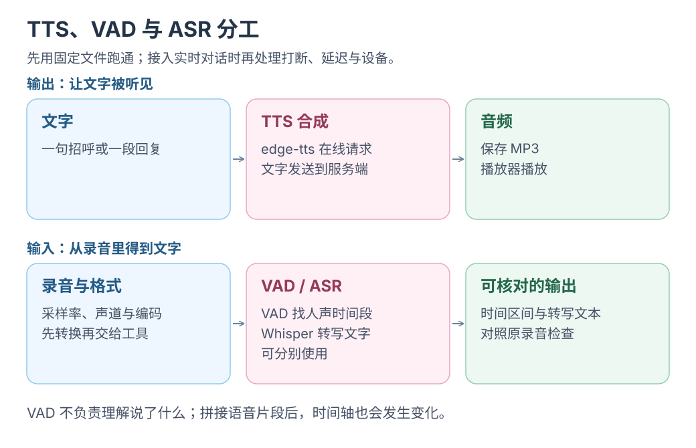

# 语音交互：edge-tts 合成、Whisper 转写与 VAD 人声检测

依次练习文字发声、录音转写与人声检测。

每工具一种安装、两个用法；先用 edge-tts <mark class="key">听见第一句话</mark>。

| 工具 / 源码 | 做什么 | 费用与联网 |
|---|---|---|
| [edge-tts](https://github.com/rany2/edge-tts) | 文字 → 声音（TTS） | 在线免 Key，文字发给微软 |
| [whisper.cpp](https://github.com/ggml-org/whisper.cpp) | 声音 → 文字（转写） | 下载模型后，本地免费运行 |
| [silero-vad](https://github.com/snakers4/silero-vad) | 找出人声与静音（VAD） | 安装后，本地免费运行 |

只想先听一句话，点[让 Yuuki 开口说第一句话](让-Yuuki-开口说第一句话.md)。

云端语音与赠额范围见 [OpenAI API：额度、图片与语音](../agent-engineering/openai-api.md)，含旧 TTS 迁移安排。

应用选题见[语音、音乐与多模态小项目](../agent-engineering/openai-api-projects.md)：灵感卡、有声笔记或口答复习。

[](../../site/public/diagrams/tts/speech-paths.svg)

**先准备一次：Mac + 独立 Python 环境**

2026-10-14 确认本机有 Homebrew、Python **3.14.6**、pip **26.1.2**；下面在虚拟环境用 `python -m pip`。

```bash
mkdir -p ~/voice-lab
cd ~/voice-lab
python3 -m venv .venv
source .venv/bin/activate
```

文件放 `~/voice-lab`，新终端先激活环境：

```bash
cd ~/voice-lab
source .venv/bin/activate
```

## 第一站 · edge-tts：先听见一句话

下载安装：

```bash
python -m pip install edge-tts
```

用法 ①：一句中文 → MP3 → 播放。

```bash
edge-tts --voice zh-CN-XiaoxiaoNeural --text "你好，我是 Yuuki。" --write-media hello.mp3
afplay hello.mp3
```

用法 ②：文本文件 → 配音 + 字幕。把自己的 UTF-8 文本放进 `article.txt`，然后执行：

```bash
edge-tts --voice zh-CN-XiaoxiaoNeural --file article.txt --write-media article.mp3 --write-subtitles article.srt
```

得到 `article.mp3` 和 `article.srt`。[官方用法](https://github.com/rany2/edge-tts#usage)

## 第二站 · whisper.cpp：把声音接回文字

下载安装工具和多语言 `base` 模型（约 142 MiB，支持中文）：

```bash
brew install whisper.cpp ffmpeg
curl -fL https://huggingface.co/ggerganov/whisper.cpp/resolve/main/ggml-base.bin -o ggml-base.bin
```

安装包不含模型，需要第二行单独下载。[Homebrew 安装说明](https://formulae.brew.sh/formula/whisper.cpp)、[官方模型说明](https://github.com/ggml-org/whisper.cpp/tree/master/models)

将 `hello.mp3` 或自己的录音转为 16 kHz 单声道 WAV：

```bash
ffmpeg -i hello.mp3 -ar 16000 -ac 1 -c:a pcm_s16le audio.wav
```

用法 ①：中文录音 → 文字文件。

```bash
whisper-cli -m ggml-base.bin -f audio.wav -l zh -otxt -of transcript
```

得到 `transcript.txt`。

用法 ②：中文录音 → 带时间的字幕。

```bash
whisper-cli -m ggml-base.bin -f audio.wav -l zh -osrt -of subtitles
```

得到 `subtitles.srt`。音频留在本机。[官方入门](https://github.com/ggml-org/whisper.cpp#quick-start)、[CLI 参数](https://github.com/ggml-org/whisper.cpp/blob/master/examples/cli/cli.cpp)

## 第三站 · silero-vad：在录音里找出人声

下载安装库和随包模型；`soundfile` 用来读写音频：

```bash
python -m pip install silero-vad soundfile
```

准备 `audio.wav`：① 打印人声起止秒数；② 拼接人声为 `speech.wav`。

整段粘贴到终端：

```bash
python - <<'PY'
import soundfile as sf
import torch
from silero_vad import load_silero_vad, get_speech_timestamps, collect_chunks

torch.set_num_threads(1)
samples, rate = sf.read("audio.wav", dtype="float32")
wav = torch.from_numpy(samples)
spans = get_speech_timestamps(wav, load_silero_vad(), sampling_rate=rate)

# 用法 ①：打印人声时间段
for span in spans:
    print(f"{span['start'] / rate:.2f} 秒 → {span['end'] / rate:.2f} 秒")

# 用法 ②：保留人声片段
if spans:
    sf.write("speech.wav", collect_chunks(spans, wav).numpy(), rate)
    print("已保存 speech.wav")
else:
    print("没有检测到人声")
PY
```

<mark class="caution">VAD 不识别文字，也不去噪</mark>；转写交给 Whisper。[官方用法](https://github.com/snakers4/silero-vad#fast-start)、[音频读写说明](https://python-soundfile.readthedocs.io/en/latest/)

`spans` 对应原录音；拼接后的 `speech.wav` 时间变短，给原视频做字幕须保留原时间或建立映射。

## 串起来玩一次

把 `hello.mp3` 转回文字，再打印人声时间；对照声音、转写和区间。接入工作台见[模型与语音基础](../architecture/ai-and-speech-foundation.md)。

资料核对：2026-10-14。已检查本机 Python/pip 和示例语法；安装、模型下载及实际语音效果尚未执行验证。
