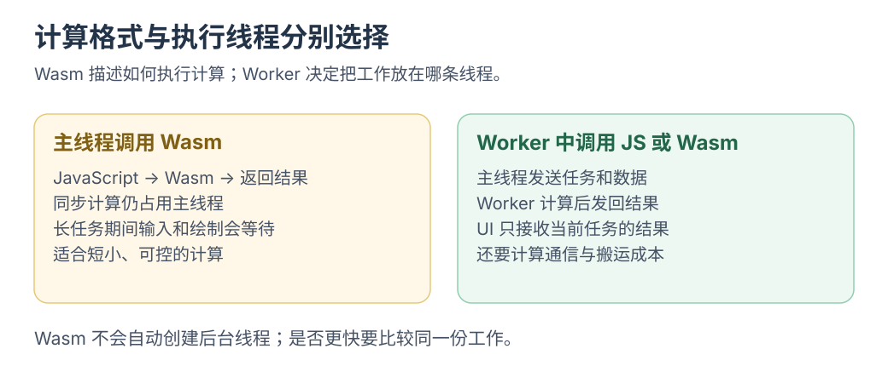

# 让 JavaScript 请来一位 Wasm 外援

先用 JavaScript 调用 Wasm 加法，再试整数边界。随后学习 Worker、内存与模型运行时。

## 先分清三件事

| 工具 | 主要解决什么问题 | 一个前端例子 |
| --- | --- | --- |
| JavaScript | 应用逻辑、事件和 Web API 组织 | 接收文件、展示进度、更新结果 |
| WebAssembly | 在宿主里执行编译后的模块，通过明确接口交互 | 调用一段编译来的计算库 |
| Web Worker | 把任务放到独立的执行线程，与页面通过消息协作 | 长计算期间让主线程继续处理输入 |

Wasm 有模块、实例、导入导出以及线性内存等概念，可以与 JavaScript 共同工作。很多 C/C++ 或 Rust 计算库可以经过工具链编译到 Wasm。[MDN WebAssembly 概念](https://developer.mozilla.org/en-US/docs/WebAssembly/Guides/Concepts)

**运行 Wasm 的位置仍需由应用安排。** 在主线程直接执行很长的计算，仍然会占用主线程；Worker 是另外一层执行与协作机制。

[](../../site/public/diagrams/wasm/thread-boundary.svg)

## 先调用一个真实的小模块

打开[JavaScript 调用 Wasm](../../site/src/pages/labs/wasm-bridge.astro)。实验编译并实例化一个只导出整数加法的小模块：

```wasm
(module
  (func (export "add") (param i32 i32) (result i32)
    local.get 0
    local.get 1
    i32.add))
```

对应的[模块字节与 JavaScript 封装](labs/wasm-add.mjs)随仓库提供。先改两个输入，观察返回结果；再试 `2147483647 + 1`。**输入前先猜一个答案，运行后再去查 `i32` 的范围。** 这次边界碰撞，会让接口中的类型有了实感。

这个实验先让接口变得具体：JavaScript 负责调用与显示，Wasm 实例执行导出的函数。换成模型运行时后，还需要准备模型文件、张量、执行后端以及任务状态。

## Wasm 的价值从哪里来

可以先考虑两种需求：已有成熟计算库，希望在浏览器复用；或者需要一段边界清楚、适合编译为数值计算的工作。然后测量它在整体流程中的作用。

总成本可以拆成：

```text
下载与缓存模块 → 编译或实例化 → 准备输入 → 调用计算 → 读取输出 → 显示
```

小函数可能主要花在初始化与调用准备；大任务还需测内存、复制与算法。按完整流程比较 JavaScript 和 Wasm。

## 接着看两个真正相交的地方

| 章节 | 从前端已有经验开始 | 连接到 AI 的问题 |
| --- | --- | --- |
| [Worker 与内存搬运](workers-and-memory.md) | 消息、ArrayBuffer、取消和过期结果 | 怎样让推理持续工作而界面仍可操作 |
| [浏览器里的 AI 后端](browser-ai.md) | 异步初始化、资源加载与能力检测 | Wasm、WebGPU 和模型运行时各在哪一层 |

如果想把这条线做成下一次小项目，先选择“一项固定计算，在 Worker 中调用并返回结果”，把启动、取消、错误和数据归属读清楚，再接一个实际模型。其他方向见[AI 与前端的交织点](../learning/ai-frontend-intersections.md)。
