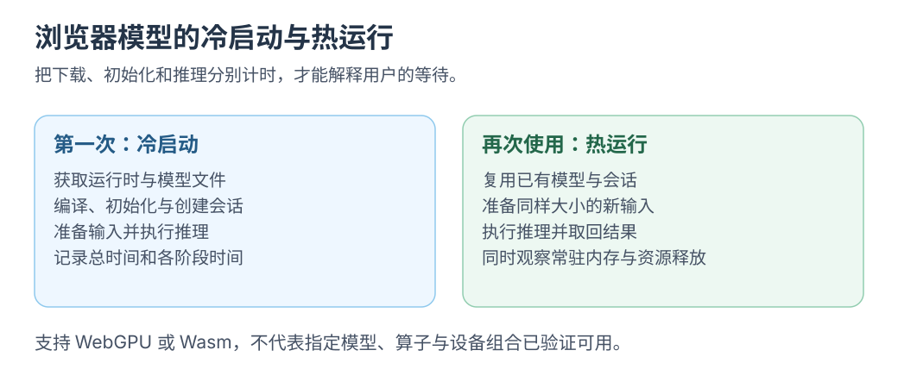

# Wasm WebGPU 与浏览器 AI 运行时

[Wasm 入口](README.md) · [Worker 与内存](workers-and-memory.md) · [其他交织点](../learning/ai-frontend-intersections.md)

前端写了 `await model.run(input)` 之后，实际工作可能发生在浏览器 CPU、GPU、本机 helper，或远端 API。先找到执行位置，再讨论缓存、速度和交互。

## 把应用的几层分开看

| 层 | 负责什么 | 前端需要掌握什么 |
| --- | --- | --- |
| 页面与交互 | 文件选择、进度、结果与取消 | 可解释的状态、输入响应和错误展示 |
| 任务调度 | 初始化、队列、Worker 与任务身份 | 并发范围、过期结果、生命周期 |
| 模型运行时 | 载入模型、准备张量、执行算子 | 模型格式、支持的算子与输入输出 |
| 执行后端 | 用 CPU 或 GPU 完成计算 | 能力检测、资源占用与数据搬运 |

ONNX Runtime Web 提供 WebAssembly CPU 和 WebGPU 等执行路径，支持范围需要按具体模型与后端核对。[ONNX Runtime Web](https://onnxruntime.ai/docs/tutorials/web/)

Transformers.js 提供浏览器中使用模型的高层接口，可以执行多种推理任务；底层执行仍涉及运行时与后端选择。[Transformers.js 官方文档](https://huggingface.co/docs/transformers.js/en/index)

## Wasm 和 WebGPU 分别在哪

Wasm 路径把编译后的计算模块交给宿主执行，通常用于 CPU 计算；WebGPU 路径通过浏览器的 GPU 能力执行支持的工作。它们与模型运行时合作，页面还需负责加载、输入准备和结果显示。

浏览器支持 API 不代表模型一定可运行；还要验证算子、后端、数值与内存需求。[ONNX Runtime Web 性能诊断](https://onnxruntime.ai/docs/tutorials/web/performance-diagnosis.html)

[](../../site/public/diagrams/wasm/runtime-cold-warm.svg)

## 冷启动和热执行分别测量

```text
第一次使用
  获取模型资源 → 初始化运行时 → 编译或准备执行 → 处理输入 → 得到结果

同一实例再次使用
  处理输入 → 得到结果
```

分开记录下载、初始化与推理，阶段可能重叠。复用已加载实例会减少等待，也会持续占用资源。

它与[缓存成本](../frontend-foundations/cache-cost.md)是一件连续的事：减少下次等待，往往需要保留结果、资源或运行实例，并为它们安排结束时机。

## 可以从一个小任务开始

| 任务 | 为什么适合连接前端经验 | 第一次观察什么 |
| --- | --- | --- |
| 本地资料的语义检索 | 文件列表、索引与向量查找可以放在同一条链上 | 文本切块、向量生成与查询的独立成本 |
| 短音频处理 | 已有录音、TypedArray 和任务状态的自然入口 | 数据格式、缓冲区传递与初始化 |
| 小型文本分类 | 输入输出明确，易于观察 Worker 协作 | 首次加载、重复执行与过期结果 |

这些是下一轮实验候选；先选择一个支持明确输入输出的模型，再核对文件大小、运行时支持与目标设备。

当前文档站的 Wasm 实验只运行随页面提供的小模块。接入实际模型时，再把下载进度、资源缓存、失败和释放机制一起落地。

## 连接回 KV Cache

浏览器里运行自回归语言模型，同样会遇到历史状态、缓存布局和上下文长度。Wasm 或 GPU 改变执行与存储方式，模型本身需要保留什么，仍取决于架构与推理实现。

先用[KV 容量实验](../../site/src/pages/labs/kv-memory.astro)看量级，再检查 Worker 与运行时的资源归属。
