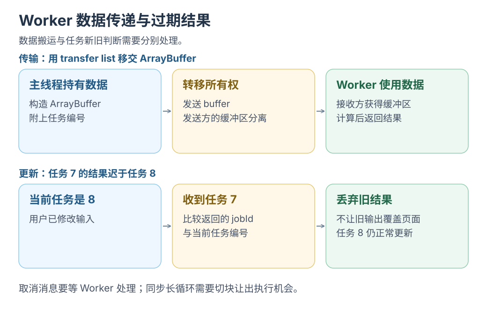

# Worker 内存与数据搬运

[Wasm 入口](README.md) · [下一篇 浏览器 AI](browser-ai.md)

计算移到 Worker 后，还要管好数据归属与旧任务结果。

## Worker 给了什么边界

Worker 通过消息协作，<mark class="caution">不能直接操作 DOM</mark>；页面管交互，Worker 管计算。[MDN 使用 Web Workers](https://developer.mozilla.org/en-US/docs/Web/API/Web_Workers_API/Using_web_workers)

```js
const worker = new Worker(new URL('./compute-worker.js', import.meta.url), {
  type: 'module',
});
worker.postMessage({ type: 'run', jobId: 7, input: values });
```

接入前先确定任务身份，以及何时拒收结果。

## 复制 转移 共享分别意味着什么

| 方式 | 数据怎样到另一侧 | 调用方要考虑什么 |
| --- | --- | --- |
| 结构化克隆 | 消息携带可克隆数据的副本 | 大数据的复制和分配成本 |
| 转移 ArrayBuffer | 转移对应资源的所有权 | 原来的 buffer 会被分离，发送方不能按原方式继续使用 |
| 共享内存 | 双方访问同一块共享缓冲区 | 并发读写协议与可见性 |

Worker 消息支持结构化克隆与可转移对象。转移大缓冲区时，要把真正的 buffer 放进转移列表。[MDN Worker 数据传递](https://developer.mozilla.org/en-US/docs/Web/API/Web_Workers_API/Using_web_workers#passing_data_by_transferring_ownership_transferable_objects)

```js
const samples = new Float32Array(16000);
worker.postMessage({ samples }, [samples.buffer]);
// 发送方随后需要按「已转移」处理 samples.buffer 的生命周期。
```

SharedArrayBuffer 需安全上下文、跨源隔离及明确的并发读写协议。[MDN SharedArrayBuffer](https://developer.mozilla.org/en-US/docs/Web/JavaScript/Reference/Global_Objects/SharedArrayBuffer)

[](../../site/public/diagrams/wasm/worker-transfer.svg)

## TypedArray 可以只是同一块内存的视图

```js
const buffer = new ArrayBuffer(16);
const first = new Float32Array(buffer);
const second = new Float32Array(buffer);
first[0] = 3;
console.log(second[0]); // 3
```

两个视图共用 buffer；接运行时先查返回副本还是视图、底层存储何时变化。

<details class="qa" id="取消也需要安排执行机会">
<summary>发了取消消息，Worker 为什么还在算？</summary>

同步计算期间也收不到取消消息；需分批让出执行、用取消接口或终止 Worker。

本仓库 [lab-worker.js](../../examples/react-webview/src/lab-worker.js) 每 300 行用 `setTimeout` 让出执行；页面按 `jobId` <mark class="key">拒绝旧任务结果</mark>。

</details>

## 给一个 AI 任务明确五个状态

从 `loading/ready/running/completed/failed` 开始，按能力加取消状态；下载、初始化和执行分别报告进度。

下一步进入[浏览器 AI 后端](browser-ai.md)，看看同样的任务协议如何包住 Wasm 或 WebGPU 计算。
